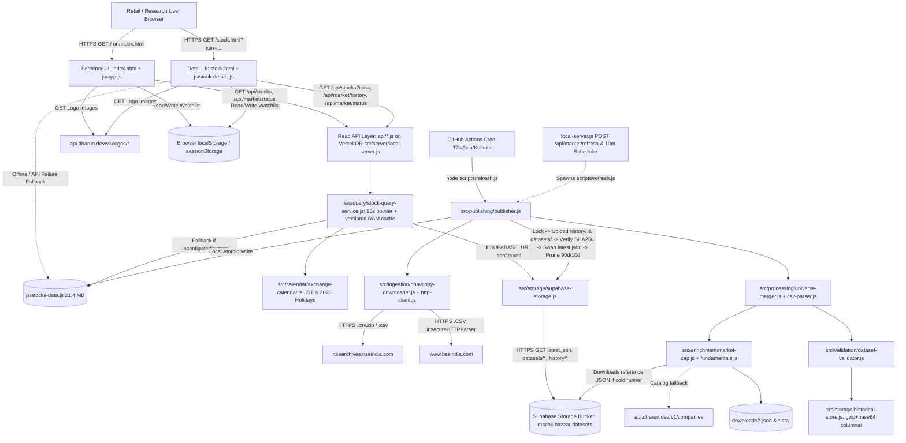
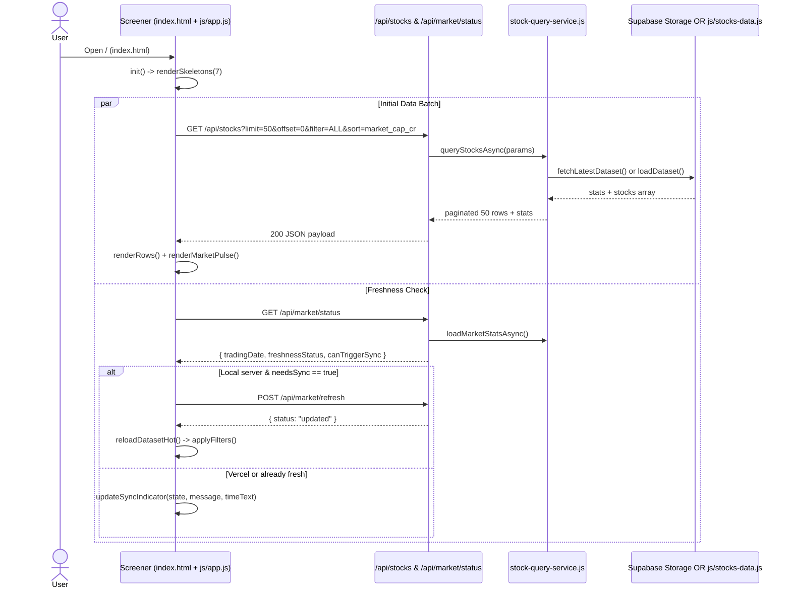
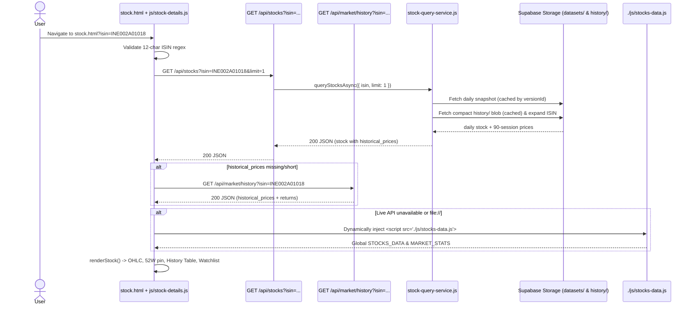
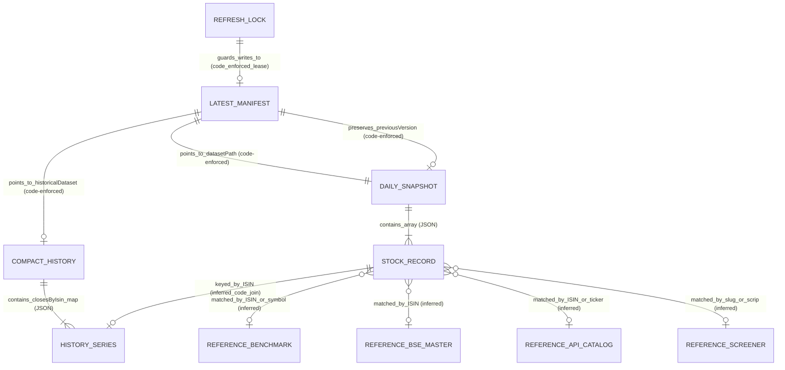

# MASTER_PROJECT_BLUEPRINT.md — Machii Bazzar

---

## 1. Document Information and Audit Metadata

| Attribute | Value |
|---|---|
| **Document Title** | Machii Bazzar — Complete Project Reverse Engineering, CTO Audit & Master Blueprint |
| **Target Repository** | `Project-Stocks` (`machii-bazzar` v2.0.0) |
| **Audit Date (IST)** | 2026-11-28 (`2026-11-28T17:37:16+05:30` baseline) |
| **Latest Local Dataset Date** | `2026-11-26` (5,453 ISIN-deduplicated equities in `js/stocks-data.js`) |
| **Audit Methodology** | Static source-code inspection across all application, API, CI/CD, test, script, and asset manifests; isolated test execution; ESLint execution; Playwright browser E2E execution; live local HTTP API probing |
| **Node.js / npm Environment Verified** | Node.js `v24.19.0`, npm `11.17.0` (Windows host; CI targets Node.js `20` on `ubuntu-latest`) |
| **Git HEAD Inspected** | `0033d14` (`2026-11-27 00:23:41 +0530` — *"Finalize automated NSE BSE data refresh"*) |
| **Deliverable Scope** | Single-file master audit (`MASTER_PROJECT_BLUEPRINT.md`); zero existing files modified, moved, or deleted |
| **Confidentiality Check** | Zero credentials, API keys, service-role tokens, or `.env` values are exposed in this document |

---

## 2. Executive Summary

**Machii Bazzar** (`machii-bazzar` v2.0.0, historically branded *Machli Bazzar* in older scripts/CSS) is an **End-of-Day (EOD) Indian Equities Screener and Market Intelligence Web Application** covering both **NSE** (National Stock Exchange) and **BSE** (Bombay Stock Exchange) across **Mainboard** and **SME** segments.

The system solves three concrete engineering and financial-data problems:
1. **Cross-Exchange Entity Fragmentation**: Indian equities trade on NSE, BSE, or both, sometimes sharing ticker symbols across completely distinct companies (e.g., `GSTL` maps to both `INE632W01016` and `INE00WS01056`). Machii Bazzar unifies and deduplicates the entire listed universe strictly by **12-character ISIN** (`INE*` / `IN9*`), yielding **5,453 unique equities** as of `2026-11-26` (3,200 NSE, 4,766 BSE, 2,513 dual-listed, 687 NSE-only, 2,253 BSE-only; 4,382 Mainboard + 1,071 SME).
2. **Zero-Cost Serverless Freshness without Git Churn**: Rather than committing 21+ MB dataset files back to Git every trading day, a scheduled **GitHub Actions** pipeline downloads official NSE/BSE BhavCopy CSV/ZIP archives post-market close, validates financial invariants, compresses a lean daily snapshot and a separate compact columnar **90-session historical matrix** (`gzip+base64` JSON envelopes), and atomically swaps `latest.json` in **Supabase Storage**. Stateless **Vercel Serverless Functions** (`api/`) read from Supabase Storage (15s pointer cache + `versionId` deduplication) and fall back to the bundled `js/stocks-data.js`.
3. **Strict Non-Fabrication Guarantee**: Missing market caps (53 of 5,453 equities), missing ratios, and missing historical sessions (e.g., recent IPOs or illiquid stocks) stay strictly `null` and render as `—` or `N/A` rather than synthetic placeholders.

**Overall Health Assessment**: The **core backend ETL pipeline, ISIN unification, Supabase atomic storage layer, and isolated unit/pipeline tests are well-engineered and solid**. However, **production Supabase runtime behavior was not directly observable** (no `.env`/credentials in this workspace), the **full `npm test` script currently FAILS** due to a stale hardcoded series/group filter in `scripts/missing-stock-audit.js` (flagging 39 legitimate `BSE:IF/R/TS/ZP` and `NSE:SZ` equities as extra), **fundamental ratios and top-343 market caps are frozen to static reference JSON caches** rather than recomputing from daily closes, the **exchange holiday calendar expires on 2026-12-31**, and **several minor UI/UX drifts** exist (hardcoded `"BSE A/B"` label on the NSE-sourced 52W card, blank `Change (INR)` CSV export column, dead `TATAMOTORS` search alias after Tata Motors demerged into `TMCV`/`TMPV`, and 150 newer ISINs missing from the `2026-11-05` logo manifest).

---

## 3. Project Overview

| Dimension | Verified Finding | Evidence |
|---|---|---|
| **Product Name** | **Machii Bazzar** (legacy branding: *Machli Bazzar* / *machli bazarr* in older scripts, comments, and CSS headers) | `package.json:2`, `README.md:1`, `index.html:6`, `src/publishing/publisher.js:154` |
| **Product Category** | Financial Market Data Platform / End-of-Day Indian Equity Screener & Stock Inspector | `README.md:3-4`, `index.html:7`, `stock.html:6` |
| **Core Value Proposition** | Unified NSE + BSE EOD equity discovery, ISIN-keyed deduplication, 90-session price history & 1W/1M/3M returns, market breadth/VIX pulse metrics, client-side watchlist, and side-by-side comparison | `index.html`, `stock.html`, `js/app.js`, `src/processing/universe-merger.js` |
| **Target Users** | Retail Indian equity investors, market researchers, and analysts screening NSE/BSE Mainboard & SME equities (unauthenticated public access; no login wall) | `index.html:69-72`, `api/*.js` |
| **Operating Model** | Public free screener web app; zero-runtime-dependency Node.js backend; static HTML/CSS/JS frontend; no monetization, billing, paywall, or user accounts implemented | `package.json` (no runtime `dependencies`), `index.html`, `api/*.js` |
| **Current Development Stage** | **v2.0.0 — Functional MVP / Pre-Scale Production Architecture** (core screener, detail view, daily EOD ETL, and Supabase storage pipeline implemented; several data-freshness, test-sync, and 2027-calendar gaps remain) | `package.json:3`, `src/publishing/publisher.js:54`, `git log` |

---

## 4. Business Objectives and Requirements

### 4.1 Confirmed Business Requirements (Explicitly Supported by Code & Repo Docs)

1. **Full NSE + BSE Mainboard and SME Coverage Deduplicated by ISIN**: Merge eligible Indian equities (`INE*`, `IN9*`) across NSE (`EQ`, `BE`, `BZ`, `SM`, `ST`, `SZ`) and BSE (`A`, `B`, `T`, `X`, `XT`, `Z`, `ZP`, `P`, `R`, `SS`, `MS`, `TS`, `IF`, `IT`, `E`) using canonical 12-character ISIN as primary key (`src/processing/universe-merger.js:26-36`, `README.md:4`, `docs/ARCHITECTURE.md:63`).
2. **Zero Fabricated Financial Data**: Unpriced stocks, unverified market caps, unavailable valuation ratios (`pe_ratio`, `pb_ratio`, `roce`, `debt_to_equity`), and insufficient historical windows (`1M` < 22 sessions, `3M` < 66 sessions) must remain `null`, never `0` or synthetic (`src/enrichment/market-cap.js:277-279`, `src/processing/universe-merger.js:106-175`, `scripts/qa-frontend-audit.js:203-241`).
3. **5-Session Carry-Forward & Exact Mathematical Reconciliation**: Securities absent on the target trading day are carried forward up to 5 prior sessions with `volume: 0` and `change_percent: 0.00`; Market Breadth (`advances + declines + unchanged + unpriced === totalUniverse`) and Exchange Coverage (`dualListed + nseOnly + bseOnly === totalUnique`) must strictly reconcile (`src/processing/universe-merger.js:391-469`, `src/validation/dataset-validator.js:156-172`).
4. **Automated Daily EOD Refresh Without Git Commits**: Scheduled GitHub Actions runs post-close in `Asia/Kolkata` (`16:52`–`20:53 IST` Mon–Fri, `08:07 IST` Mon–Sat, `20:07 IST` Sun Muhurat), publishing atomically to Supabase Storage (`latest.json`) with `permissions: contents: read` (`docs/EXTERNAL_STORAGE_SETUP.md:3`, `.github/workflows/refresh-stock-data.yml:7-51`).
5. **Bounded Retention & Storage Efficiency**: Separate heavy up-to-90-session columnar closing-price history (`history/`) from lean daily snapshots (`datasets/`), both `gzip+base64` encoded, retaining 90 daily sessions and 10 rolling history snapshots while protecting `latest.json`, `previousVersion`, `locks/`, and `reference/` (`src/config/constants.js:14-21`, `src/storage/supabase-storage.js:637-806`).
6. **ISIN-Keyed Dedicated Stock Profile & Offline Usability**: Clicking any stock navigates to `./stock.html?isin=...`, which queries `/api/stocks?isin=...` (with `/api/market/history?isin=...` fallback) and lazy-loads `./js/stocks-data.js` if APIs are unavailable (`file://` or static hosting) (`js/stock-details.js:338-442`, `tests/security-and-ci.test.js:84-88`).
7. **ISIN-Keyed Logo Manifest with Graceful Initials Fallback**: Render audited SVG/PNG logos from `api.dharun.dev/v1/logos/...`, suppress requests for confirmed 404s, cache runtime errors in `sessionStorage`, and render 2-letter initials without layout shift (`js/company-logo.js:1-96`, `scripts/build-company-logo-manifest.js:1-46`).

### 4.2 Requirements Inferred from Implementation

1. **Personal Watchlist & Side-by-Side Comparison without Backend Persistence**: Client-side `localStorage` key `machii_watchlist` powers the `WATCHLIST` filter pill, and an in-memory `comparisonStocks` map (max 4 stocks) drives the floating tray and `<dialog>` comparison modal (`js/app.js:27-28,330-395`, `js/stock-details.js:248-292`).
2. **CSV Export of Currently Loaded Screener Rows**: Toolbar button exports `loadedStocks` (the rows fetched so far via infinite scroll, NOT the entire filtered server universe) as a UTF-8 BOM CSV (`js/app.js:577-644`).
3. **Brand-to-Legal-Entity Search Aliasing**: Mapping popular brand queries (`zomato` -> `ETERNAL`, `blinkit` -> `ETERNAL`, `policybazaar`/`paisabazaar` -> `POLICYBZR`, `maggi` -> `NESTLEIND`, `jlr`/`jaguar` -> `TATAMOTORS`) without inventing fake tickers (`src/query/stock-query-service.js:37-45`, `scripts/missing-stock-audit.js:63-71`).
4. **Shrinkage Protection & Downgrade Protection**: Pipelines abort on >10% stock universe drop or attempts to publish an older trading date over a newer published date unless `--force` / `--allow-downgrade` is supplied (`src/validation/dataset-validator.js:49-54`, `src/publishing/publisher.js:274-278`).

### 4.3 Potential Future Requirements (Supported by Code Hooks / Partial Surfaces)

1. **Dynamic Live Fundamentals & Market Cap Recomputation**: Currently `market-cap.js` and `fundamentals.js` read static caches (`benchmark_stocks_verified.json`, `bse_list_securities_verified.json`, `screener_market_caps.json`, `api-companies-catalog.json`) and have a tier-6 `total_outstanding_shares` math hook that is unpopulated (`0` stocks resolved via share math in `MARKET_CAP_COVERAGE_REPORT.md:32`).
2. **Company Descriptions (`oneLine`)**: `stock-details.js:115` explicitly renders a `Company description` field hardcoded to `null`, while `downloads/api-companies-catalog.json` already contains `oneLine` descriptions for 5,573 companies.
3. **1-Year Returns & Interactive Price Charts**: `qa-frontend-audit.js:234` checks `return_1y` is null; `stock.html` intentionally omits charts (`qa-frontend-audit.js:283-285`), displaying a tabular historical close table instead, while `90` sessions of close history are already stored.
4. **2027+ Exchange Calendar Updates**: `exchange-calendar.js` only covers 2026 holidays and Muhurat sessions; multi-year calendar management or dynamic NSE holiday fetching will be needed before 2027.

### 4.4 Unknown Business Decisions

- Exact live production Vercel domain, Supabase project state, and whether the Supabase Storage bucket (`machii-bazzar-datasets`) is configured **Private** (requiring `SUPABASE_ANON_KEY`) or **Public**.
- Whether `js/stocks-data.js` (21.4 MB) will continue to be updated periodically in Git as a Vercel cold-fallback snapshot or frozen as a legacy bootstrap artifact.
- Intended refresh frequency/cadence for `reference/*.json` enrichment caches (benchmarks, BSE security master, screener market caps, India API catalog) and `js/company-logo-manifest.js`.
- Whether user accounts, server-persisted watchlists/portfolios, intraday quotes, or monetization tiers are planned.

---

## 5. Repository Inventory and Folder Structure

### 5.1 Repository File Accounting

- **Total Files (excluding `.git/` and `node_modules/`)**: **284 files**
  - **Git-tracked source, config, assets, tests, docs**: **67 files** (`git ls-files`)
  - **Untracked local data artifacts in `downloads/` (gitignored)**: **216 files** (90 NSE CSVs, 90 BSE CSVs, 15 NSE 52W CSVs, 15 NSE Index Close CSVs, 6 JSON caches/logs)
  - **Untracked local dataset backup (`js/stocks-data.backup.js`, gitignored)**: **1 file** (9,227,554 bytes, dated `2026-11-26`)
- **Ignored/Excluded Directories Checked**:
  - `.git/`: Git repository metadata (clean working tree at audit start)
  - `node_modules/`: Installed npm `devDependencies` (ESLint, Playwright, globals, transitive packages)
  - `.backup/`, `test-results/`: Do not exist on disk (referenced in `.gitignore` and `.vercelignore`)

### 5.2 Directory & File Inventory

```text
Project-Stocks/
├── .github/workflows/
│   └── refresh-stock-data.yml              # Scheduled Mon-Sun IST EOD pipeline -> Supabase Storage (256 lines)
├── .vscode/
│   └── settings.json                       # {"git.ignoreLimitWarning": true}
├── api/                                    # Vercel Node.js Serverless Functions (Read-only read layer)
│   ├── health.js                           # GET /api/health
│   ├── stocks.js                           # GET /api/stocks
│   └── market/
│       ├── dataset.js                      # GET /api/market/dataset
│       ├── history.js                      # GET /api/market/history
│       ├── refresh.js                      # POST /api/market/refresh (read-only status probe on Vercel)
│       └── status.js                       # GET /api/market/status
├── css/
│   ├── style.css                           # Compiled Tailwind v4 + Ink theme tokens & base rules (326,965 bytes)
│   ├── page-layout.css                     # Responsive screener layout, mobile card table & compare tray/dialog (674 lines)
│   └── stock-details.css                   # Responsive stock detail layout & grids (164 lines)
├── docs/
│   ├── ARCHITECTURE.md                     # Pipeline & modular architecture guide (95 lines)
│   ├── EXTERNAL_STORAGE_SETUP.md           # Supabase Storage, GitHub Actions & Vercel env guide (70 lines)
│   └── reports/
│       ├── MARKET_CAP_COVERAGE_REPORT.md   # Auto-generated market cap audit for 2026-11-26 (109 lines)
│       └── logo-verification-audit-2026-11-05.json  # 5,389-stock logo HTTP probe log (5.51 MB)
├── downloads/                              # [Gitignored] Raw BhavCopy CSVs, supplementary CSVs & reference JSONs (216 files)
├── js/
│   ├── app.js                              # Screener frontend controller (1,084 lines)
│   ├── stock-details.js                    # Stock detail page controller (445 lines)
│   ├── company-logo.js                     # Shared ISIN-keyed logo & initials component (96 lines)
│   ├── company-logo-manifest.js            # Generated 5,389-ISIN lookup map (326,942 bytes)
│   ├── logo-aliases.js                     # Offline ticker/rename alias table for logo audit (51 lines; unused in browser)
│   ├── stocks-data.js                      # Tracked fallback dataset: MARKET_STATS + 5,453 STOCKS_DATA (21,427,398 bytes)
│   └── stocks-data.backup.js               # [Gitignored] Previous local write backup (9,227,554 bytes)
├── scripts/                                # CLI runners & standalone verification/audit scripts (14 files)
│   ├── download-bhavcopy.js                # CLI wrapper -> src/ingestion/bhavcopy-downloader.js
│   ├── sync-stock-universe.js              # CLI wrapper -> src/publishing/publisher.js (syncUniverse)
│   ├── refresh.js                          # CLI wrapper -> src/publishing/publisher.js (runRefresh)
│   ├── build-company-logo-manifest.js      # Compiles logo-verification-audit JSON -> js/company-logo-manifest.js
│   ├── verify-dataset.js                   # 67-check dataset & BhavCopy CSV reconciliation suite
│   ├── qa-frontend-audit.js                # 104-check static/algorithmic frontend QA suite
│   ├── missing-stock-audit.js              # 39-check exchange master reconciliation (currently FAILING 2 checks)
│   ├── test-new-listing-discovery.js       # 32-check diff/discovery/idempotency suite
│   ├── test-auto-refresh.js                # 22-check calendar/API/auto-refresh suite
│   ├── test-market-cap-coverage.js         # 19-check market-cap & segment coverage suite
│   ├── test-pipeline.js                    # 33-test mocked E2E pipeline & retention suite (2,040 lines)
│   ├── test-infinite-scroll.js             # Playwright Chromium screener/detail API & UI E2E suite (158 lines)
│   ├── audit-logo-coverage.js              # Manual script querying api.dharun.dev to generate LOGO_COVERAGE_AUDIT.md
│   └── audit-responsive-comprehensive.js   # Manual Playwright 8-viewport layout audit (writes to test-results/)
├── src/                                    # Core modular Node.js application & pipeline library (14 files)
│   ├── calendar/exchange-calendar.js       # IST time, 2026 holidays, Muhurat Sunday, cutoff logic
│   ├── config/constants.js                 # Paths, bucket defaults, retention constants, series/groups, 100 ISIN overrides
│   ├── enrichment/fundamentals.js          # India VIX, NSE/BSE 52W High/Low, sector mapping, static benchmark ratio carryover
│   ├── enrichment/market-cap.js            # 7-tier market-cap waterfall, Supabase reference fallback, ranking & MD report
│   ├── ingestion/http-client.js            # Bounded HTTP/HTTPS GET + retry/backoff + host-scoped insecureHTTPParser
│   ├── ingestion/bhavcopy-downloader.js    # NSE ZIP/CSV & BSE CSV downloaders, PKZIP inflate, CSV validators, polling, backfill
│   ├── processing/csv-parser.js            # RFC-4180 CSV parser, company name cleaner, date/number parsers
│   ├── processing/universe-merger.js       # ISIN merge, 5-session carry-forward, 90-session matrix, 1W/1M/3M return math, diffing
│   ├── publishing/publisher.js             # Local & remote pipeline orchestrator, PID lockfile, atomic JS file swap
│   ├── query/stock-query-service.js        # Remote/local dataset loading, 15s manifest cache, history hydration, filter/sort/page
│   ├── server/local-server.js              # Hardened local HTTP server, static allowlist, CORS, sync child-process trigger
│   ├── storage/historical-store.js         # Columnar 90-session compression (`gzip+base64`), SHA-256 & payload validator
│   ├── storage/supabase-storage.js         # Supabase Storage REST client, distributed lock, 3-phase atomic publish, 90d/10d pruning
│   └── validation/dataset-validator.js     # Pre-publish dataset integrity validator
├── tests/                                  # Isolated modular test suites (zero live network / zero Supabase secrets)
│   ├── run-all.js                          # Test runner deleting SUPABASE_* env vars and running 7 suites
│   ├── api-and-query.test.js               # Query bounds, caching, Vercel 405/200 handlers, separated history hydration
│   ├── enrichment.test.js                  # Market cap waterfall, SME rank exclusion, sector override & placeholder bypass
│   ├── ingestion.test.js                   # Calendar, ZIP extraction, HTML/date rejection, 429/503 polling backoff
│   ├── normalization.test.js               # CSV quotes, ISIN dedup, dual-listed math, 90-session cap, compact history roundtrip
│   ├── security-and-ci.test.js             # Env isolation, static allowlist traversal blocks, CI no-push check
│   ├── storage-retention.test.js           # Safe prune paths, checksum rollback, NoSuchKey handling, 90d/10d retention
│   └── validation.test.js                  # Schema/spread/breadth/shrinkage validation, --sync-only behavior
├── .gitignore                              # Ignores downloads/*, backup JS, .env*, logs, test-results/
├── .vercelignore                           # Excludes .git, .github, downloads, docs, tests, scripts, server.js from Vercel
├── eslint.config.js                        # ESLint flat config (CommonJS + browser/node globals)
├── index.html                              # Screener HTML entry point (261 lines)
├── package.json                            # Project manifest & 25 npm scripts (v2.0.0)
├── package-lock.json                       # npm lockfile v3 (version field still 1.0.0)
├── README.md                               # Project documentation
├── server.js                               # Local HTTP server entry point (30 lines)
├── stock.html                              # Stock detail HTML entry point (199 lines)
└── vercel.json                             # Vercel function config (includeFiles: js/stocks-data.js, maxDuration: 60)
```

---

## 6. Application Entry Points

| Entry Point | Runtime Context | Initialization Flow | Verified File / Line |
|---|---|---|---|
| **`index.html`** | Browser (Screener Home `/`, `/index.html`) | Loads Google Fonts + `css/style.css` + `css/page-layout.css?v=2`; loads `js/company-logo-manifest.js`, `js/company-logo.js`, `js/app.js`; `DOMContentLoaded` -> `init()` invokes `setupEvents()`, `setupInfiniteScroll()`, `fetchNextBatch()` (`GET /api/stocks`), `checkEodAutoRefresh()` (`GET /api/market/status`). | `index.html:1-261`, `js/app.js:1070-1082` |
| **`stock.html`** | Browser (Stock Profile `/stock.html?isin=...`) | Loads Google Fonts + `css/style.css` + `css/page-layout.css?v=2` + `css/stock-details.css?v=2`; loads `js/company-logo-manifest.js`, `js/company-logo.js`, `js/stock-details.js`; IIFE runs `init()`, validates 12-char ISIN query param, fetches `/api/stocks?isin=...&limit=1` (then `/api/market/history?isin=...` if needed), or lazy-loads `./js/stocks-data.js`. | `stock.html:1-199`, `js/stock-details.js:395-445` |
| **`server.js`** | Local Node.js Server (`npm start`) | Calls `createAppServer()` from `src/server/local-server.js`; when `require.main === module`, binds `PORT` (`process.env.PORT || 8080`) and starts `startBackgroundScheduler()` (10-minute `setInterval` freshness check). Exports `server`, `handleRequest`, `readMarketStatsFromDataset`, `triggerSyncJob`. | `server.js:1-30`, `src/server/local-server.js:372-401` |
| **`api/health.js`** | Vercel Serverless (`GET /api/health`) | Exports async `(req, res)` handler checking `req.method === 'GET'`, calling `loadMarketStatsAsync()` and `checkSessionFreshness()`, returning `200`/`503` JSON. | `api/health.js:7-37` |
| **`api/stocks.js`** | Vercel Serverless (`GET /api/stocks`) | Exports async `(req, res)` handler checking `GET`, calling `queryStocksAsync(req.query || {})`. | `api/stocks.js:5-20` |
| **`api/market/status.js`** | Vercel Serverless (`GET /api/market/status`) | Calls `loadMarketStatsAsync()`, `checkSessionFreshness()`, `getLatestExpectedTradingDate()`; returns `canTriggerSync: false`. | `api/market/status.js:6-53` |
| **`api/market/dataset.js`** | Vercel Serverless (`GET /api/market/dataset`) | Calls `loadMarketStatsAsync()`, returns `stats`, `freshness`, `historicalDataset` metadata with `s-maxage=15`. | `api/market/dataset.js:6-31` |
| **`api/market/history.js`** | Vercel Serverless (`GET /api/market/history`) | Calls `queryStockHistoryAsync(req.query || {})`; returns session metadata or per-ISIN closing series. | `api/market/history.js:5-24` |
| **`api/market/refresh.js`** | Vercel Serverless (`POST /api/market/refresh`) | Forces manifest reload (`loadMarketStatsAsync({ force: true })`), returns `200` if fresh or `503` (`sync_unavailable`) if stale. | `api/market/refresh.js:6-46` |
| **`scripts/refresh.js`** | CLI / GitHub Actions / Local Spawn | Calls `publisher.parseCliArgs()` and `publisher.runRefresh(opts)` for automated download -> backfill -> merge -> validate -> local/Supabase publish. | `scripts/refresh.js:1-26` |
| **`scripts/sync-stock-universe.js`** | CLI (`npm run sync*`) | Calls `publisher.syncUniverse()` directly on local BhavCopy CSVs. | `scripts/sync-stock-universe.js:1-25` |
| **`scripts/download-bhavcopy.js`** | CLI (`npm run download*`) | Downloads NSE/BSE BhavCopy + supplementary files via `src/ingestion/bhavcopy-downloader.js`. | `scripts/download-bhavcopy.js:1-60` |
| **`scripts/build-company-logo-manifest.js`** | Build/Maintenance CLI (`npm run build:logos`) | Transforms `docs/reports/logo-verification-audit-2026-11-05.json` into `js/company-logo-manifest.js`. | `scripts/build-company-logo-manifest.js:1-46` |
| **`.github/workflows/refresh-stock-data.yml`** | CI/CD Scheduled Runner | Cron (`TZ=Asia/Kolkata`) + `workflow_dispatch`; prechecks Supabase manifest freshness -> runs `scripts/refresh.js` -> verifies remote manifest -> runs isolated tests. | `.github/workflows/refresh-stock-data.yml:1-256` |

**Router / Auth / DB Bootstrap Note**:
- There is **no** framework router (Express/Next/Fastify); routing is split between **Vercel file-based routing** (`api/**/*.js` + static root files) and a manual `pathname` switch inside `src/server/local-server.js:159-370`.
- There is **no** traditional SQL/ORM database connection pool (`pg`/`prisma`); remote persistence is initialized lazily per call via `src/storage/supabase-storage.js` reading `process.env.SUPABASE_URL`, `SUPABASE_ANON_KEY`, `SUPABASE_SERVICE_ROLE_KEY`, and `SUPABASE_STORAGE_BUCKET`.
- There is **no** user authentication middleware.

---

## 7. Technology Stack

| Category | Technology | Version | Where Used | Purpose | Verification |
|---|---|---|---|---|---|
| **Frontend** | Vanilla HTML5 / ES6+ JS | N/A (Browser native) | `index.html`, `stock.html`, `js/*.js` | Zero-framework screener & detail UI | Verified in source & Playwright Chromium |
| **Styling** | Compiled Tailwind CSS v4 + Custom CSS | Compiled in `css/style.css` (not in `package.json`) | `css/style.css`, `css/page-layout.css`, `css/stock-details.css` | Editorial "Dark Ink" theme, responsive card table, dialogs | Verified in `css/*.css` & HTML `<link>` |
| **Typography** | Google Fonts (`Fraunces`, `Instrument Sans`) | External CDN CSS | `index.html:19-21`, `stock.html:9-11`, `css/style.css:2` | Display & UI web fonts | Verified in HTML/CSS source |
| **Backend** | Node.js Built-in `http`, `https`, `fs`, `zlib`, `crypto`, `child_process` | Node `20` (CI) / `v24.19.0` (verified locally) | `src/**/*.js`, `api/**/*.js`, `server.js` | Zero-runtime-dependency HTTP server, ETL pipeline, PKZIP inflate, gzip, SHA-256 | Verified (`package.json` has zero `dependencies`) |
| **Language** | JavaScript (CommonJS backend, IIFE browser JS) | ES2022+ (`ecmaVersion: 'latest'`) | All `.js` files | Unified JS codebase | Verified in `eslint.config.js:12-13` |
| **Database / Object Store** | Supabase Storage REST API + Local JS File (`js/stocks-data.js`) | Supabase Storage v1 API | `src/storage/supabase-storage.js`, `src/storage/historical-store.js`, `js/stocks-data.js` | Immutable versioned daily & 90-session history blobs (`gzip+base64` JSON) + `latest.json` pointer; local fallback | Verified via source + mocked storage tests; **live Supabase runtime unverified (no credentials)** |
| **Client Persistence** | Browser `localStorage` & `sessionStorage` | Web Storage API | `js/app.js`, `js/stock-details.js`, `js/company-logo.js` | Watchlist ISIN persistence (`machii_watchlist`), logo failure cache, 5-min sync status cache | Verified in source & Playwright |
| **Authentication** | **None (End-User)**; Supabase Bearer/apikey (`service_role` / `anon`) for Storage | Supabase REST headers | `src/storage/supabase-storage.js:251-258` | Service-to-storage write lock & read authentication | Verified in source; live keys not present |
| **API** | REST JSON over HTTP/Vercel Serverless Functions | Vercel Node.js Functions | `api/health.js`, `api/stocks.js`, `api/market/*.js`, `src/server/local-server.js` | Screener pagination/filter/sort, ISIN detail & history lookup, calendar freshness | Verified via local HTTP server & handler tests |
| **State Management** | Module-scoped closures (Frontend) + Module-level in-memory TTL/version caches (Backend) | Custom JS | `js/app.js:6-28`, `src/query/stock-query-service.js:31-35` | UI query/comparison state; 15s manifest pointer & `versionId` RAM cache | Verified in source |
| **Hosting / Compute** | Vercel (Web + Serverless Functions) + GitHub Actions (Cron ETL) | `vercel.json`, `actions/checkout@v4`, `actions/setup-node@v4`, `actions/cache@v4` | `vercel.json`, `.github/workflows/refresh-stock-data.yml` | Serverless read API + static hosting; daily cron ETL | Verified in config files; live cloud deployments unverified |
| **Storage (CI Cache)** | GitHub Actions Cache (`downloads/`) | `actions/cache@v4` | `.github/workflows/refresh-stock-data.yml:75-81` | Persists BhavCopy CSVs across ephemeral CI runs | Verified in workflow YAML |
| **Build Tools / Linting** | ESLint + `@eslint/js` + `globals` (no bundler/transpiler) | `eslint ^10.14.0`, `@eslint/js ^10.0.1`, `globals ^17.14.0` | `eslint.config.js`, `package.json:34-38` | Static linting (`npm run lint`); note Tailwind CLI is NOT in `package.json` | Verified (`npm run lint` passed) |
| **Testing** | Node `assert` / `vm` + Playwright Chromium | `playwright ^1.64.1` | `tests/*.test.js`, `scripts/test-*.js`, `scripts/verify-dataset.js`, `scripts/qa-frontend-audit.js`, `scripts/missing-stock-audit.js` | Unit, mocked storage/pipeline, data reconciliation, and headless browser E2E tests | Verified by direct execution (see Section 20) |

---

## 8. System Architecture

### 8.1 Architectural Overview

Machii Bazzar follows a **decoupled CQRS-like Static/Serverless Read + Scheduled Batch ETL Write architecture**:

- **Write / Ingestion Path (Scheduled Batch ETL)**: Runs either in GitHub Actions (`.github/workflows/refresh-stock-data.yml`) or locally (`scripts/refresh.js` / `npm start` background scheduler). It resolves the expected IST trading session, downloads official NSE & BSE BhavCopy archives and optional NSE Index/52W archives, hydrates prior history and reference caches, merges by ISIN, validates invariants, writes `js/stocks-data.js` locally (unless skipped/dry-run), and atomically publishes compressed daily + 90-session historical payloads to Supabase Storage.
- **Read / Serving Path (Stateless Serverless or Local Node Server)**: Both Vercel Functions (`api/**/*.js`) and `src/server/local-server.js` delegate all data queries to `src/query/stock-query-service.js`. If `SUPABASE_URL` is configured, it fetches `latest.json` (15s TTL pointer cache) and fetches `datasets/...` only when `versionId` changes, hydrating `history/...` on demand for ISIN/history queries. If Supabase is unconfigured or unreachable, it falls back seamlessly to local `js/stocks-data.js`.
- **Frontend Presentation Path**: Pure static HTML/CSS/JS pages (`index.html`, `stock.html`) communicate with `/api/*` via `fetch()`. `stock.html` retains an offline fallback that dynamically injects `<script src="./js/stocks-data.js">` when opened via `file://` or when `/api/stocks` fails.

### 8.2 Verified System Architecture Diagram



---

## 9. Frontend Architecture

### 9.1 Application Structure, Pages & Routing

The frontend has **two standalone multi-page HTML entrypoints** (no SPA router, no build step):
1. **Screener Home (`index.html`, `js/app.js`, `css/page-layout.css`)**:
   - Sticky brand header (`machii · bazzar`) + `STOCKS` badge (`index.html:32-51`).
   - Hero section with `#market-status-badge` and `#eod-sync-indicator` freshness pill (`index.html:57-73`).
   - 5-card Market Pulse grid (`#pulse-metrics`): Verified Market Cap, India VIX, Market Breadth bar, Near 52W High, Verified Cap Ranks 5-bar logarithmic histogram (`index.html:76-147`).
   - Filter pill toolbar (`ALL`, `TOP GAINERS`, `TOP LOSERS`, `NEAR 52W HIGH`, `WATCHLIST`, `HIGH VOLUME`, plus collapsible mobile `Sectors` group with 12 sector pills) (`index.html:150-176`).
   - Table card (`#stocks-table-card`) with search input (`/` shortcut, `Esc` clear/blur), `Export CSV` button, row density toggle (`#density-toggle-btn`), 12-column responsive table (collapses to 2-column grid cards below `1024px`), status bar, and `#infinite-sentinel` (`index.html:179-239`).
   - Floating `#compare-tray` (bottom bar, up to 4 stocks) and native HTML `<dialog id="compare-dialog">` modal (`index.html:247-254`).
2. **Stock Detail Profile (`stock.html`, `js/stock-details.js`, `css/stock-details.css`)**:
   - Reads `?isin=<12-char-ISIN>` from `window.location.search`.
   - Loading state (`#stock-loading`), error state (`#stock-error`), and main detail `<article id="stock-detail">` (`stock.html:38-191`).
   - Hero summary card: Company logo (`lg` 48x48), symbol, company name, exchange/SME badges, Watchlist toggle button, EOD price & daily change, 52-week range visualizer bar (`#stock-52w-pin`), and `#market-data-status` freshness line (`stock.html:47-88`).
   - Trading session data card: OHLC 4-tile grid, Day Range fill bar, Volume & Volume Ratio, and Valuation Ratios section (`P/E`, `P/B`, `ROCE %`, `Debt/Equity`, hidden when all 4 are null) (`stock.html:92-159`).
   - Recent price history table (`#stock-history-section`, reversed most-recent-first across up to 90 sessions) (`stock.html:162-176`).
   - Company information `<dl>` grid (Market cap, Sector, Industry, 52W High/Low, Segment, Series/group, Company description) (`stock.html:178-184`).
   - Exchange listings card (NSE symbol card, BSE scrip code card, ISIN & listing status card) (`stock.html:186-189`).

### 9.2 Components, State Management & API Clients

- **Shared Logo Component (`js/company-logo.js`)**: Frozen singleton `window.CompanyLogo` consuming `window.COMPANY_LOGO_MANIFEST` (`js/company-logo-manifest.js`). Format: `[statusCode, url]` where `1` = official logo, `2` = API monogram, `0` = confirmed 404 (skips `` entirely and renders circular 2-letter initials). Caches runtime load failures in `sessionStorage['machii-logo-failures-v1']` (capped at 512 ISINs).
- **Screener State (`js/app.js:6-28`)**: Closure variables `loadedStocks`, `loadedIsins` (`Set`), `marketStats`, `nextOffset`, `resultTotal`, `hasMore`, `loading`, `loadError`, `queryVersion` (race-condition guard incrementing on filter change), `activeController` (`AbortController`), `observer` (`IntersectionObserver` with `rootMargin: '700px 0px'`), `activeFilter`, `activeSector`, `sortColumn` (`'market_cap_cr'`), `sortDirection` (`'desc'`), `sortOverride`, `searchQuery`, `isDense`, `comparisonStocks` (`Map`, max 4).
- **API Client Calls**:
  - `fetch('/api/stocks?...')` with `AbortController` and `cache: 'no-store'` (`js/app.js:501`).
  - `fetch('/api/market/status')` with 5-minute `sessionStorage['mb_last_sync_check']` cache (`js/app.js:896-927`).
  - `fetch('/api/market/refresh', { method: 'POST' })` ONLY when `data.needsSync && data.canTriggerSync !== false` (i.e., local `server.js`, never Vercel) (`js/app.js:947-969`).
  - `stock-details.js` calls `fetch('/api/stocks?isin=...&limit=1')`, then `fetch('/api/market/history?isin=...')` if `historical_prices` is missing/short, plus `fetch('/api/market/status')` (`2.5s` timeout); falls back to injecting `<script src="./js/stocks-data.js">` (`js/stock-details.js:299-442`).

### 9.3 Page Execution Traces

**Screener Page (`index.html` + `js/app.js`)**:
- *Filter / Search / Sort / Scroll*: User types in `[data-stocks-search="true"]` (120ms debounce) or clicks `.filter-pill-btn` or `th[data-sortable="true"]` -> mutates closure state -> `applyFilters()` increments `queryVersion`, aborts `activeController`, clears `loadedStocks`/`tbody` -> `fetchNextBatch()` renders 7 skeleton rows (`renderSkeletons(7)`) -> `GET /api/stocks?limit=50&offset=...` -> `queryStocksAsync()` -> response checked against `queryVersion` -> appends deduplicated rows (`renderRows`), updates `marketStats` + `#pulse-metrics` (`renderMarketPulse()`), updates `#showing-status` & `#infinite-status`.
- *Watchlist Toggle*: Click `.watchlist-toggle-btn` -> `toggleWatchlist(isin)` reads/writes JSON array in `localStorage['machii_watchlist']` -> updates star CSS classes; if `activeFilter === 'WATCHLIST'` and unstarred, triggers `applyFilters()`.
- *Compare*: Click `.compare-toggle-btn` (up to 4 stocks) -> `toggleComparison(stock)` updates `comparisonStocks` `Map` -> `renderCompareTray()` shows sticky bottom tray -> click `[data-compare-open]` -> `renderComparison()` populates table -> `dialog.showModal()`.
- *Export CSV*: Click `#export-csv-btn` -> serializes `loadedStocks` (currently loaded rows only) with UTF-8 BOM -> triggers Blob download `machii-bazzar-stocks-<tradingDate>.csv`.

### 9.4 Loading, Empty, Error, Responsive & Incomplete/Broken UI Findings

| UI Aspect | Verified Behavior | Source Evidence |
|---|---|---|
| **Loading States** | Screener renders 7 animated pulse skeleton rows (`renderSkeletons`) on initial load/filter change, plus spinning loader in `#infinite-status` on scroll batches. Detail page shows `#stock-loading`. | `js/app.js:452-478`, `stock.html:38` |
| **Empty States** | Watchlist empty renders dedicated prompt (`"Your Watchlist is empty"`). Zero search/filter matches renders `"No stocks found"`. | `js/app.js:490-495,515` |
| **Error States** | Screener sets `loadError = true` and displays `"Could not load stocks. Retry"` button (`#infinite-retry`). Detail page shows `#stock-error` for invalid/missing ISIN or dataset load failure. | `js/app.js:479-481,519`, `stock.html:40-44` |
| **Forms / Validation** | No traditional `<form>` elements exist. Only `[data-stocks-search="true"]` text input (`max 120 chars` sliced server-side) and ISIN regex `/^[A-Z0-9]{12}$/i` in `stock-details.js:397`. | `index.html:185`, `stock-details.js:397` |
| **UI Permissions** | Zero role-based UI controls; public read-only interface. | `index.html`, `stock.html` |
| **XSS Protection** | `escapeHtml()` consistently wraps dynamic symbol/name/sector/ISIN interpolations in both `js/app.js` and `js/stock-details.js` and `js/company-logo.js`. | `js/app.js:41-49`, `js/stock-details.js:10-18` |
| **Broken / Stale UI Defects** | 1. **Card 4 ("Near 52W High")** hardcodes `"BSE A/B · ..."` and `"Surveyed BSE Groups A & B..."` even though active data uses NSE 52W archive (3,185 equities).<br>2. **CSV Export** outputs empty `Change (INR)` column because `s.change` doesn't exist on stock records.<br>3. **`Company description`** on `stock.html` always renders `N/A` (`field('Company description', null)`).<br>4. **Unused DOM lookup** `const retryButton = document.getElementById('infinite-retry')` at startup.<br>5. **Hardcoded HTML initial attributes** `aria-rowcount="5389"` and `title="Data not available yet"` on `1M`/`3M` headers before JS updates them.<br>6. **Unreferenced `js/logo-aliases.js`** (not loaded in HTML). | `index.html:112,206,216-217`, `js/app.js:36,234-235,621`, `js/stock-details.js:115` |

---

## 10. Backend Architecture

### 10.1 Server & Execution Modes

The backend runs in **two execution modes sharing the exact same `src/query/stock-query-service.js` and `src/calendar/exchange-calendar.js` logic**:
1. **Vercel Serverless Functions (`api/*.js`)**: Six stateless CommonJS handler files exporting `async function(req, res)` (no Express). Read-only with respect to Supabase Storage and bundled `js/stocks-data.js`. Configured in `vercel.json` with `maxDuration: 60` and `includeFiles: "js/stocks-data.js"`.
2. **Hardened Local HTTP Server (`server.js` -> `src/server/local-server.js`)**: Node built-in `http.createServer(handleRequest)` serving:
   - Strictly allowlisted static files (`ALLOWED_STATIC_PATHS` Set of 12 exact paths: `/index.html`, `/stock.html`, 3 CSS files, 6 JS files — blocking directory traversal, `package.json`, `server.js`, `src/`, `downloads/`, `.env`).
   - The 6 `/api/*` routes matching Vercel endpoints, PLUS `POST /api/market/refresh` actually spawning `node scripts/refresh.js --latest` (with in-process `isSyncing` mutex) and `startBackgroundScheduler()` polling freshness every 10 minutes.
   - Localhost-only CORS headers (`^https?:\/\/(localhost|127\.0\.0\.1)(:\d+)?$`).

### 10.2 Request / Pipeline Layers

- **Routing & Method Guards**: Every API endpoint explicitly enforces its HTTP method (`GET` or `POST`) and returns `405` with an `Allow` header otherwise.
- **Query & Caching Service (`src/query/stock-query-service.js`)**: Maintains 5 module-level caches (`cachedLocal`, `cachedRemote`, `cachedManifestOnly`, `cachedHistoricalRemote`, `cachedCatalogSectorMap`) across warm invocations. Applies `SECTOR_OVERRIDES` (100 curated ISINs) and catalog sector fallback on load (`normalizeDataset`), then executes multi-key search (including `ALIASES`), filters, sorts, and `<= 50` pagination (`executeStockQuery`).
- **ETL Pipeline Services (`src/publishing/publisher.js`)**: Orchestrates `runRefresh` (file-locked via `downloads/.refresh.lock` PID check with 30m stale timeout) -> `bhavcopy-downloader.js` -> `syncUniverse` -> `universe-merger.js` -> `market-cap.js` & `fundamentals.js` -> `dataset-validator.js` -> `writeLocalDatasetAtomically` & `supabase-storage.publishDatasetToStorage`.
- **Error Handling**:
  - Ingestion: Rejects HTTP errors, HTML error pages, `< 50 KB` or `< 1000`-row CSVs, date mismatches, and corrupt PKZIP buffers via atomic `.tmp` write + rename.
  - Publishing: Refuses non-trading dates, future dates, >10% universe shrinkage (unless `--force`), and older-date downgrades (unless `--allow-downgrade`).
  - Storage: Uses lockfile + SHA-256 read-back verification + fail-closed retention cleanup (never deletes if manifest or listing fails).
  - **Gap noted**: `local-server.js` routes `/api/market/status`, `/api/market/dataset`, `/api/market/refresh` and Vercel `api/market/refresh.js` lack top-level `try/catch` blocks around `loadMarketStatsAsync()`.

---

## 11. Module and Feature Documentation

| Module | File(s) | Business Purpose & Functionality | Implementation | Testing | Operational Status | Remaining Work |
|---|---|---|---|---|---|---|
| **Exchange Calendar** | `src/calendar/exchange-calendar.js` | IST wall-clock conversion, 2026 holidays (16 dates), Muhurat Sunday (`2026-11-08`), 16:30/19:30 EOD cutoffs, freshness (`current`/`delayed`/`stale`) | **COMPLETED (2026 only)** | **TESTED** (`ingestion.test.js`, `test-auto-refresh.js`, `test-pipeline.js`) | **OPERATIONALLY_VERIFIED** (in local Node & tests) | Add 2027+ holiday & special session calendars |
| **HTTP Client** | `src/ingestion/http-client.js` | Bounded-timeout HTTP/HTTPS GET, 5-redirect cap, exponential backoff honoring `Retry-After`, host-scoped `insecureHTTPParser` for `bseindia.com` | **COMPLETED** | **TESTED** (`ingestion.test.js` unit check) | **IMPLEMENTED_UNTESTED** (against live NSE/BSE in this audit) | Add explicit URL/redirect host allowlist validation |
| **BhavCopy Downloader** | `src/ingestion/bhavcopy-downloader.js` | Downloads NSE ZIP/CSV, BSE CSV, NSE `ind_close_all` & `CM_52_wk_High_low`; pure-Node PKZIP inflate; HTML/date/row guards; polling & backfill | **COMPLETED** | **TESTED** (mocked transports in `ingestion.test.js`, `test-pipeline.js`) | **IMPLEMENTED_UNTESTED** (live NSE/BSE fetch not executed in audit) | Consider `AbortController`/stream size limits on huge archives |
| **CSV Parser & Normalizer** | `src/processing/csv-parser.js` | RFC-4180 CSV parser, company legal-suffix expansion (`cleanCompanyName`), numeric & multi-format date parsing | **COMPLETED** | **TESTED** (`normalization.test.js`, `test-pipeline.js`) | **OPERATIONALLY_VERIFIED** (against 90d local CSVs) | None critical |
| **ISIN Universe Merger** | `src/processing/universe-merger.js` | ISIN (`INE`/`IN9`) dedup across NSE/BSE, 5-session carry-forward, 90-session history matrix, 6/22/66-session return math, `buildUniverseDiff` | **COMPLETED** | **TESTED** (`normalization.test.js`, `test-pipeline.js`) | **OPERATIONALLY_VERIFIED** (local dataset verified) | Deduplicate series/group constants with `constants.js`; flag `traded_on_target` on output rows if needed |
| **Market Cap Waterfall** | `src/enrichment/market-cap.js` | 7-tier resolution (`BENCHMARK` -> `BSE Master` -> `India API ISIN` -> `Screener` -> `India API Ticker` -> `Share Math` -> `Carryover`), ranking, MD report | **PARTIAL** (Tier 6 share math unused; Tier 1 static) | **TESTED** (`enrichment.test.js`, `test-market-cap-coverage.js`) | **OPERATIONALLY_VERIFIED** (99.03% coverage on local dataset) | Recalculate live market caps from latest price or refresh reference JSONs |
| **Fundamentals & VIX/52W** | `src/enrichment/fundamentals.js` | India VIX, NSE 52W High/Low (BSE fallback), 100 ISIN overrides + catalog canonical sector map, static ratio carryover | **PARTIAL** (ratios frozen from static 343-stock benchmark; Screener PE/ROCE ignored) | **TESTED** (`enrichment.test.js`, `verify-dataset.js`) | **OPERATIONALLY_VERIFIED** | Integrate Screener PE/ROCE or live fundamentals feed; compute `change` |
| **Dataset Validator** | `src/validation/dataset-validator.js` | Validates ISINs, OHLC bounds, shrinkage (>10%), breadth & exchange identities, 90-session history & compact history payload | **COMPLETED** | **TESTED** (`validation.test.js`, `test-pipeline.js`) | **OPERATIONALLY_VERIFIED** | None critical |
| **Compact History Store** | `src/storage/historical-store.js` | Compact `[startIdx, closesSlice]` columnar structure, level-9 `gzip+base64` JSON envelope, SHA-256 verification, hydration | **COMPLETED** | **TESTED** (`normalization.test.js`, `storage-retention.test.js`, `validation.test.js`) | **OPERATIONALLY_VERIFIED** (via tests) | None critical |
| **Supabase Storage Client** | `src/storage/supabase-storage.js` | Storage lock (`locks/refresh.lock.json`), separated `history/` + `datasets/` upload + read-back SHA-256 check, atomic `latest.json` swap, 90d/10d fail-closed pruning | **COMPLETED** | **TESTED** (mocked HTTP in `storage-retention.test.js`, `test-pipeline.js`) | **UNKNOWN** (live Supabase unreachable/unconfigured locally) | Make lock acquisition atomic if supported or document single-writer constraint |
| **Pipeline Orchestrator** | `src/publishing/publisher.js`, `scripts/refresh.js`, `scripts/sync-stock-universe.js` | `syncUniverse`, `runRefresh`, `--dry-run`, `--backfill`, `--sync-only`, `--sync-reference`, local PID lock + atomic file write | **COMPLETED** | **TESTED** (`validation.test.js`, `test-pipeline.js`) | **IMPLEMENTED_UNTESTED** (remote publish unverified in audit) | Refactor `readExistingDataset` shared helper; fix branding typo |
| **Query & Cache Service** | `src/query/stock-query-service.js` | 15s pointer cache, `versionId` dedup, local fallback, on-demand history hydration, alias search, filter/sort/pagination | **COMPLETED** | **TESTED** (`api-and-query.test.js`, `test-infinite-scroll.js`) | **OPERATIONALLY_VERIFIED** (local mode verified) | Fix `TATAMOTORS` alias, move `WATCHLIST` `Set` outside filter loop, align `SORTABLE` with `constants.js` |
| **API Endpoints (Vercel & Local)** | `api/*.js`, `src/server/local-server.js` | 6 REST endpoints + allowlisted static file server + 10m local auto-sync scheduler | **COMPLETED** | **TESTED** (`api-and-query.test.js`, `security-and-ci.test.js`, `test-auto-refresh.js`, `test-infinite-scroll.js`) | **OPERATIONALLY_VERIFIED** (local server probed & browser tested) | Add `try/catch` to unhandled routes; add `POST` or safer handling for large watchlists |
| **Screener Frontend** | `index.html`, `js/app.js`, `css/page-layout.css` | Infinite scroll table, 5 Pulse cards, search, filter/sector pills, sort, density toggle, watchlist, compare tray/dialog, CSV export | **COMPLETED** (with minor UI drifts) | **TESTED** (`qa-frontend-audit.js`, `test-infinite-scroll.js`) | **OPERATIONALLY_VERIFIED** (Chromium E2E passed) | Fix Near 52W High `"BSE A/B"` copy, blank CSV `Change (INR)`, dead `retryButton`, outdated `3758`/`5389` fallbacks |
| **Stock Detail Frontend** | `stock.html`, `js/stock-details.js`, `css/stock-details.css` | ISIN lookup + history hydration + offline fallback, OHLC, 52W range bar, valuation ratios, 90d price table, watchlist | **COMPLETED** (`Company description` always `N/A`) | **TESTED** (`qa-frontend-audit.js`, `test-infinite-scroll.js`) | **OPERATIONALLY_VERIFIED** (Chromium E2E passed) | Wire `oneLine` description from catalog; clean outdated comment |
| **Company Logo Subsystem** | `js/company-logo.js`, `js/company-logo-manifest.js`, `scripts/build-company-logo-manifest.js` | Audited 5,389-ISIN logo URL map, lazy/eager loading, error caching, initials fallback | **COMPLETED** (manifest stale by 150 ISINs) | **TESTED** (`qa-frontend-audit.js`, `test-infinite-scroll.js`) | **OPERATIONALLY_VERIFIED** | Re-audit 150 unmapped ISINs since `2026-11-05`; integrate or retire `js/logo-aliases.js` |
| **Missing Stock Audit Script** | `scripts/missing-stock-audit.js` | Master BhavCopy reconciliation & brand entity resolution suite | **BROKEN** (stale series/group sets) | **BROKEN** (37 pass, 2 fail) | **BROKEN** (breaks `npm test`) | Import `NSE_EQUITY_SERIES` & `BSE_EQUITY_GROUPS` from `universe-merger.js` |

---

## 12. User Roles and Permissions

Machii Bazzar is an **unauthenticated public market screener**. There are **no** end-user accounts, login flows, user roles, or RBAC tables in the application.

| Actor / Principal | Context | Capabilities & Permissions | Enforcement Mechanism |
|---|---|---|---|
| **Anonymous Web Visitor** | Browser (`index.html`, `stock.html`, `/api/*`) | Read-only access to equity universe, market stats, 90d history, logos; client-only Watchlist (`localStorage`) and Compare Tray (memory). Cannot trigger sync on Vercel (`canTriggerSync: false`). | Vercel endpoints only expose `GET` (+ `POST /api/market/refresh` which performs a read-only freshness probe). |
| **Local Developer / Browser on Localhost** | `server.js` (`localhost:8080`) | Same read capabilities PLUS `POST /api/market/refresh` triggers `scripts/refresh.js` locally, and static file access restricted to 12 allowlisted paths. | `ALLOWED_STATIC_PATHS` allowlist, localhost-only CORS, HTTP 405 method guards. |
| **GitHub Actions Scheduled Runner** | `.github/workflows/refresh-stock-data.yml` | Read-only repo checkout (`contents: read`), read/write access to Supabase Storage (`SUPABASE_SERVICE_ROLE_KEY`), zero `git push` capability. | GitHub workflow `permissions: contents: read`; secrets scoped strictly to `precheck`, `refresh`, `summary` steps. |
| **Vercel Serverless Runtime** | Vercel Functions (`api/**/*.js`) | Read-only access to Supabase Storage (`SUPABASE_ANON_KEY` or public read) + local bundled `js/stocks-data.js`. | No write key configured in Vercel docs; `api/market/refresh.js` never executes writes. |

---

## 13. Complete User Journeys

### 13.1 Journey 1: Initial Screener Load, Infinite Scroll, Search, Filter & Sort

1. **User Action**: Visitor opens `/` or `/index.html`.
2. **Frontend Component**: `index.html` loads `js/company-logo-manifest.js`, `js/company-logo.js`, and `js/app.js` (`init()` at `js/app.js:1070`).
3. **Local State & UI**: `fetchNextBatch()` (`js/app.js:488`) sets `loading = true`, renders 7 skeleton rows (`renderSkeletons(7)`), and calls `GET /api/stocks?limit=50&offset=0&search=&filter=ALL&sort=market_cap_cr&direction=desc&sortOverride=false`. In parallel, `checkEodAutoRefresh()` (`js/app.js:885`) checks `sessionStorage['mb_last_sync_check']` (5m TTL) or queries `GET /api/market/status`.
4. **Backend Execution**:
   - Vercel `api/stocks.js` (or `src/server/local-server.js:204`) calls `queryStocksAsync(params)` (`src/query/stock-query-service.js:535`).
   - `loadDatasetAsync()` checks `cachedRemote` (15s TTL `POINTER_CACHE_TTL_MS`); if Supabase is configured, fetches `latest.json` and only fetches `datasets/<date>/stocks-dataset-<versionId>.json` if `versionId` changed; otherwise loads local `js/stocks-data.js` via `loadDataset()` (`mtimeMs`+`size` cached).
   - `executeStockQuery()` filters, sorts, slices `[0..50)`, and returns `{ ok: true, stocks, offset, nextOffset, limit, total, hasMore, stats, storageSource, storageVersionId }`.
5. **Frontend Response & UI Update**: `renderRows()` renders ISIN-keyed `<tr data-row-isin="...">` rows with circular logos (`CompanyLogo.render`), sparkline SVGs (`createSparklineSvg`), and hover action buttons (`★`, `⇄`, `↗`); `renderMarketPulse()` updates the 5 Market Pulse cards; `IntersectionObserver` (`#infinite-sentinel`, `rootMargin: '700px 0px'`) triggers subsequent 50-row batches on scroll.
6. **Failure Scenario**: If `/api/stocks` returns non-200 or network fails, `loadError = true` and `updateInfiniteStatus()` renders `#infinite-retry` button (`Could not load stocks. Retry`). If `/api/market/status` detects `needsSync && canTriggerSync === false` (Vercel), `#eod-sync-indicator` shows `Delayed` or `Stale EOD data`; if `canTriggerSync === true` (local `server.js`), `app.js` automatically fires `POST /api/market/refresh`.



### 13.2 Journey 2: Stock Detail Inspection (with Separated History Hydration & Offline Fallback)

1. **User Action**: Visitor clicks any stock row/link (`./stock.html?isin=<ISIN>`) or presses `Enter`/`Space` on a focused row.
2. **Frontend Validation**: `js/stock-details.js:init()` (`js/stock-details.js:395`) validates `isin` against `/^[A-Z0-9]{12}$/i`. Invalid ISINs immediately display `#stock-error`.
3. **API Request & History Hydration**:
   - Calls `fetchLiveStockByIsin(normalizedIsin)` (`GET /api/stocks?isin=...&limit=1`, 5s timeout).
   - On backend, `queryStocksAsync` detects `params.isin` (`includeHistory = true`) and if `historical_prices` is absent (Supabase separated storage mode), calls `loadHistoricalDatasetAsync()` to download/cache `history/<date>/historical-prices-<versionId>.json` and calls `expandHistoricalPricesForIsin()`, plus `deriveReturnsFromHistory()` for `1W`/`1M`/`3M` returns (`src/query/stock-query-service.js:538-567`).
   - If `historical_prices` is still missing or `< 2` entries, `stock-details.js:406-417` falls back to `GET /api/market/history?isin=...`.
4. **Offline / API Failure Fallback**: If `file://` or API fails, `loadStaticFallbackScript()` dynamically appends `<script src="./js/stocks-data.js">` (`21.4 MB`), finds the stock by uppercase ISIN in `STOCKS_DATA`, and calls `renderStock(stock)`.
5. **UI Render**: Populates header, logo (`size: 'lg'`), EOD price/change, 52W range pin, OHLC grid & day-range bar, volume/volume ratio, valuation ratios (if any non-null), up-to-90-session historical close table (most recent first), company info `<dl>`, exchange listings cards, watchlist toggle button, and `/api/market/status` freshness text.



### 13.3 Journey 3: Watchlist, Side-by-Side Comparison & CSV Export

- **Watchlist**: User clicks `★` on a row (`js/app.js:754`) or detail page (`js/stock-details.js:285`). `localStorage['machii_watchlist']` updates immediately. Clicking the `WATCHLIST` pill (`js/app.js:402,490`) checks `getWatchlist().size`; if empty, short-circuits locally with empty-state message; otherwise queries `GET /api/stocks?filter=WATCHLIST&isins=ISIN1,ISIN2,...`.
- **Comparison**: User clicks `⇄` on 1–4 rows (`js/app.js:388,742`). Updates `comparisonStocks` `Map` (`MAX_COMPARISON_STOCKS = 4`). `#compare-tray` opens at bottom; clicking `Compare stocks ↗` opens `<dialog id="compare-dialog">` showing Price, Daily change, Market cap, 1W/1M/3M returns, Volume, Sector, and Exchange side-by-side (`js/app.js:370-386`).
- **CSV Export**: User clicks `#export-csv-btn` (`js/app.js:577-644`). Builds RFC-4180 CSV from currently loaded client array `loadedStocks` (note: NOT all `resultTotal` matching server rows if `loadedStocks.length < resultTotal`, and `Change (INR)` column is empty due to `s.change` being undefined).

---

## 14. API and Backend Documentation

### 14.1 Endpoint Reference Table

| Module | HTTP Method | Endpoint | Route File | Controller | Service | Authentication | Authorization | Validation | Request Params | Request Body | Response Structure | Database / Storage Ops | Error Handling | Implementation Status |
|---|---|---|---|---|---|---|---|---|---|---|---|---|---|---|
| **Health** | `GET` | `/api/health` | `api/health.js` & `src/server/local-server.js:176` | `healthApi` / `handleRequest` | `loadMarketStatsAsync()`, `checkSessionFreshness()` | None | Public | `req.method === 'GET'` (405 + `Allow: GET`) | None | None | `{ ok, status, tradingDate, stockCount, isUpToDate, freshnessStatus, storageSource, storageVersionId, storageConfigured: { read, write }, timestampUtc }` | Read `latest.json` (15s cache) or local `MARKET_STATS` | `503` if `!stats`; `500` JSON on thrown error (`Cache-Control: no-store`) | **COMPLETED** |
| **Stocks Query** | `GET` | `/api/stocks` | `api/stocks.js` & `src/server/local-server.js:204` | `stocksApi` / `handleRequest` | `queryStocksAsync()`, `executeStockQuery()` | None | Public | `GET` only (405); `limit` clamped `[1..50]`; `offset >= 0`; `search` sliced to 120 chars; `sort` checked against `SORTABLE` whitelist | `limit`, `offset`, `isin`, `search`, `filter`, `isins`, `exchange`, `sector`, `sort`, `direction`, `sortOverride`, `includeHistory` | None | `{ ok: true, stocks: [...], offset, nextOffset, limit, total, hasMore, stats, storageSource, storageVersionId }` | Read `latest.json` + `datasets/*` (cached) + `history/*` (if `isin` or `includeHistory` set) or local `stocks-data.js` | `try/catch` -> `500 { ok: false, error: 'Unable to load stocks right now.' }` (`Cache-Control: no-store`) | **COMPLETED** |
| **Market Status** | `GET` | `/api/market/status` | `api/market/status.js` & `src/server/local-server.js:217` | `marketStatusApi` / `handleRequest` | `loadMarketStatsAsync()`, `checkSessionFreshness()`, `getLatestExpectedTradingDate()`, `inspectStoredSessions()` (local only) | None | Public | `GET` only (405) | None | None | `{ ok: true, canTriggerSync, isSyncing, [syncStartedAt], tradingDate, istDisplayTime, refreshedAtUtc, nseSourceDate, bseSourceDate, stockCount, pipelineVersion, storageSource, storageVersionId, historicalDataset, isUpToDate, needsSync, freshnessStatus, isDelayed, isStale, missingSessionsCount, latestExpectedDate, latestDownloadedDate, latestProcessedDate, latestPublishedDate, reason, marketCalendar, changeLogSummary }` | Read `latest.json` / local `MARKET_STATS`; local server also scans `downloads/` CSVs | Vercel wraps in `try/catch` (500 JSON, `s-maxage=15`); **Local server omits `try/catch`** (`no-store`) | **COMPLETED** |
| **Market Dataset** | `GET` | `/api/market/dataset` | `api/market/dataset.js` & `src/server/local-server.js:291` | `marketDatasetApi` / `handleRequest` | `loadMarketStatsAsync()`, `checkSessionFreshness()` | None | Public | `GET` only (405) | None | None | `{ ok: true, stats, freshness, storageSource, storageVersionId, historicalDataset, isSyncing }` | Read `latest.json` / local `MARKET_STATS` | `404` if `!stats`; Vercel catches -> `500` (`s-maxage=15`); **Local server omits `try/catch`** | **COMPLETED** |
| **Market History** | `GET` | `/api/market/history` | `api/market/history.js` & `src/server/local-server.js:310` | `marketHistoryApi` / `handleRequest` | `queryStockHistoryAsync()`, `loadHistoricalDatasetAsync()`, `expandHistoricalPricesForIsin()` | None | Public | `GET` only (405); if `isin` provided, enforces `/^[A-Z0-9]{12}$/` (`400` if invalid) | `isin` (optional; if omitted returns session metadata only) | None | Without `isin`: `{ ok: true, tradingDate, historyVersionId, historicalDataset, startDate, endDate, sessionCount, maxSessions, sessions, storageSource, storageVersionId }`. With `isin`: adds `{ isin, symbol, company_name, historical_prices: [{date, close}], return_1w, return_1m, return_3m }` | Read `datasets/*` + `history/*` (cached) or local `stocks-data.js` | `400` bad ISIN; `404` ISIN not found; `try/catch` -> `500` (`s-maxage=15` Vercel, `no-store` local) | **COMPLETED** |
| **Market Refresh** | `POST` | `/api/market/refresh` | `api/market/refresh.js` & `src/server/local-server.js:257` | `marketRefreshApi` / `handleRequest` | Vercel: `loadMarketStatsAsync({ force: true })`; Local: `triggerSyncJob(date)` -> spawns `scripts/refresh.js` | None | Public (Localhost only in local mode; read-only on Vercel) | `POST` only (405); local server checks `date` against `/^\d{4}-\d{2}-\d{2}$/` | `date` (optional query param in local mode only; unused on Vercel) | None (ignored) | Fresh: `200 { ok: true, status: 'up_to_date', ... }`. Vercel stale: `503 { ok: false, status: 'sync_unavailable', ... }`. Local syncing: `200 { ok: true, status: 'in_progress', ... }`. Local finished: `200 { ok: true, status: 'updated', ... }` or `500 { ok: false, status: 'failed', ... }` | Vercel reads `latest.json`; Local spawns full ETL & writes disk + optional Supabase | **Both Vercel `api/market/refresh.js` and `local-server.js` omit `try/catch`** around `loadMarketStatsAsync({ force: true })` | **COMPLETED** |

### 14.2 Request Execution Trace (Canonical API Flow)

`HTTP Request` -> `Vercel Runtime OR local-server.js handleRequest()` -> `Method Check (405 Allow)` -> `stock-query-service.js` (`loadDatasetAsync` / `loadMarketStatsAsync` / `loadHistoricalDatasetAsync`) -> `supabase-storage.js` (if configured) OR `fs.readFileSync(js/stocks-data.js)` -> `executeStockQuery()` / `checkSessionFreshness()` -> `JSON Response`

### 14.3 API Contract Discrepancies & Issues Identified

1. **Duplicate Sort Whitelists**: `src/config/constants.js:43-46` exports `SORTABLE_FIELDS` (`pe_ratio`, `pb_ratio`, `pct_from_high`, `company_name`, etc.), which is dead/unused; `src/query/stock-query-service.js:47-50` defines `SORTABLE` (`rank`, `symbol`, `current_price`, `change_percent`, `market_cap_cr`, `return_1w`, `return_1m`, `return_3m`, `volume_ratio`, `volume`). Note `stock-query-service.js` silently falls back to `market_cap_cr` on unknown `sort` values rather than returning `400`.
2. **Cache-Control & CORS Divergence**: Vercel endpoints `dataset.js`, `status.js`, and `history.js` emit `Cache-Control: public, s-maxage=15, stale-while-revalidate=60`, whereas `local-server.js` emits `Cache-Control: no-store` everywhere. `local-server.js` sets localhost CORS headers; Vercel `api/*.js` sets no CORS headers.
3. **Unhandled Exceptions in `api/market/refresh.js` & `local-server.js`**: Missing `try/catch` on `/api/market/refresh` (both Vercel and local) and `/api/market/status`, `/api/market/dataset` (local).
4. **Long-Held HTTP Connection on Local Refresh**: `local-server.js:287` `await triggerSyncJob(requestedDate)` holds the HTTP `POST /api/market/refresh` connection open until `scripts/refresh.js` exits, rather than returning `202 Accepted` immediately (even though `isSyncing` polling exists in `app.js:1024`).
5. **URL Length Limit Risk on Watchlist Filter**: `GET /api/stocks?filter=WATCHLIST&isins=...` passes all watchlisted ISINs in the URL query string.

---

## 15. Database Blueprint

### 15.1 Storage Engines & Persistence Model

Machii Bazzar does **not** use a relational SQL database (PostgreSQL tables) or ORM. Instead, it uses a **dual object-storage + file-bundle persistence architecture**:
1. **Remote Primary Persistence (Production)**: **Supabase Storage** bucket `machii-bazzar-datasets` (configurable via `SUPABASE_STORAGE_BUCKET`), storing immutable versioned `gzip+base64`-wrapped JSON blobs and mutable JSON control objects (`latest.json`, `locks/refresh.lock.json`, `reference/*.json`).
2. **Local Disk Persistence & Serverless Fallback**: JavaScript module file `js/stocks-data.js` (21.4 MB, tracked in Git) exporting global `const MARKET_STATS = {...}` and `const STOCKS_DATA = [...]` (including inline up-to-90-session `historical_prices`), plus local backup `js/stocks-data.backup.js` and raw/reference artifacts in `downloads/`.
3. **Browser Persistence**: `localStorage['machii_watchlist']` (JSON array of uppercase 12-char ISINs), `sessionStorage['machii-logo-failures-v1']` (JSON array up to 512 failed ISINs), `sessionStorage['mb_last_sync_check']` (JSON `{ checkedAt, state, message, timeText }`).

### 15.2 Object Key Hierarchy & Schemas (Supabase Storage & Local Equivalents)

#### A. Pointer Manifest (`latest.json`) — Mutable Atomic Swap Target
- **Fields**: `schemaVersion` (`2`), `versionId` (`"<YYYY-MM-DD>-<ISO-ts>"`), `tradingDate` (`YYYY-MM-DD`), `nseSourceDate`, `bseSourceDate`, `refreshedAtUtc`, `istDisplayTime`, `totalStocks` (int), `pipelineVersion` (`"2.0.0"`), `datasetPath` (`datasets/<date>/stocks-dataset-<versionId>.json`), `encoding` (`"gzip+base64"`), `sha256` (hex), `bytes` (int), `rawBytes` (int), `historicalDataset` (`{ schemaVersion, versionId, tradingDate, datasetPath, encoding, sha256, contentSha256, bytes, rawBytes, startDate, endDate, sessionCount, maxSessions, isinCount }`), `publishedSessions` (string[], max 180), `publishedSessionsComplete` (bool), `previousVersion` (`{ versionId, tradingDate, datasetPath, sha256, historicalDataset }` or `null`), `stats` (`MARKET_STATS` object).

#### B. Daily Equity Snapshot (`datasets/<YYYY-MM-DD>/stocks-dataset-<versionId>.json`) — Immutable (`upsert: false`, `cache-control: 31536000`)
- **Envelope**: `{ schemaVersion: 2, encoding: "gzip+base64", format: "machii-bazzar-daily-v2", versionId, tradingDate, stockCount, hasInlineHistory: false, uncompressedBytes, uncompressedSha256, payload: "<base64 gzip>" }`.
- **Decompressed Inner Payload**: `{ schemaVersion: 2, versionId, tradingDate, refreshedAtUtc, stats: MARKET_STATS, stocks: StockRecord[] }` (with `historical_prices` stripped from every `StockRecord`).
- **StockRecord Fields (`5,453` rows in current local dataset)**:
  - **Keys & Identifiers**: `isin` (PK, string, 12-char `/^IN[E9][A-Z0-9]{9}$/`, unique enforced by validator), `symbol` (string, non-null), `company_name` (string, non-null), `nse_symbol` (nullable string), `bse_scrip_code` (nullable string), `exchanges` (array of `'NSE'|'BSE'`), `segment` (`'Mainboard'|'SME'`), `series` (nullable string: NSE series or BSE group), `listing_status` (`'Active'`), `rank` (nullable int, Mainboard verified only), `verified_rank_tier` (string).
  - **Classification**: `sector` (string, defaults `'Unclassified'`), `industry` (nullable string).
  - **Price & Volume**: `open_price`, `high_price`, `low_price`, `close_price`, `current_price`, `prev_close` (all nullable positive floats; `close_price === current_price`), `change_percent` (nullable float), `volume` (non-negative int), `volume_ratio` (float, defaults `1.0`).
  - **Returns & History**: `sparkline_7d` (nullable float[], max 6), `return_1w` (nullable float), `return_1w_session_start` (nullable date), `return_1w_session_end` (nullable date), `return_1m` (nullable float), `return_3m` (nullable float), `historical_prices` (`Array<{date, close}>`, max 90 — **present in local `js/stocks-data.js`, stripped in Supabase daily blobs**).
  - **52-Week & Fundamentals**: `week52_high`, `week52_low`, `pct_from_high` (nullable floats), `is_near_high` (boolean), `pe_ratio`, `pb_ratio`, `roce`, `debt_to_equity` (nullable floats), `logo_url` (nullable string, unused), `market_cap_cr` (nullable positive float), `market_cap_source` (nullable enum string).
  - **Audit Timestamps**: `trading_date` (`YYYY-MM-DD`), `fetched_at` (UTC ISO), `refreshed_at` (UTC ISO).

#### C. Separated Compact Historical Matrix (`history/<YYYY-MM-DD>/historical-prices-<versionId>.json`) — Immutable (`upsert: false`, reused if `contentSha256` matches)
- **Envelope**: `{ schemaVersion: 2, encoding: "gzip+base64", format: "machii-bazzar-history-v2", versionId, tradingDate, startDate, endDate, sessionCount, maxSessions: 90, isinCount, contentSha256, uncompressedBytes, uncompressedSha256, payload }`.
- **Decompressed Inner Payload**: `{ schemaVersion: 2, format: "machii-bazzar-history-v2", versionId, tradingDate, refreshedAtUtc, startDate, endDate, maxSessions: 90, sessionCount, isinCount, contentSha256, sessions: string[], closesByIsin: { [isin]: [startOffsetInt, Array<number|null>] } }`.

#### D. Distributed Lock, Reference Caches & Audit Logs
- `locks/refresh.lock.json`: `{ ownerId, acquiredAtUtc, expiresAtUtc }` (TTL 15 minutes).
- `reference/<file>.json`: 4 enrichment JSON files (`benchmark_stocks_verified.json` [343 rows], `bse_list_securities_verified.json` [209 rows], `screener_market_caps.json` [5,544 rows], `api-companies-catalog.json` [5,575 rows]).
- `downloads/universe-changes-<YYYY-MM-DD>.json`: Local diff artifact (`newlyListed`, `newExchangeListings`, `symbolChanges`, `seriesChanges`, `delistedOrSuspended`).

### 15.3 Entity-Relationship & Data Storage Diagram



*(Note: Because Supabase Storage is an object store rather than Postgres relational tables, **all** primary-key uniqueness, foreign-key matching on `ISIN`, checksums, and retention referential integrity are **enforced in application JavaScript code**, not by database engine constraints. There are no SQL migrations, soft-deletes, or user-owned records; retention executes hard batch deletions `DELETE /storage/v1/object/<bucket>` after the 90-daily / 10-history session cutoff while protecting `latest.json`, `previousVersion`, `locks/`, and `reference/`.)*

---

## 16. Authentication and Security

### 16.1 End-User Authentication Lifecycle

- **Registration / Login / Logout / Password Hashing / Reset / Email Verification / Session Cookies / JWT Refresh / Resource Ownership**: **NOT APPLICABLE** — The application has zero user accounts and zero user-authenticated endpoints.

### 16.2 Service-to-Storage Authentication & Authorization Model

| Identity / Tier | Credential | Transmission Mechanism | Access Scope |
|---|---|---|---|
| **Public End-User** | None | Anonymous HTTPS | `GET` screener/detail pages & `/api/*` read endpoints; `POST /api/market/refresh` only triggers sync in local dev (`server.js`). |
| **Vercel Serverless Reader** | `SUPABASE_ANON_KEY` (optional if bucket public) | `Authorization: Bearer <key>` + `apikey: <key>` (`src/storage/supabase-storage.js:251-258`) | Read-only GETs (`latest.json`, `datasets/*`, `history/*`). If neither `serviceKey` nor `anonKey` is set, calls `/storage/v1/object/public/...`. |
| **GitHub Actions / Local Publisher** | `SUPABASE_SERVICE_ROLE_KEY` | `Authorization: Bearer <key>` + `apikey: <key>` | Full bucket read/write/list/delete (`locks/`, `datasets/`, `history/`, `reference/`, `latest.json`). |

### 16.3 Service Auth & Write-Guard Sequence Diagram

```mermaid
sequenceDiagram
    actor GHA as GitHub Actions (refresh-stock-data.yml)
    participant Pub as publisher.js
    participant Supa as Supabase Storage REST API
    participant Test as Isolated Test Step (run-all.js / test-pipeline.js)

    Note over GHA,Test: Secrets scoped ONLY to precheck, refresh, summary steps
    GHA->>Pub: Invoke scripts/refresh.js (with SUPABASE_SERVICE_ROLE_KEY)
    Pub->>Supa: GET latest.json (Bearer service_role)
    Supa-->>Pub: Current manifest (downgrade check)
    Pub->>Supa: POST locks/refresh.lock.json (Bearer service_role)
    Pub->>Supa: POST history/*.json & GET read-back SHA-256 verify
    Pub->>Supa: POST datasets/*.json & GET read-back SHA-256 verify
    Pub->>Supa: POST latest.json (atomic pointer swap)
    Pub->>Supa: DELETE expired datasets/ (>90) & history/ (>10)
    Pub->>Supa: DELETE locks/refresh.lock.json

    Note over GHA,Test: Next CI step runs WITHOUT SUPABASE_* secrets
    GHA->>Test: node tests/run-all.js && node scripts/test-pipeline.js
    Test->>Test: Explicitly deletes SUPABASE_* env vars; uses mock HTTP
```

### 16.4 Security Posture Highlights

- **Strengths**: Strict static path allowlist (`ALLOWED_STATIC_PATHS`) + path traversal canonical check (`src/server/local-server.js:41-53,335-345`); XSS escaping (`escapeHtml`) across frontend DOM injection; host-scoped `insecureHTTPParser` limited strictly to `bseindia.com` (`src/ingestion/http-client.js:40-43`); GitHub Actions `permissions: contents: read` with zero `git push` and secret isolation from test steps (`.github/workflows/refresh-stock-data.yml:49-50,85-89,142-145,208-225`); fail-closed `isObjectNotFoundResponse` preventing 401/403/500/NoSuchBucket from being misread as a fresh empty bucket (`src/storage/supabase-storage.js:162-188`).
- **Risks / Weaknesses**: See Section 23 (no rate limiting on `/api/*`, non-atomic lock acquisition race window, potential redirect protocol/host following in `http-client.js`, missing `try/catch` in `refresh.js` / `local-server.js`, unvalidated `stats` size/DoS on huge `?isins=`).

---

## 17. External Integrations

| Service | Purpose | SDK / API | Auth Mechanism | Configuration Variables | Calling Files | Error / Retry / Rate Limits | Status |
|---|---|---|---|---|---|---|---|
| **Supabase Storage** | Persistent versioned snapshots (`datasets/`, `history/`), `latest.json` pointer, distributed lock, `reference/` caches | REST API via Node `http`/`https` (no `@supabase/supabase-js` SDK) | `Bearer` + `apikey` (`SUPABASE_SERVICE_ROLE_KEY` or `SUPABASE_ANON_KEY`, or `/public/`) | `SUPABASE_URL`, `SUPABASE_SERVICE_ROLE_KEY`, `SUPABASE_ANON_KEY`, `SUPABASE_STORAGE_BUCKET` (default `machii-bazzar-datasets`) | `src/storage/supabase-storage.js`, `src/query/stock-query-service.js`, `src/enrichment/market-cap.js`, `.github/workflows/refresh-stock-data.yml` | 30s timeout, 3 retries with exp backoff (`500ms..8s`) on `0`, `429`, `>=500`; SHA-256 read-back verify | **COMPLETED (Mock-tested; live cloud unverified locally)** |
| **NSE Archives** (`nsearchives.nseindia.com`) | Official EOD CM Unified BhavCopy (`.csv.zip` / `.csv`), Index Close (`ind_close_all_*.csv` -> India VIX), 52-Week High/Low (`CM_52_wk_High_low_*.csv`) | HTTPS GET (`http-client.js`) + pure-Node PKZIP `zlib.inflateRawSync` | Browser `User-Agent` + `Referer: https://www.nseindia.com/` | None (URLs deterministic by date) | `src/ingestion/bhavcopy-downloader.js`, `src/ingestion/http-client.js` | 25s timeout, 350ms request pacing, 4 attempts exp backoff (`1.5s` base, respects `Retry-After`), HTML/row/date validation | **COMPLETED (Mock-tested + CSV artifacts verified on disk)** |
| **BSE Archives** (`www.bseindia.com`) | Official EOD BSE CM Unified BhavCopy (`.CSV`) | HTTPS GET with `insecureHTTPParser: true` scoped strictly to `bseindia.com` | Browser `User-Agent` + `Referer: https://www.bseindia.com/markets/MarketInfo/BhavCopy.aspx` | None | `src/ingestion/bhavcopy-downloader.js`, `src/ingestion/http-client.js` | Same retry/pacing/HTML/date/row guards; `insecureHTTPParser` mitigates malformed BSE HTTP headers | **COMPLETED (Mock-tested + CSV artifacts verified on disk)** |
| **India Listed Companies & Logo API** (`api.dharun.dev`) | 1) Company catalog (`GET /v1/companies?limit=100&offset=...`) for market cap & sector enrichment; 2) Company logos (`GET /v1/logos/<TICKER>`) in browser | HTTPS JSON (`market-cap.js`, `audit-logo-coverage.js`) & `` tags (`company-logo.js`) | None (public endpoint) | None (`API_BASE_URL` hardcoded in `src/enrichment/market-cap.js:24`) | `src/enrichment/market-cap.js`, `js/company-logo-manifest.js`, `js/company-logo.js`, `scripts/audit-logo-coverage.js` | Catalog fetch: 10s timeout, 3 retries, 60ms inter-page sleep; caches locally to `downloads/api-companies-catalog.json` (>5,000 items skips network unless `--refresh-catalog`). Browser logos cached via manifest + `sessionStorage` failure cache | **OPERATIONALLY_VERIFIED** (logos verified in Playwright E2E; catalog cached on disk) |
| **Screener Dataset Cache** (`screener_market_caps.json`) | Priority-4 market-cap fallback (5,544 records) | Static local/Supabase `reference/` JSON file (no live scraper in repo) | Supabase `reference/` auth if remote | `downloads/screener_market_caps.json` | `src/enrichment/market-cap.js:26,196-207` | Static cache only; PE/ROCE fields inside file are unused | **COMPLETED (Static Cache)** |
| **Google Fonts CDN** | `Fraunces` & `Instrument Sans` typography | CSS `<link>` & `@import` | Public CDN | None | `index.html:19-21`, `stock.html:9-11`, `css/style.css:2` | System font fallbacks (`Georgia`, `Instrument Sans`, sans-serif) | **COMPLETED** |
| **GitHub Actions & Vercel** | Automated cron pipeline & serverless API hosting | GitHub YAML + `vercel.json` | GitHub Secrets (`SUPABASE_URL`, `SUPABASE_SERVICE_ROLE_KEY`), Vercel Env Vars | `REFRESH_WAIT_MINUTES`, `REFRESH_POLL_SECONDS`, `SUPABASE_*` | `.github/workflows/refresh-stock-data.yml`, `vercel.json`, `api/**/*.js` | Workflow concurrency group `stock-data-refresh`; Vercel 60s `maxDuration` | **COMPLETED (Config inspected; live cloud unverified)** |

---

## 18. Background Jobs and Scheduled Tasks

### 18.1 GitHub Actions Scheduled Workflow (`.github/workflows/refresh-stock-data.yml`)

- **Trigger Schedules (`UTC` -> `IST` comments in YAML)**:
  - Mon–Fri: `11:22`, `12:07`, `12:42`, `13:18`, `14:08`, `14:47`, `15:23` UTC (`16:52`, `17:37`, `18:12`, `18:48`, `19:38`, `20:17`, `20:53` IST) — handles initial post-close window & delayed exchange publications.
  - Mon–Sat: `02:37` UTC (`08:07` IST) — overnight/pre-market recovery check.
  - Sun: `14:37` UTC (`20:07` IST) — special Muhurat session check.
  - Manual `workflow_dispatch`: accepts `date`, `backfill`, `force`, `dry_run`, `wait_minutes` (default `'15'`).
- **Execution Pipeline**:
  1. `actions/checkout@v4` (`contents: read`, `fetch-depth: 1`), `setup-node@v4` (`20`), `npm ci --omit=dev`.
  2. `actions/cache@v4` restores `downloads/` (`bhavcopy-archives-*`).
  3. `precheck` step checks `isWriteConfigured()` and compares `latest.json` `tradingDate` against `exchange-calendar.getLatestExpectedTradingDate()`.
  4. If `is_fresh == 'false'` (or `workflow_dispatch`), `refresh` step executes `node scripts/refresh.js` (polling with `--wait --wait-minutes=15 --poll-seconds=30` by default).
  5. Verifies remote `latest.json` freshness, then runs **secret-free** `node tests/run-all.js` and `node scripts/test-pipeline.js` (+ `verify-dataset.js` if today's NSE CSV exists locally).
  6. Appends markdown table to `$GITHUB_STEP_SUMMARY` with **0 git commits**.

### 18.2 Local Server Background Scheduler (`src/server/local-server.js:376-390`)

- Started automatically by `server.js:23` (`startBackgroundScheduler()`).
- Runs every `10 * 60 * 1000` ms (10 minutes): calls `loadMarketStatsAsync()`, evaluates `checkSessionFreshness()`, and if `freshness.needsSync && !isSyncing`, calls `triggerSyncJob()` spawning `node scripts/refresh.js --latest`.
- **Concurrency & Lock Mechanisms**:
  - In-memory `isSyncing` boolean in `local-server.js:25`.
  - File-based PID lock `downloads/.refresh.lock` in `src/publishing/publisher.js:678-710` (stale after 30 minutes or dead PID).
  - Remote storage lease lock `locks/refresh.lock.json` in `src/storage/supabase-storage.js:952-1006` (15-minute TTL).

### 18.3 NPM CLI Batch Commands (`package.json:18-32`)

- `npm run download` / `download:backfill` -> `scripts/download-bhavcopy.js`
- `npm run refresh` / `refresh:backfill` -> `scripts/refresh.js`
- `npm run sync` / `sync:latest` / `sync:date` -> `scripts/sync-stock-universe.js`
- `npm run storage:publish` / `storage:publish-with-ref` -> `scripts/refresh.js --sync-only --force [--sync-reference]`
- `npm run build:logos` -> `scripts/build-company-logo-manifest.js`

---

## 19. Complete Data Flow

### 19.1 End-to-End Daily ETL & Serverless Read Data Flow

```mermaid
sequenceDiagram
    participant Cron as GitHub Actions / CLI (refresh.js)
    participant Cal as exchange-calendar.js
    participant DL as bhavcopy-downloader.js
    participant Exch as NSE & BSE HTTPS Archives
    participant Supa as supabase-storage.js
    participant Merge as universe-merger.js + enrichment/*
    participant Val as dataset-validator.js + historical-store.js
    participant Disk as js/stocks-data.js + downloads/
    participant Bucket as Supabase Storage Bucket

    Cron->>Cal: getLatestExpectedTradingDate() & checkSessionFreshness()
    Cron->>Supa: fetchLatestManifest() (check published tradingDate)
    alt Freshness == current and not --force
        Cron-->>Cron: Exit early (up_to_date)
    else Needs refresh
        Cron->>DL: Download 6-session BhavCopy window + today's VIX & 52W archives
        DL->>Exch: GET .csv.zip / .CSV (retry, pace, reject HTML/date mismatch)
        Exch-->>DL: Validated CSV files -> atomic write to downloads/
        Cron->>Supa: fetchLatestDataset() + fetchHistoricalDataset() + downloadReferenceJson()
        Supa-->>Cron: Prior 90d closes + prior universe + reference JSONs (cold-runner hydration)
        Cron->>Merge: mergeExchangeUniverse() (ISIN dedup, 5d carry-forward, 7-tier mcap, 1W/1M/3M returns)
        Merge-->>Cron: mergedStocks, marketStats, compactHistoryDataset, changeLog
        Cron->>Val: validateMergedDataset() (ISIN, OHLC, <=90 history, breadth & coverage identities, shrinkage <=10%)
        Val-->>Cron: Validation OK
        Cron->>Disk: Atomic write js/stocks-data.js + stocks-data.backup.js + MARKET_CAP_COVERAGE_REPORT.md
        Cron->>Supa: publishDatasetToStorage()
        Supa->>Bucket: Acquire locks/refresh.lock.json
        Supa->>Bucket: Upload gzip+base64 history/<date>/*.json (or reuse if contentSha256 unchanged) + SHA-256 read-back
        Supa->>Bucket: Upload gzip+base64 datasets/<date>/*.json (inline history stripped) + SHA-256 read-back
        Supa->>Bucket: Atomic swap latest.json (preserving previousVersion + publishedSessions ledger)
        Supa->>Bucket: pruneOldDatasets() (retain 90 daily + 10 history; protect active/previous/locks/reference)
        Supa->>Bucket: Delete locks/refresh.lock.json
    end
```

---

## 20. Testing and Quality Assurance

All automated checks below were **actually executed during this audit** on `2026-11-28` (Node.js `v24.19.0`, Windows) without modifying any source files.

### 20.1 Executed Verification Results

| Script / Command | Scope & Type | Executed? | Observed Result | Limitations & Notes |
|---|---|---|---|---|
| `npm run lint` (`eslint .`) | Static JS lint across repo (ignores `stocks-data*.js`, `company-logo-manifest.js`, `node_modules`) | **Yes** | **PASS** (exit 0; 0 errors/warnings) | `no-unused-vars` and `no-empty` are disabled in `eslint.config.js:26-27` |
| `npm run test:unit` (`node tests/run-all.js`) | 7 isolated backend test suites (`ingestion`, `normalization`, `enrichment`, `validation`, `storage-retention`, `api-and-query`, `security-and-ci`) | **Yes** | **PASS** (**7/7 suites passed, 0 failed**) | Scrubs `SUPABASE_*` env vars; mocks NSE/BSE HTTP and Supabase REST |
| `npm run test:verify` (`node scripts/verify-dataset.js`) | Dataset & local BhavCopy CSV reconciliation on `js/stocks-data.js` (5,453 stocks, `2026-11-26`) | **Yes** | **PASS** (**67 passed, 0 failed**) | Verifies local `js/stocks-data.js` against local `downloads/` CSVs, not remote Supabase |
| `npm run test:qa` (`node scripts/qa-frontend-audit.js`) | Search, filters, duplicate-symbol ISIN checks, null integrity, Pulse math, logo manifest counts, search benchmark | **Yes** | **PASS** (**104 passed, 0 failed**; 3.14ms/query) | Static/vm/eval simulation against `js/stocks-data.js` & source strings (no real DOM) |
| `npm run test:audit` (`node scripts/missing-stock-audit.js`) | Reconciles `js/stocks-data.js` against 6-session `downloads/` BhavCopy masters + 29-query entity resolution battery | **Yes** | **FAIL** (**37 passed, 2 failed**; exit 1) | **CONFIRMED DEFECT**: Hardcoded stale series/group sets omit `NSE:SZ` and `BSE:IF/R/TS/ZP`, flagging 39 valid stocks as extra (`5453 !== 5414`) |
| `npm run test:discovery` (`node scripts/test-new-listing-discovery.js`) | Listing diffing, dual-listing expansion, ISIN uniqueness, idempotency, change log persistence | **Yes** | **PASS** (**32 passed, 0 failed**) | Re-implements `detectUniverseChanges` locally rather than importing `buildUniverseDiff` from `universe-merger.js` |
| `npm run test:refresh` (`node scripts/test-auto-refresh.js`) | IST calendar, holidays/Muhurat, cutoffs, in-memory `handleRequest` endpoints, `app.js` status DOM/state strings | **Yes** | **PASS** (**22 passed, 0 failed**) | Uses `Date` override and static `index.html`/`app.js` string assertions |
| `npm run test:pipeline` (`node scripts/test-pipeline.js`) | 33 end-to-end pipeline, retry/429/503/HTML/ZIP error, storage lock, SHA-256 rollback, 90d retention & cold 90d history tests | **Yes** | **PASS** (**33 passed, 0 failed**) | Scrubs `SUPABASE_*` env vars; uses mocked HTTP transports & `os.tmpdir()` |
| `npm run test:mcap` (`node scripts/test-market-cap-coverage.js`) | Market-cap >99% coverage, rank segments, null safeguards, backup file & MD report existence | **Yes** | **PASS** (**19 passed, 0 failed**) | Checks local files; suite 2/5 test mock helpers rather than live `fetchOrLoadApiCatalog` |
| `npm run test:browser` (`node scripts/test-infinite-scroll.js`) | Real local HTTP server (`server.js`) + Chromium Playwright (`390x844` mobile) testing 110 batches (5,453 ISINs), retry, logos, search, sort, scroll, detail page | **Yes** | **PASS** (exit 0) | Hits live `api.dharun.dev/v1/logos/*` over internet for sample logos; tests mobile viewport only (`390x844`), not `index.html` comparison dialog or CSV download |
| `npm test` (compound script) | Runs `test:unit && test:verify && test:qa && test:audit && test:discovery && test:refresh && test:pipeline` | **Blocked by `test:audit`** | **FAILS at `test:audit`** | Each individual sub-script was executed separately; all 6 others pass |
| `scripts/audit-responsive-comprehensive.js` | Playwright 8-viewport responsive & touch-target audit | **Not run** | **NOT RUN** | Writes PNGs/JSON to `test-results/`; also queries removed `#mobile-menu-btn` DOM IDs |
| `scripts/audit-logo-coverage.js` | Queries `api.dharun.dev` & generates `LOGO_COVERAGE_AUDIT.md` | **Not run** | **NOT RUN** | Writes `docs/reports/LOGO_COVERAGE_AUDIT.md` |
| Live `local-server.js` HTTP Endpoint Probe | Ephemeral Node HTTP server on `127.0.0.1:0` probing 6 API routes | **Yes** | **PASS (HTTP 200)** on all 6 `GET` endpoints | Local file mode only (`storageSource: "local_file"`) |

---

## 21. Actual Implementation Status

Using the audit's strict independent status taxonomy (`COMPLETED`, `PARTIAL`, `PENDING`, `BROKEN`, `UNKNOWN`, `IMPLEMENTED_UNTESTED`, `TESTED`, `OPERATIONALLY_VERIFIED`):

| Feature / Subsystem | Implementation | Testing | Operational Status | Source Evidence | Remaining Work |
|---|---|---|---|---|---|
| **NSE + BSE BhavCopy Ingestion & ZIP/HTML Guards** | `COMPLETED` | `TESTED` | `IMPLEMENTED_UNTESTED` (live NSE/BSE fetch not executed in audit) | `src/ingestion/bhavcopy-downloader.js:409-858`, `src/ingestion/http-client.js:40-207`; `tests/ingestion.test.js`, `scripts/test-pipeline.js` | Verify against live 2026-11-27 archives; add host redirect allowlist |
| **ISIN Deduplication, 5d Carry-Forward & 90d History** | `COMPLETED` | `TESTED` | `OPERATIONALLY_VERIFIED` | `src/processing/universe-merger.js:34-730`; `tests/normalization.test.js`, `scripts/verify-dataset.js` | Unify series/group sets with `constants.js` |
| **1W / 1M / 3M Return Computation** | `COMPLETED` | `TESTED` | `OPERATIONALLY_VERIFIED` | `src/processing/universe-merger.js:106-175,581-619`, `src/query/stock-query-service.js:306-377`; `tests/normalization.test.js`, `tests/api-and-query.test.js` | None |
| **Multi-Source Market Cap Waterfall** | `PARTIAL` | `TESTED` | `OPERATIONALLY_VERIFIED` (99.03% local coverage) | `src/enrichment/market-cap.js:212-285`; `tests/enrichment.test.js`, `scripts/test-market-cap-coverage.js` | Dynamic daily mcap updates for top-343 benchmark stocks; populate Tier-6 share counts |
| **Fundamentals, Sector & 52W Enrichment** | `PARTIAL` | `TESTED` | `OPERATIONALLY_VERIFIED` (local dataset) | `src/enrichment/fundamentals.js:18-327`; `tests/enrichment.test.js` | Ratios (`PE`/`PB`/`ROCE`/`D/E`) frozen to 343 static benchmarks; Screener `pe`/`roce` unused |
| **Exchange Calendar & Freshness Evaluator** | `PARTIAL` (2026 only) | `TESTED` | `OPERATIONALLY_VERIFIED` | `src/calendar/exchange-calendar.js:12-297`; `tests/ingestion.test.js`, `scripts/test-auto-refresh.js` | Add 2027 exchange holidays & Muhurat session before Jan 2027 |
| **Dataset Integrity Validation** | `COMPLETED` | `TESTED` | `OPERATIONALLY_VERIFIED` | `src/validation/dataset-validator.js:19-190`; `tests/validation.test.js` | None |
| **Supabase Atomic Storage, Separated History & 90d/10d Pruning** | `COMPLETED` | `TESTED` (mocked) | `UNKNOWN` (no live Supabase credentials in workspace) | `src/storage/supabase-storage.js:190-1389`, `src/storage/historical-store.js:36-352`; `tests/storage-retention.test.js`, `scripts/test-pipeline.js` | Verify live Supabase bucket & atomic lock behavior |
| **Vercel Serverless Read APIs (`api/*.js`)** | `COMPLETED` | `TESTED` (mock req/res) | `UNKNOWN` (live Vercel not probed) | `api/health.js`, `api/stocks.js`, `api/market/*.js`; `tests/api-and-query.test.js`, `scripts/test-infinite-scroll.js:43-48` | Add `try/catch` to `api/market/refresh.js` |
| **Local HTTP Server & Static Allowlist (`server.js`)** | `COMPLETED` | `TESTED` | `OPERATIONALLY_VERIFIED` | `src/server/local-server.js:41-401`; `tests/security-and-ci.test.js`, `scripts/test-auto-refresh.js`, live probe | Add `try/catch` to `/api/market/status`, `dataset`, `refresh`; return `202` async on refresh |
| **Screener UI (`index.html`, `js/app.js`)** | `COMPLETED` (with UI defects) | `TESTED` | `OPERATIONALLY_VERIFIED` (Chromium E2E) | `index.html`, `js/app.js`, `css/page-layout.css`; `scripts/qa-frontend-audit.js`, `scripts/test-infinite-scroll.js` | Fix Near 52W `"BSE A/B"` label, blank CSV `Change (INR)`, compare & CSV automated browser tests |
| **Stock Detail UI (`stock.html`, `js/stock-details.js`)** | `COMPLETED` (`Company description` hardcoded `null`) | `TESTED` | `OPERATIONALLY_VERIFIED` (Chromium E2E) | `stock.html`, `js/stock-details.js`, `css/stock-details.css`; `scripts/qa-frontend-audit.js`, `scripts/test-infinite-scroll.js` | Wire catalog `oneLine` description; add watchlist/52W/OHLC Playwright assertions |
| **Company Logo Component & Manifest** | `COMPLETED` (manifest stale for 150 ISINs) | `TESTED` | `OPERATIONALLY_VERIFIED` | `js/company-logo.js`, `js/company-logo-manifest.js`, `scripts/build-company-logo-manifest.js`; `scripts/test-infinite-scroll.js` | Re-audit 150 newer ISINs since `2026-11-05` |
| **Missing Stock Audit Script (`npm run test:audit`)** | `BROKEN` | `BROKEN` (37/39) | `BROKEN` | `scripts/missing-stock-audit.js:95-96` vs `src/processing/universe-merger.js:26-32` | Sync series/group sets from `universe-merger.js` |
| **GitHub Actions Daily Refresh Workflow** | `COMPLETED` | `TESTED` (static lint in `security-and-ci.test.js` & `test-pipeline.js`) | `UNKNOWN` (live GHA run not observed) | `.github/workflows/refresh-stock-data.yml:1-256` | Verify live scheduled workflow execution & Supabase secrets |


---

## 22. Bugs and Technical Debt

Every defect and technical debt item below distinguishes **CONFIRMED** observations (verified directly in source files or failing command output) from **POTENTIAL / ARCHITECTURAL RISKS** (inferred from code paths under untested runtime conditions).

### 22.1 Confirmed Bugs and Technical Debt Inventory

| Issue ID | Severity | Status / Nature | Module / Files | Source Evidence | Technical Explanation & Reproduction | Business Impact | Recommended Resolution | Dependencies | Verification Criteria |
|---|---|---|---|---|---|---|---|---|---|
| **BUG-001** | **HIGH** | **CONFIRMED** | `scripts/missing-stock-audit.js` | `scripts/missing-stock-audit.js:95-96` vs `src/processing/universe-merger.js:26-32` | `missing-stock-audit.js` hardcodes stale equity series/group sets (`NSE_EQUITY_SERIES`: excludes `SZ`; `BSE_EQUITY_GROUPS`: excludes `ZP`, `R`, `SS`, `TS`, `IF`, `IT`, `E`). Running `npm run test:audit` flags **39 legitimate equities** (`BSE:IF`: 23, `BSE:R`: 11, `BSE:TS`: 2, `BSE:ZP`: 2, `NSE:SZ`: 1) as extra (`5453 !== 5414`), failing 2 of 39 checks and breaking compound `npm test`. | Broken CI/local QA gate (`npm test` exits 1); false alarms on newly admitted NSE/BSE groups. | Export `NSE_EQUITY_SERIES` & `BSE_EQUITY_GROUPS` from `src/processing/universe-merger.js` (or `src/config/constants.js`) and import them in `missing-stock-audit.js`; also update `publisher.js:504` SME rule string to include `SZ`. | None | `npm run test:audit` & `npm test` exit `0` with `5453 === 5453`. |
| **BUG-002** | **HIGH** | **CONFIRMED** (Time-Bomb) | `src/calendar/exchange-calendar.js` | `src/calendar/exchange-calendar.js:12-33` | Only defines `EXCHANGE_HOLIDAYS_2026` (16 dates) and `SPECIAL_TRADING_SESSIONS_2026` (`2026-11-08`). On `2027-01-01`+, weekday exchange holidays will be treated as expected trading sessions, causing repeated false `delayed`/`stale` alerts and futile BhavCopy download retries. | Automated freshness detection and scheduler break silently on 2027 exchange holidays. | Parameterize holiday and special-session maps by year (adding 2027 NSE/BSE holiday calendar) and add a CI/unit assertion warning before year-end. | Official 2027 NSE/BSE holiday circulars | Unit tests verify `isTradingDay()` returns `false` for 2027 holidays. |
| **BUG-003** | **MEDIUM** | **CONFIRMED** | `index.html`, `js/app.js` | `index.html:112`, `js/app.js:234-235` | Card 4 ("Near 52W High") renders subtitle `BSE A/B · <date>` and tooltip `"Surveyed BSE Groups A & B; ... NSE-only and other BSE groups not included."`, even though `MARKET_STATS` shows `near52WeekHighStatus: "NSE_ARCHIVE (CM_52_wk_High_low_26112026.csv)"` and `near52WeekHighSurveyedUniverse: "NSE Official 52-Week High/Low Archive (3185 matched equities)"` (`272 / 3185 = 8.5%`). | Misleads users and analysts about which exchange universe the Near 52W High metric surveys. | Bind `#near-52w-sub` text and `title` dynamically from `marketStats.near52WeekHighSurveyedUniverse` / status metadata; update `index.html:112` default attribute. | None | Card 4 UI label matches `MARKET_STATS.near52WeekHighSurveyedUniverse`. |
| **BUG-004** | **MEDIUM** | **CONFIRMED** | `src/enrichment/market-cap.js`, `src/enrichment/fundamentals.js` | `src/enrichment/market-cap.js:221-285`, `src/enrichment/fundamentals.js:281-288`, `docs/reports/MARKET_CAP_COVERAGE_REPORT.md:32` | Top-343 `BENCHMARK_VERIFIED` market caps and all `pe_ratio` (332), `pb_ratio` (150), `roce` (342), and `debt_to_equity` (137) values are frozen from static `benchmark_stocks_verified.json` (and `prevStock` carryover) — e.g. `RELIANCE` `market_cap_cr` remains `1776424.32` even as EOD price moves (`1311` -> `1396.2`). `screener_market_caps.json` (5,544 entries: 4,401 with `pe`, 5,382 with `roce`) is ignored by `fundamentals.js`, and Tier-6 share-math (`CALCULATED_OUTSTANDING_SHARES`) has `0` matches. | Stale market caps and valuation ratios diverge from live closing prices over time; 4,000+ equities show `N/A` ratios despite Screener data existing locally. | Store verified share count / implied market-cap multiplier for daily EOD price scaling (preserving non-fabrication) and decide whether to opt into `screener_market_caps.json` `pe`/`roce` fields or refresh benchmarks on schedule. | Product approval on benchmark source of truth | `market_cap_cr` moves proportionally with daily `close_price` for benchmarked equities; unit tests verify null safety. |
| **BUG-005** | **MEDIUM** | **CONFIRMED** | `js/app.js`, `src/processing/universe-merger.js` | `js/app.js:621` vs `src/processing/universe-merger.js:663-704` | `exportCsv()` writes `escapeCsv(s.change != null ? s.change : '')` for column `Change (INR)`, but `universe-merger.js` never emits a `change` field on stock records (only `current_price`, `prev_close`, `change_percent`). In addition, `exportCsv()` only exports `loadedStocks` (currently scrolled client rows, e.g. 50 of 5,453) instead of all matching server rows. | Exported CSVs always contain a blank `Change (INR)` column and silently truncate un-scrolled rows. | Compute `current_price - prev_close` when exporting (or emit `change` in `universe-merger.js`), and clarify UI copy as `"Export loaded rows"` or fetch full filtered set on export. | None | Downloaded CSV shows valid numeric INR delta when `current_price` and `prev_close` exist. |
| **BUG-006** | **MEDIUM** | **CONFIRMED** | `src/query/stock-query-service.js` | `src/query/stock-query-service.js:37-45` | `ALIASES` maps `jlr: 'TATAMOTORS'` and `jaguar: 'TATAMOTORS'`. `TATAMOTORS` no longer exists in `js/stocks-data.js` following the Tata Motors demerger into `TMCV` (`INE1TAE01010`) and `TMPV` (`INE155A01022`). (Legacy check in `missing-stock-audit.js` passes only if `jlr` is omitted or stale.) | Searching `"jlr"` or `"jaguar"` returns zero Tata Motors results. | Update `jlr`/`jaguar` alias target to `'TMPV'` (Tata Motors Passenger Vehicles / JLR parent) or multi-target token `'TATA MOTORS'`. | None | `GET /api/stocks?search=jlr` returns `TMPV` (`INE155A01022`). |
| **BUG-007** | **MEDIUM** | **CONFIRMED** | `js/stock-details.js`, `src/enrichment/fundamentals.js` | `js/stock-details.js:115`, `src/enrichment/fundamentals.js:288` | `stock-details.js:115` hardcodes `field('Company description', null)`, always rendering `N/A`, even though `downloads/api-companies-catalog.json` provides `oneLine` descriptions for 5,573 of 5,575 companies. Meanwhile `fundamentals.js:288` emits `logo_url: "/stock-logos/<SYMBOL>.png"` even though `/stock-logos/` does not exist and logos use `COMPANY_LOGO_MANIFEST` -> `api.dharun.dev`. | Company description slot wastes UI real estate with permanent `N/A`; `logo_url` field in dataset JSON inflates payload size with dead paths. | Optionally include sanitized `oneLine` description or remove placeholder field from `stock.html`; remove dead `logo_url` generation or point to manifest URL. | None | Stock detail shows real description or cleanly omits unpopulated row; dataset JSON shrinks. |
| **BUG-008** | **MEDIUM** | **CONFIRMED** | `js/company-logo-manifest.js`, `js/logo-aliases.js` | `docs/reports/logo-verification-audit-2026-11-05.json`, `js/company-logo-manifest.js`, `js/logo-aliases.js` | Logo manifest contains `5,389` entries audited `2026-11-05`. Against `2026-11-26` (`5,453` stocks), `5,303` match and **`150` newly listed / updated ISINs are missing**, falling back to initials instead of probing/caching logos. Separately, `js/logo-aliases.js` is only imported by offline `scripts/audit-logo-coverage.js` despite being allowlisted in `local-server.js:52` & `eslint.config.js:19`. | Newer IPOs and demerged entities (since Nov 5) never attempt official logo rendering until manifest rebuild. | Run `audit-logo-coverage.js` + `npm run build:logos` on schedule or after new-listing discovery (`universe-changes-*.json`); clean unused `logo-aliases.js` allowlist if offline-only. | Live `api.dharun.dev` reachability | Missing-from-manifest count drops near zero for current `5,453` universe. |
| **BUG-009** | **LOW** | **CONFIRMED** | `src/query/stock-query-service.js` | `src/query/stock-query-service.js:485-494` | 1) Inside `filter === 'WATCHLIST'`, `const isinSet = new Set(String(params.isins).split(',')...)` is reconstructed on **every single iteration** of `stocks.filter(...)` (5,453 allocations per request). 2) `NEAR_HIGH` uses `s.pct_from_high && Number(s.pct_from_high) >= -8`, treating `pct_from_high === 0` as falsy (masked only when `s.is_near_high` is already `true`). | Unnecessary GC pressure on Watchlist queries; fragile zero-edge boolean check. | Hoist `isinSet` allocation outside `stocks.filter(...)`; replace truthiness check with `s.pct_from_high != null && Number(s.pct_from_high) >= -8`. | None | Unit tests assert exact match on `pct_from_high === 0` (`is_near_high: false`) and single `Set` allocation. |
| **BUG-010** | **LOW** | **CONFIRMED** | `api/market/refresh.js`, `src/server/local-server.js` | `api/market/refresh.js:12`, `src/server/local-server.js:221,262,272,295,376-390` | 1) Missing `try/catch` around `await loadMarketStatsAsync(...)` on `api/market/refresh.js:12` and local `server.js` `/api/market/status`, `/api/market/dataset`, `/api/market/refresh`. If storage throws unexpectedly, requests can reject unhandled instead of returning structured `500` JSON. 2) `local-server.js:287` awaits synchronous child execution `triggerSyncJob()`, holding HTTP response open; `startBackgroundScheduler()` runs every 10m with `--latest` (without `--wait`), failing repeatedly between 16:30 IST cutoff and exchange upload (~17:30 IST). | Brittle error handling under storage failures; stuck client HTTP request on local auto-sync and repeated local log noise during 16:30–17:30 IST window. | Wrap all async route handlers in `try/catch` returning standard `500` JSON; return `202 Accepted` on local refresh trigger and let `app.js` poll `/api/market/status`. | None | Fault-injection test throws from `loadMarketStatsAsync` and asserts HTTP `500` JSON response. |
| **DEBT-001** | **MEDIUM** | **CONFIRMED** | `src/config/constants.js`, `src/query/stock-query-service.js`, `src/processing/universe-merger.js` | `src/config/constants.js:43-46`, `universe-merger.js:26-32`, `stock-query-service.js:47-50` | Duplicated/drifted constants across modules: `SORTABLE_FIELDS` exported in `constants.js` is unused (while `stock-query-service.js` defines `SORTABLE`), and `NSE_ELIGIBLE_SERIES`/`BSE_INCLUDED_GROUPS` in `constants.js` duplicate `universe-merger.js`. Furthermore, the regex parser reading `MARKET_STATS` / `STOCKS_DATA` from `js/stocks-data.js` is copy-pasted across **7 files** (`publisher.js`, `stock-query-service.js`, `local-server.js`, `audit-logo-coverage.js`, `qa-frontend-audit.js`, `test-market-cap-coverage.js`, `test-new-listing-discovery.js`). | Constants drift silently (as caused `BUG-001`); parser maintenance requires 7 edits. | Centralize shared dataset loader and series/sort whitelists in `src/config/constants.js` and `src/` shared helper. | None | All `tests/run-all.js` suites pass; zero duplicated constant definitions. |
| **DEBT-002** | **LOW** | **CONFIRMED** | `index.html`, `stock.html`, `js/app.js`, `scripts/audit-responsive-comprehensive.js`, `package-lock.json`, `eslint.config.js` | `index.html:206,216-217`, `stock.html:161`, `js/app.js:36,252`, `audit-responsive-comprehensive.js:166-181`, `package-lock.json:3,9`, `eslint.config.js:26-27` | Stale artifacts & disabled checks: 1) `js/app.js:36` unused `retryButton`; `js/app.js:252` hardcoded `3758` unranked fallback; `index.html:206,216-217` hardcoded `aria-rowcount="5389"` & `"Data not available yet"`; `stock.html:161` outdated `(last 6 sessions)` comment. 2) `audit-responsive-comprehensive.js:166-181` queries deleted `#mobile-menu-btn` DOM IDs. 3) `package-lock.json` top-level version `1.0.0` vs `package.json` `2.0.0`; brand spelling alternates `Machii Bazzar` / `Machli Bazzar` (`publisher.js:154`); `eslint.config.js:26-27` disables `no-unused-vars` & `no-empty`; Tailwind v4 source CSS & build pipeline are missing from repo (only precompiled `css/style.css` is tracked). | Dead code accumulates; future CSS class additions in Tailwind cannot be compiled cleanly from source. | Remove dead code/comments, re-enable `no-unused-vars`, update `audit-responsive-comprehensive.js`, sync lockfile, and restore Tailwind source config. | None | `eslint` passes with `no-unused-vars: 'warn'` or `'error'`; Playwright audit passes cleanly. |

### 22.2 Potential / Unverified Risks (Require Live Environment Inspection)

- **RISK-001 (Storage Lock Race)**: `src/storage/supabase-storage.js:952-993` `acquireStorageLock()` performs a non-atomic `GET -> POST (x-upsert: true) -> GET` lease sequence on `locks/refresh.lock.json`. Under single-workflow `concurrency: group: stock-data-refresh` in GitHub Actions this is safe, but concurrent external runners could still collide within the HTTP roundtrip window.
- **RISK-002 (21.4 MB Local Fallback Cold-Start Memory)**: `src/query/stock-query-service.js:110-114` and `src/publishing/publisher.js:56-64` synchronously read and `JSON.parse()` 21.4 MB `js/stocks-data.js` (~40–80 MB V8 heap spike) whenever Supabase is bypassed or unavailable; in local mode `GET /api/stocks?limit=50` also serializes full 90-session `historical_prices` arrays on all 50 rows (unlike Supabase mode which strips inline history).

---

## 23. Security Audit Findings

Because Machii Bazzar has **zero user accounts, login forms, sessions, or SQL database queries**, classical SQLi, credential stuffing, and IDOR/BOLA classes do not apply to user data. Security risks center on **public API denial-of-service**, **outbound HTTP ingestion**, **CDN/serverless caching consistency**, and **operational error exposure**.

| Finding ID | Severity | Status | Component | Source Evidence | Technical Finding | Exploitability / Impact | Remediation |
|---|---|---|---|---|---|---|---|
| **SEC-001** | **MEDIUM** | **CONFIRMED** | HTTP Request Ingestion Client (`src/ingestion/http-client.js`) | `src/ingestion/http-client.js:72-81` | Redirect handling follows up to 5 HTTP `Location` redirects resolving relative or absolute URLs across **any host or protocol** (including HTTP downgrades or unintended external/internal targets if an upstream exchange host returns a malicious redirect). (`insecureHTTPParser: true` itself is safely restricted via `shouldUseInsecureHttpParser(parsed)` to `bseindia.com` / `*.bseindia.com` at `http-client.js:40-43`.) | Low probability (requires compromised NSE/BSE DNS/CDN or redirect), Medium impact (SSRF-style redirection or plaintext downgrade). | Enforce `https:` protocol and an explicit allowed-hostname suffix set (`nseindia.com`, `bseindia.com`, `supabase.co`, `dharun.dev`) on redirects. |
| **SEC-002** | **MEDIUM** | **CONFIRMED** | Public API Rate Limiting & Query Abuse (`api/stocks.js`, `src/query/stock-query-service.js`) | `src/query/stock-query-service.js:485-489` | Zero rate limiting or payload size bounds on `GET /api/stocks?filter=WATCHLIST&isins=...`. Combined with `BUG-009` (`new Set(...)` inside the 5,453-item filter loop) and local-mode inline 90-day history arrays, repeated high-frequency requests with large `isins=` lists can amplify CPU/bandwidth per serverless invocation. | Unauthenticated availability / Serverless quota exhaustion risk under abuse. | Cap max `isins` count (e.g. `<= 200`), hoist `Set` outside loop, strip inline `historical_prices` in local paginated list mode, and add Vercel/edge rate-limiting rules. |
| **SEC-003** | **LOW** | **CONFIRMED** | Local API & Vercel Refresh Error Handlers | `api/market/refresh.js:12`, `src/server/local-server.js:217-308` | Missing `try/catch` blocks around async `loadMarketStatsAsync` calls in `api/market/refresh.js` and 3 local server endpoints. Can surface generic runtime unhandled-rejection crashes instead of sanitized JSON error responses. | Service reliability degradation on upstream Supabase outage. | Wrap handlers in structured `try/catch` emitting sanitized `{ ok: false, error }` HTTP `500` responses. |
| **SEC-004** | **LOW** | **CONFIRMED** | Supply Chain / Outdated Tooling & Missing Security Headers | `index.html`, `stock.html`, `vercel.json`, `eslint.config.js` | 1) No HTTP security headers configured in `vercel.json` or `local-server.js` (`Content-Security-Policy`, `X-Content-Type-Options`, `Referrer-Policy`, `X-Frame-Options`). 2) Static HTML relies on external Google Fonts CSS and unpinned third-party image origin `api.dharun.dev` without Subresource Integrity (none needed for images, CSS font import has none). | Low client exposure (app holds no auth tokens/PII; only non-sensitive ISIN watchlist in `localStorage`). | Add `headers` block in `vercel.json` (`X-Content-Type-Options: nosniff`, `Referrer-Policy: strict-origin-when-cross-origin`, strict `CSP`). |
| **SEC-005** | **INFO (Verified Good Control)** | **CONFIRMED** | Local Static Server, Frontend XSS & CI Secret Hygiene | `src/server/local-server.js:41-53,335-345`, `js/app.js:41-49`, `.github/workflows/refresh-stock-data.yml:49-50`, `tests/security-and-ci.test.js` | Positive security controls verified: strict 12-path `ALLOWED_STATIC_PATHS` allowlist prevents reading `.env`/`package.json`/`downloads/`; `escapeHtml` prevents DOM XSS; `SUPABASE_SERVICE_ROLE_KEY` is excluded from CI unit/pipeline test steps and has `permissions: contents: read` with zero `git push`. | Strong baseline defense-in-depth on secret isolation and local file serving. | Maintain `tests/security-and-ci.test.js` invariants on all future PRs. |

---

## 24. Missing Features and Requirements Gaps

*(Boundary statement: Because no external PRD or Confluence spec exists in the repository beyond `README.md`, `docs/*.md`, `package.json`, `.github/workflows/*.yml`, source comments, and test suites, every gap classification below is strictly bounded to observable product functionality, repo docs, and verifiable code hooks.)*

| Capability / Feature | Classification | Evidence & Observable Reality | Gap / Impact |
|---|---|---|---|
| **Master Audit Reconciliation Green Check (`npm run test:audit`)** | **`IMPLEMENTED_BUT_BROKEN`** | `scripts/missing-stock-audit.js:95-96` out of sync with `src/processing/universe-merger.js:26-32`; exits `1` (37 pass, 2 fail). | Breaks `npm test` umbrella command despite healthy core dataset. |
| **2027+ Exchange Holiday & Muhurat Calendar** | **`CONFIRMED_MISSING`** | `src/calendar/exchange-calendar.js:12-33` only covers `2026`. | Calendar freshness logic will break on `2027-01-01` onward. |
| **Live Share-Count-Based Daily Market Cap Recomputation & Dynamic Fundamental Ratios** | **`PARTIALLY_IMPLEMENTED`** | `src/enrichment/market-cap.js` has Tier-6 share math hook (`0` matches in `MARKET_CAP_COVERAGE_REPORT.md:32`), Tier-1 top-343 caps stay static, and `src/enrichment/fundamentals.js` freezes 343 benchmark ratios while ignoring Screener `pe`/`roce`. | Top-343 market caps and `PE`/`PB`/`ROCE`/`D/E` become progressively staler relative to daily EOD close prices. |
| **Company Profile Description (`oneLine`) on Stock Detail Page** | **`PARTIALLY_IMPLEMENTED`** | `js/stock-details.js:115` hardcodes `field('Company description', null)` even though `downloads/api-companies-catalog.json` contains `oneLine` for 5,573 companies. | Stock detail page shows `Company description: N/A` for all 5,453 equities. |
| **Full Filtered Universe CSV Export & Non-Empty `Change (INR)`** | **`IMPLEMENTED_BUT_BROKEN`** | `js/app.js:577-644` exports empty `Change (INR)` (`s.change` undefined) and exports only already-scrolled `loadedStocks` instead of full filtered matches. | Users expecting full screener CSV export receive truncated rows and an empty INR change column. |
| **Responsive & Multi-Viewport Automated QA (`audit-responsive-comprehensive.js`)** | **`IMPLEMENTED_BUT_BROKEN`** | `scripts/audit-responsive-comprehensive.js:166-181` queries deleted `#mobile-menu-btn` DOM IDs; `test-infinite-scroll.js` only covers `390x844` mobile. | Automated desktop/tablet Playwright regression coverage is stale/missing. |
| **Tailwind CSS Source Stylesheet & Build Pipeline** | **`CONFIRMED_MISSING`** (in repo) | Compiled `css/style.css` (`326,965` bytes / ~`319 KiB`) is tracked directly, while Tailwind source CSS and `@tailwindcss/cli` are absent from `package.json`. | Editing Tailwind utility classes safely requires extracting or rebuilding Tailwind v4 configuration. |
| **Tailwind / Charting / 1Y Return (`return_1y`) Visualization** | **`CONFIRMED_MISSING`** (By Design per QA) | `scripts/qa-frontend-audit.js:234,283-285` asserts `return_1y` stays `null` (90 sessions ≈ 4.5 months) and `stock.html` intentionally uses a tabular close table rather than charts. | Extending to interactive candlestick/line charts or 1Y returns requires >252 stored sessions and a chart renderer. |
| **User Authentication, Cloud-Synced Watchlists & Alerts** | **`POTENTIAL_REQUIREMENT` / `UNKNOWN`** | Zero login UI, auth middleware, or Supabase Postgres tables exist; Watchlist uses browser-local `localStorage` only. | Watchlists do not sync across devices/browsers; whether accounts are desired is an unconfirmed business decision. |
| **Production Supabase / Vercel End-to-End Smoke Verification** | **`IMPLEMENTED_BUT_UNVERIFIED`** | Production storage/API code is complete & mock-tested, but live cloud project, env vars, and scheduled GHA run history were outside workspace scope. | Cannot sign off live cloud cutover without post-deploy production smoke checks. |

---

## 25. Performance and Scalability

### 25.1 Observed Performance & Payload Characteristics

- **Client Screener Query Speed**: `scripts/qa-frontend-audit.js` measured an average search query execution time of **`3.14 ms/query`** over all **5,453 equities** in memory, and `scripts/test-infinite-scroll.js` verified **110 paginated API batches** (`limit=50`) returning all **5,453 unique ISINs** smoothly in headless Chromium.
- **Compressed Storage Efficiency**: `src/storage/historical-store.js` stores 90-session closes as a compact columnar map (`[startIdx, closesSlice]`) compressed at gzip level 9 inside a `base64` JSON envelope, stripping inline `historical_prices` arrays from daily `datasets/` blobs so paginated screener API responses remain tiny in Supabase mode.
- **Serverless Cache Hierarchy**: `src/query/stock-query-service.js` layers a **15-second `latest.json` pointer TTL cache** (`POINTER_CACHE_TTL_MS = 15000`) over **`versionId`-keyed immutable snapshot caching** (`datasets/` and `history/`), plus Vercel Edge CDN caching (`s-maxage=15, stale-while-revalidate=60` on `dataset.js`, `status.js`, `history.js`).

### 25.2 Identified Bottlenecks & Scalability Limits

1. **Full In-Memory Universe Scan & Sort on Every `GET /api/stocks` Miss**:
   - Currently `5,453` objects in RAM iterate and sort in `<5 ms`. Even at 2x–3x universe growth (~15,000 equities), single-process JS filter/sort remains sub-20 ms; however, re-creating `new Set(...)` inside `WATCHLIST` `filter()` (`stock-query-service.js:485-489`) wastes allocations on every request.
2. **21.4 MB Bundled Local Fallback File (`js/stocks-data.js`)**:
   - `vercel.json` bundles `js/stocks-data.js` into every Serverless Function (`includeFiles: "js/stocks-data.js"`). In fallback/local mode, `fs.readFileSync` + `JSON.parse()` parses all 21.4 MB synchronously (with all 90-day `historical_prices` attached), risking Vercel cold-start latency and memory overhead if Supabase fails or during `server.js` local paginated `/api/stocks` responses (which do **not** strip `historical_prices` before serializing 50 rows).
3. **Full Catalog Sector Fallback Loop (`buildApiCatalogSectorMap`)**:
   - Reads and scans `downloads/api-companies-catalog.json` (5,575 entries) into memory on cold start (`cachedCatalogSectorMap`), which stays fast (<20 ms) while cached in warm Lambda memory.
4. **Daily ETL Window Scalability**:
   - Single-threaded synchronous CSV parsing (`csv-parser.js`) and PKZIP inflation (`bhavcopy-downloader.js`) over ~6–90 CSV sessions complete cleanly within GitHub Actions step timeouts and Vercel's absence from the write path (all writes stay off Vercel).
5. **Egress Amplification on Cold Lambdas**:
   - Whenever Vercel spins up a fresh Serverless instance (cold start) or `versionId` increments once daily, that instance downloads the compressed daily snapshot (and compressed compact history if `/api/stocks?isin=` or `/api/market/history` is invoked) from Supabase Storage into module memory. Under high concurrent cold-start traffic right after a daily publish, Supabase Storage free-tier egress bandwidth can become the first scaling constraint (mitigated partially by `s-maxage=15`, though `/api/stocks` itself emits `Cache-Control: no-store`).

---

## 26. Deployment and Infrastructure

### 26.1 Runtime Environments Verified from Config

| Environment | Configuration Files | Execution Responsibility | Storage / Networking | Key Operational Constraints |
|---|---|---|---|---|
| **Vercel Serverless Web & Read API** | `vercel.json`, `.vercelignore`, `api/**/*.js` | Serves static root (`index.html`, `stock.html`, `css/*`, `js/*`) and 6 stateless `api/*.js` functions (`maxDuration: 60`, includes `js/stocks-data.js`). | Reads Supabase Storage (`SUPABASE_URL`, optional `SUPABASE_ANON_KEY`, `SUPABASE_STORAGE_BUCKET`), falls back to bundled `js/stocks-data.js`. `.vercelignore` excludes `.git`, `.github`, `downloads/`, `docs/`, `tests/`, `scripts/`, `server.js`. | Never runs Playwright, writes, or `scripts/refresh.js`. `/api/stocks` sends `no-store`, while `dataset.js`/`status.js`/`history.js` use `s-maxage=15, stale-while-revalidate=60`. |
| **GitHub Actions Cron ETL** | `.github/workflows/refresh-stock-data.yml`, `scripts/refresh.js` | Runs automated Mon–Sun IST schedule (`16:52`–`20:53`, `08:07`, `20:07 IST`) + manual `workflow_dispatch`. | Node `20` on `ubuntu-latest`, `npm ci --omit=dev` (zero Playwright install), caches `downloads/` via `actions/cache@v4`, reads/writes Supabase Storage using `SUPABASE_SERVICE_ROLE_KEY`. | Single-concurrency group `stock-data-refresh`; `permissions: contents: read`; zero git commits/pushes; precheck skips download/publish when Supabase `latest.json` already reflects `latestExpectedDate`. |
| **Local Development & Verification Server** | `server.js`, `src/server/local-server.js`, `package.json` | Serves static allowlist + 6 `/api/*` endpoints + spawns `scripts/refresh.js --latest` on `POST /api/market/refresh` and every 10 minutes via `startBackgroundScheduler()`. | Defaults to `PORT=8080`, reads local `js/stocks-data.js` (or Supabase if env vars configured locally), writes `js/stocks-data.js` + `downloads/*`. | No `.env` file exists on disk currently; Windows/macOS/Linux host with Node `>=20`. |

### 26.2 Required Environment Variables (Documented Names Only — Zero Values)

| Variable Name | Used By | Purpose | Required in Prod? |
|---|---|---|---|
| `SUPABASE_URL` | `supabase-storage.js`, `stock-query-service.js`, `local-server.js`, `.github/workflows/refresh-stock-data.yml` | Base URL of Supabase project hosting Storage bucket | Yes (for live cloud freshness; falls back to `local_file` if unset) |
| `SUPABASE_SERVICE_ROLE_KEY` | `supabase-storage.js`, `.github/workflows/refresh-stock-data.yml` | Read/write/delete auth for GitHub Actions & local `storage:publish` | Yes for ETL writer; **never** deploy to Vercel |
| `SUPABASE_ANON_KEY` | `supabase-storage.js`, `docs/EXTERNAL_STORAGE_SETUP.md` | Optional read auth for Vercel if bucket is Private | Only if bucket is Private |
| `SUPABASE_STORAGE_BUCKET` | `src/config/constants.js` | Overrides default bucket name `machii-bazzar-datasets` | Optional |
| `PORT` | `src/server/local-server.js` | Overrides local HTTP listen port (`8080`) | Optional (local only) |
| `REFRESH_WAIT_MINUTES` / `REFRESH_POLL_SECONDS` | `src/publishing/publisher.js`, `.github/workflows/refresh-stock-data.yml` | Polling window defaults for exchange BhavCopy availability | Optional |

### 26.3 Free-Tier & Infrastructure Observations

- Separation of `history/` (retained 10 sessions, reused via `contentSha256`) from `datasets/` (retained 90 sessions) with gzip+base64 compression was explicitly designed to keep Supabase Storage footprint small within free-tier object/egress quotas (`docs/EXTERNAL_STORAGE_SETUP.md:3-8`).
- Missing observability: neither structured JSON logging middleware, OpenTelemetry/Sentry error reporting, nor dead-man's-switch alerting on missed daily GitHub Actions runs currently exists beyond `$GITHUB_STEP_SUMMARY` and `GET /api/health` (`503` if dataset unreadable; still returns HTTP `200` even when `isUpToDate === false` unless `stats` is null!).

---

## 27. Architectural Decisions and Constraints

### 27.1 Explicitly Documented vs Inferred Architectural Decisions

| Category | Decision / Constraint | Origin | Rationale & Evidence | Risk if Changed Lightly |
|---|---|---|---|---|
| **ISIN Primary Key** | Deduplicate NSE & BSE listings strictly on 12-char ISIN (`INE`/`IN9`) | **Documented** (`README.md`, `ARCHITECTURE.md`, `universe-merger.js`) | Solves symbol reuse across unrelated companies (e.g. `GSTL`) and dual-listed entity merging without synthetic IDs. | Changing key to `symbol` immediately re-introduces silent row collisions and breaks Watchlist/Detail links. |
| **Non-Fabrication Rule** | Missing market cap, ratios, and <22/<66 session returns remain strictly `null` | **Documented** (`market-cap.js`, `qa-frontend-audit.js`) | Preserves financial data integrity for investors; never substitutes `0` or guesswork. | Substituting defaults (`0`) breaks mathematical invariants and screener sort accuracy. |
| **Separated Compressed History** | Strip `historical_prices` from remote `datasets/*` and store compact `[startIdx, closesSlice]` matrix in `history/*` | **Documented** (`EXTERNAL_STORAGE_SETUP.md`, `historical-store.js`, `supabase-storage.js`) | Reduces Supabase egress & serverless memory for screener pagination while retaining 90-session charts/returns on demand. | Re-inlining 90d arrays into `datasets/` multiplies paginated API bandwidth and egress costs. |
| **Zero-Commit GitHub Actions ETL** | CI publishes to Supabase Storage (`contents: read`), never committing daily `js/stocks-data.js` to Git | **Documented** (`EXTERNAL_STORAGE_SETUP.md`, `refresh-stock-data.yml`) | Eliminates daily 21 MB Git commit bloat and infinite CI loops. | Enabling Git commits in cron bloats repo history by ~7 GB/year. |
| **Secret-Free Test Harness** | `tests/run-all.js` & `test-pipeline.js` strip `SUPABASE_*` env vars and isolate network/disk | **Explicitly Enforced** (`tests/run-all.js`, `security-and-ci.test.js`) | Guarantees CI/local tests never mutate or read production Supabase data. | Removing env scrubbers risks destructive test leakage against production buckets. |
| **Zero-Runtime-Dependency Backend** | All Node backend/server/ZIP/gzip/SHA-256 code uses Node built-ins only (`devDependencies` only for lint/Playwright) | **Inferred from `package.json`** | Keeps `npm ci --omit=dev` instantaneous in GitHub Actions and Vercel functions minimal/cold-start fast. | Adding heavy runtime frameworks (`express`, Playwright in `dependencies`, etc.) slows serverless bundles and CI. |
| **No Client-Side Frameworks / Build Step** | Vanilla JS IIFEs + precompiled Tailwind `css/style.css` + custom `page-layout.css` / `stock-details.css` | **Inferred from `index.html`, `package.json`** | Zero frontend build pipeline required for static/Vercel deployment or `file://` detail fallback. | Introducing JSX/TS without updating `.vercelignore`, `eslint.config.js`, and `stock.html` `file://` breaks zero-build portability. |

---

## 28. Development Roadmap

Dependency-ordered engineering roadmap derived strictly from verified audit defects, security findings, and operational risks:

| Task ID | Priority | Module | Problem | Recommended Action | Dependencies | Affected Files | Acceptance Criteria | Verification Method | Status |
|---|---|---|---|---|---|---|---|---|---|
| **RM-001** | **P0** (Immediate) | Audit & Validation (`missing-stock-audit.js`, `publisher.js`) | `npm run test:audit` fails (37/39) due to stale `NSE_EQUITY_SERIES` & `BSE_EQUITY_GROUPS`, breaking `npm test`. | Export canonical `NSE_EQUITY_SERIES` & `BSE_EQUITY_GROUPS` from `universe-merger.js`, import into `missing-stock-audit.js`, update `publisher.js:504` SME rule string with `SZ`. | None | `src/processing/universe-merger.js`, `scripts/missing-stock-audit.js`, `src/publishing/publisher.js` | `5453 === 5453` extra/missing count is 0; full `npm test` exits `0`. | `npm run test:audit && npm test` | **TODO** |
| **RM-002** | **P0** (Immediate — Before `2027-01-01`) | Calendar (`exchange-calendar.js`) | Only 2026 holidays/Muhurat sessions exist; system treats 2027 holidays as missing trading sessions. | Refactor holiday set into multi-year calendar map and populate all official 2027 NSE/BSE holidays. | Official 2027 NSE/BSE holiday list | `src/calendar/exchange-calendar.js`, `tests/ingestion.test.js` | `isTradingDay()` accurately classifies 2026 & 2027 holidays/weekends. | `npm run test:unit && npm run test:refresh` | **TODO** |
| **RM-003** | **P1** (High) | API Error Handling (`api/market/refresh.js`, `local-server.js`) | Missing `try/catch` around `loadMarketStatsAsync` on refresh/status/dataset routes; local refresh blocks HTTP until child finishes. | Wrap all async handlers in `try/catch` returning sanitized `500` JSON; return `202` immediately on local refresh while `isSyncing` runs async. | None | `api/market/refresh.js`, `src/server/local-server.js`, `tests/api-and-query.test.js` | Fault-injected async failures return `500` JSON instead of uncaught rejection; local refresh returns `202`. | `npm run test:unit && npm run test:refresh` | **TODO** |
| **RM-004** | **P1** (High) | Security (`http-client.js`, `stock-query-service.js`, `vercel.json`) | Open cross-host/protocol redirects in ingestion; uncapped `?isins=` inside `WATCHLIST` `Set` loop; missing HTTP security headers in `vercel.json`. | Enforce HTTPS + host allowlist on redirects; hoist `isinSet` & cap `<=200`; strip local-mode inline history in paginated `/api/stocks`; add security headers to `vercel.json`. | None | `src/ingestion/http-client.js`, `src/query/stock-query-service.js`, `vercel.json` | Redirect tests reject untrusted hosts; local `/api/stocks` omits `historical_prices` unless `isin`/`includeHistory` set. | `npm run test:unit && npm run lint` | **TODO** |
| **RM-005** | **P1** (High) | Screener & Detail UX (`index.html`, `js/app.js`, `stock-details.js`) | Card 4 says `"BSE A/B"` for NSE 52W data; CSV export `Change (INR)` blank & truncated to scrolled rows; broken `TATAMOTORS` alias (`jlr`/`jaguar`). | Bind Near 52W card metadata from `marketStats`; compute INR delta on export + clarify loaded-rows scope; fix `jlr`/`jaguar` alias to `TMPV`; fix `pct_from_high === 0` falsy guard. | None | `index.html`, `js/app.js`, `src/query/stock-query-service.js`, `scripts/qa-frontend-audit.js` | All UI labels, CSV INR delta, `jlr` search, and `pct_from_high === 0` filter behave accurately. | `npm run test:qa && npm run test:browser` | **TODO** |
| **RM-006** | **P2** (Medium) | Data Freshness (`market-cap.js`, `fundamentals.js`, `stock-details.js`, `company-logo-manifest.js`) | Top-343 market caps & ratios frozen to static JSON; Screener PE/ROCE & catalog `oneLine` descriptions unused; 150 newer ISINs missing from Nov 5 logo manifest. | Add share-count-scaled market cap updates; decide Screener `pe`/`roce` + catalog `oneLine` inclusion; remove dead `logo_url`; refresh `company-logo-manifest.js`. | Product decision on fundamentals source | `src/enrichment/market-cap.js`, `src/enrichment/fundamentals.js`, `js/stock-details.js`, `js/company-logo-manifest.js` | Market cap updates with closing price; 150 missing ISIN logos audited; `oneLine` populated or unused slot removed. | `npm run test:mcap && npm run test:verify` | **TODO** |
| **RM-007** | **P2** (Medium) | Maintainability & CSS/Test Debt (`constants.js`, `eslint.config.js`, `audit-responsive-comprehensive.js`) | 7x duplicated JS dataset regex parser; unused `SORTABLE_FIELDS`, `retryButton`, `logo-aliases.js`; stale `audit-responsive-comprehensive.js` selectors; missing Tailwind source CSS. | Extract shared dataset reader helper; prune dead variables and enable `no-unused-vars` in ESLint; fix Playwright audit script & add desktop/compare/CSV E2E assertions; add Tailwind v4 config. | None | `src/config/constants.js`, `eslint.config.js`, `scripts/audit-responsive-comprehensive.js`, `scripts/test-infinite-scroll.js` | Single dataset parser helper; ESLint clean with `no-unused-vars: error`; Playwright passes across mobile + desktop viewports. | `npm run lint && npm run test:browser` | **TODO** |
| **RM-008** | **P3** (Low / Prod Ops) | Cloud Smoke Verification & Observability (`.github/workflows/*`, `api/health.js`) | Live Supabase bucket state, GHA cron run logs, and Vercel prod URL were unavailable locally; zero alerting on stale EOD runs. | Execute smoke check against deployed Vercel + Supabase bucket; verify bucket ACL & lock behavior; add webhook/alerting on consecutive stale sessions. | Production credentials & URL | `api/health.js`, `.github/workflows/refresh-stock-data.yml` | Verified HTTP 200 on prod endpoints matching latest expected IST trading date. | Production curl/smoke + GHA workflow logs | **TODO** |

---

## 29. Audit Coverage and Unanalyzed Areas

### 29.1 Repository Audit Coverage Matrix

| Area | Coverage Status | Inspected / Verified Scope | Execution / Depth | Exclusions & Limitations |
|---|---|---|---|---|
| **Root Config, Docs & CI** | **100% Inspected** | `package.json`, `package-lock.json` (header/deps), `vercel.json`, `.gitignore`, `.vercelignore`, `eslint.config.js`, `.github/workflows/refresh-stock-data.yml`, `README.md`, `docs/*.md` | Full source review + CI logic check (`security-and-ci.test.js`) | `package-lock.json` lines 101–1037 (transitive npm graph) & `docs/reports/logo-verification-audit-2026-11-05.json` lines 61–195,674 (array entries) inspected by schema/summary only. |
| **Backend Application (`src/` & `server.js`)** | **100% Inspected** | All 14 `src/**/*.js` files + `server.js` read in full | Full source inspection + unit suites + live HTTP server probe | Production Supabase bucket & live NSE/BSE/India-API upstream endpoints not hit during isolated audit. |
| **Serverless API (`api/`)** | **100% Inspected** | All 6 files (`health.js`, `stocks.js`, `market/*.js`) read in full | Full source inspection + handler tests + local HTTP server probe | Live deployed Vercel edge network (`vercel.app` / custom domain) unverified (no URL/credentials in repo). |
| **Frontend HTML / JS / Layout CSS** | **100% Inspected (Code/UI JS)** | `index.html`, `stock.html`, `js/app.js`, `js/stock-details.js`, `js/company-logo.js`, `js/logo-aliases.js`, `css/page-layout.css`, `css/stock-details.css` read in full | Full source audit + `qa-frontend-audit.js` + headless Chromium Playwright E2E | `css/style.css` (`326,965` bytes compiled Tailwind), `js/company-logo-manifest.js` (`326,942` bytes JSON map), and `js/stocks-data.js` (`21,427,398` bytes / `21.4 MB` data array) inspected via structure, headers, schemas, and programmatic query scripts rather than line-by-line dump. |
| **Tests & Scripts (`tests/`, `scripts/`)** | **100% Inspected** | All 8 `tests/*.js` and all 14 `scripts/*.js` files read in full | Executed ESLint + 9 test/verification/E2E suites directly | Did not execute `audit-responsive-comprehensive.js` (writes `test-results/`) or `audit-logo-coverage.js` (writes `docs/reports/`) to obey strict read-only single-output constraint. |
| **Local Data Artifacts (`downloads/`)** | **Schema Inspected** | All 216 files inventoried by type/count; CSV headers and JSON schemas of all 6 JSON reference/diff files inspected | Reconciled programmatically via `verify-dataset.js`, `missing-stock-audit.js`, `test-market-cap-coverage.js` | Individual rows of all 216 gitignored CSVs not manually read line-by-line. |
| **Database / Supabase Cloud State** | **Code Complete; Live Cloud UNVERIFIED** | `supabase-storage.js` + `historical-store.js` read 100% and tested under mock HTTP server | Mocked storage/retention suites passed (`storage-retention.test.js`, `test-pipeline.js`) | **UNANALYZED LIVE**: No `.env`, `SUPABASE_URL`, `SUPABASE_ANON_KEY`, or `SUPABASE_SERVICE_ROLE_KEY` exists in workspace; live bucket policy (Public vs Private), current live `latest.json` `versionId`, and live GHA run history were unreachable. |

**Exact File Accounting Summary**: Of **284 total workspace files** (excluding `.git/` and `node_modules/`), all **67 git-tracked files** were audited (`62` read line-by-line in full; `5` large generated/lock/bundle files—`package-lock.json`, `docs/reports/logo-verification-audit-2026-11-05.json`, `css/style.css`, `js/company-logo-manifest.js`, and `js/stocks-data.js`—inspected via headers, schemas, programmatic verification scripts, and tail inspection), plus **216 gitignored `downloads/` artifacts** and `js/stocks-data.backup.js` (`9,227,554` bytes) inventoried/schema-checked.

---

## 30. Complete CTO Executive Assessment

### 30.1 Direct Answers to the 21 Executive CTO Questions

1. **What is this project?**
   An unauthenticated, zero-runtime-dependency End-of-Day (EOD) Indian equity screener and market intelligence web app (**Machii Bazzar** v2.0.0) covering **5,453 ISIN-deduplicated NSE + BSE equities** across Mainboard and SME segments with 90-session closing history, market breadth/VIX/52W pulse analytics, watchlist, comparison dialog, and automated post-close ingestion.
2. **Who is it built for?**
   Retail Indian equity investors, researchers, and market analysts screening NSE/BSE Mainboard & SME equities without login or paywall barriers (`index.html`, `stock.html`).
3. **What problem does it solve cleanly today?**
   It eliminates cross-exchange ticker ambiguity and duplicate rows by canonicalizing NSE + BSE equities on 12-character ISINs, maintains up to 90 trading sessions of historical closes + 1W/1M/3M returns with a 5-session carry-forward rule for illiquid stocks, enforces strict non-fabrication (`null` rather than fake `0`), and runs serverless + daily cron refresh at near-zero infrastructure cost.
4. **How does frontend–backend communication actually work?**
   `index.html`/`js/app.js` and `stock.html`/`js/stock-details.js` issue `fetch()` calls to 6 REST routes (`/api/health`, `/api/stocks`, `/api/market/status`, `/api/market/dataset`, `/api/market/history`, `/api/market/refresh`), served identically in production by Vercel Functions (`api/*.js`) and locally by `src/server/local-server.js`, both delegating to `src/query/stock-query-service.js`. `stock.html` also falls back to injecting `./js/stocks-data.js` offline (`file://`).
5. **What is the actual database / storage architecture?**
   There is **no relational database or SQL schema**. Remote persistence uses **Supabase Storage** object blobs compressed with `gzip+base64` (`datasets/<date>/*.json` stripped of history + separated columnar `history/<date>/*.json` matrix) coordinated by an atomic pointer swap on `latest.json` and leased lock `locks/refresh.lock.json`, backed locally by a tracked `21.4 MB` JS fallback file (`js/stocks-data.js`) and client-side `localStorage` (`machii_watchlist`).
6. **Which features are genuinely complete vs merely cosmetic?**
   - *Complete & working*: Core BhavCopy downloader/ZIP inflate/guards, ISIN universe merger, 90d compact history compression & hydration, Market Pulse stats (VIX, Breadth, Market Cap Ranks, Near 52W math), infinite-scroll screener, search + brand aliases (except `jlr`), multi-column sort, sector & pill filters, stock detail page OHLC/52W/history table, `localStorage` watchlist, 4-stock compare modal, Supabase atomic storage + 90d/10d pruning code.
   - *Cosmetic / Broken / Frozen*: `stock-details.js:115` `Company description` is hardcoded `null` (`N/A`); CSV `Change (INR)` column exports blank (`s.change` undefined) and truncates un-scrolled rows; Near 52W card hardcodes stale `"BSE A/B"` copy despite measuring NSE 52W CSV; top-343 market caps and PE/PB/ROCE/D/E ratios stay frozen to static JSON rather than recalculating daily.
7. **Is the codebase modular and maintainable?**
   Yes — the refactoring into `src/` (14 single-responsibility modules across `calendar`, `config`, `ingestion`, `processing`, `enrichment`, `validation`, `storage`, `publishing`, `query`, `server`) is clean and disciplined. Main debt is constant/parser duplication across scripts and disabled ESLint `no-unused-vars`.
8. **Can a new developer run and test it locally in under 10 minutes?**
   Yes. `npm ci && npm start` launches the full app immediately from bundled `js/stocks-data.js` (`PORT=8080`) with zero external keys or DB setup required, and 9 isolated test/lint/Playwright commands run cleanly without Supabase credentials.
9. **Does `npm test` pass right now?**
   **No.** While `lint`, `test:unit` (7/7 suites), `test:verify` (67/67), `test:qa` (104/104), `test:discovery` (32/32), `test:refresh` (22/22), `test:pipeline` (33/33), `test:mcap` (19/19), and `test:browser` all pass individually, compound **`npm test` FAILS at `npm run test:audit`** (`scripts/missing-stock-audit.js`: 37 passed, 2 failed) because its hardcoded series/group filter excludes `NSE:SZ` and `BSE:IF/R/TS/ZP` (39 stocks).
10. **What happens on `2027-01-01`?**
    `src/calendar/exchange-calendar.js` only defines `2026` exchange holidays (`EXCHANGE_HOLIDAYS_2026`). Beginning January 2027, every weekday NSE/BSE holiday will be falsely classified as a missing trading day (`delayed`/`stale`), triggering futile download retries. **This is a mandatory P0 fix before year-end.**
11. **What is the biggest product data-quality weakness?**
    Stale fundamentals and frozen top-343 market caps: `RELIANCE` and top-tier companies keep static market caps from `benchmark_stocks_verified.json` while closing prices change daily, `pe_ratio`/`pb_ratio`/`roce`/`debt_to_equity` cover only 137–342 stocks (ignoring 4,401 PE / 5,382 ROCE entries already sitting in `downloads/screener_market_caps.json`), and Tier-6 share-math has 0 matches.
12. **How reliable is daily automated ingestion?**
    Well-defended architecturally: strict HTML/size/row/date validation rejects corrupt exchange files, PKZIP decompression handles multi-platform headers in pure Node, BSE's malformed HTTP headers are cleanly mitigated via host-scoped `insecureHTTPParser`, post-cutoff polling handles delayed exchange publishing, and SHA-256 read-back verification + lockfiles protect Supabase swaps. Unverified only against live production cloud credentials during this local audit.
13. **Are there authentication, user management, or RBAC gaps?**
   There are zero user accounts by design. Service-to-storage writes require `SUPABASE_SERVICE_ROLE_KEY`, strictly isolated in GitHub Actions cron steps and excluded from Vercel runtime and test suites.
14. **Are there critical security vulnerabilities?**
    No Critical/P0 breaches exist. Medium risks are unvalidated cross-host/protocol redirect following in `http-client.js`, absent rate-limiting / `?isins=` size bounds on public `/api/stocks` (paired with per-row `Set` allocation), and missing `try/catch` blocks on `api/market/refresh.js` and 3 local server routes.
15. **What could fail under production traffic spikes?**
    Repeated uncached cold starts pulling compressed snapshots from Supabase Storage (mitigated by 15s manifest + `versionId` RAM cache), or `js/stocks-data.js` (`21.4 MB`) synchronous JSON fallback parsing during local/Supabase-failover bursts. Also local `POST /api/market/refresh` blocks an HTTP socket during synchronous child-process execution.
16. **How healthy is frontend code quality & UX?**
    Clean, responsive (`1024px` table -> card layout), accessible keyboard shortcuts (`/` search, `Esc`), XSS-safe (`escapeHtml`), and verified in real headless Chromium (`390x844`). Needs small targeted fixes (Card 4 `"BSE A/B"` label, CSV export blank INR delta + row-scope clarity, `Company description` hook, stale HTML fallback numbers `3758`/`5389`, and updated `150` newer logos).
17. **What external vendor lock-ins exist?**
    Data ingestion relies on undocumented public NSE/BSE BhavCopy URL conventions (`nsearchives.nseindia.com`, `www.bseindia.com`) and third-party `api.dharun.dev` for company catalog & logos. Persistence relies lightly on Supabase Storage REST API (`gzip+base64` JSON blobs make migration to S3/R2 trivial within one storage adapter module).
18. **Could the Tailwind CSS styling be rebuilt easily today?**
    Not directly from this repository alone: `css/style.css` (`326,965` bytes compiled Tailwind v4) is checked in without its Tailwind input CSS source or `@tailwindcss/cli` in `package.json`. Custom styling changes currently go into `css/page-layout.css` and `css/stock-details.css`.
19. **What is the most dangerous code area NOT to touch without tests?**
    `src/processing/universe-merger.js` (ISIN unification + 5-day carry-forward + history alignment) and `src/storage/supabase-storage.js` (atomic `latest.json` swap, `previousVersion` tracking, fail-closed 90d/10d pruning). Never weaken `dataset-validator.js` shrinkage checks or `tests/run-all.js` env scrubbers.
20. **Is the project ready for unattended production operation today?**
    **Conditionally ready with immediate fixes required**: Fix `missing-stock-audit.js` (`RM-001`), add 2027 exchange holidays before Jan 2027 (`RM-002`), harden `try/catch` + redirect host allowlist (`RM-003`/`RM-004`), and run one live production smoke check against Supabase Storage, Vercel, and GitHub Actions workflow history (`RM-008`).
21. **Overall Project Health Verdict**:
    **`SOLID ARCHITECTURE WITH MINOR DATA-FRESHNESS, CALENDAR & TEST-SYNC DEBT (B+ Engineering / C+ Release Readiness until RM-001 & RM-002 land)`**. The underlying engineering—ISIN canonicalization, zero-dependency Node modules, cryptographic storage verification, and isolated test harness—is unusually rigorous for a v2.0 MVP, making every identified defect straightforward and low-risk to resolve.

---

## 31. Glossary and Technical Reference

| Term / Symbol | Exact Definition in Repository |
|---|---|
| **ISIN** | 12-character International Securities Identification Number matching `/^IN[E9][A-Z0-9]{9}$/` — canonical primary key unifying NSE & BSE listings (`src/processing/universe-merger.js:34-36`). |
| **Mainboard vs SME** | Equities segmented into `'SME'` (`NSE` series `SM`/`ST`/`SZ` or `BSE` groups `M`/`MT`/`MS`) and `'Mainboard'` (all other eligible NSE/BSE equity series/groups) (`src/processing/universe-merger.js:26-32`). |
| **BhavCopy** | Official End-of-Day exchange trading summary CSV/ZIP published by NSE (`BhavCopy_NSE_CM_0_0_0_YYYYMMDD_F_0000.csv.zip`) and BSE (`BhavCopy_BSE_CM_0_0_0_YYYYMMDD_F_0000.CSV`). |
| **5-Session Carry-Forward** | Rule carrying forward securities that did not trade on target date up to 5 prior trading sessions with `volume = 0` and `change_percent = 0.00` (`src/processing/universe-merger.js:409-443`). |
| **`MARKET_STATS`** | Aggregate KPI object stored inside `latest.json`, `datasets/*`, and `js/stocks-data.js` (`5,453` equities, Breadth, VIX `16.84`, Near 52W High `272 / 3185`, Market Cap Segments, Coverage metrics as of `2026-11-26`). |
| **Compact History Matrix (`v2`)** | Columnar 90-session closing-price index (`sessions[]` + `closesByIsin[isin] = [startIdx, slice[]]`) compressed via `gzip+base64` (`src/storage/historical-store.js:18`). |
| **`latest.json` Pointer Manifest** | Mutable Supabase Storage JSON pointer atomically updated after read-back SHA-256 verification of `history/` and `datasets/` blobs, storing `previousVersion` and `publishedSessions` ledger. |
| **Non-Fabrication Rule** | Invariant forbidding synthetic replacement values (`0`) when market caps, valuation ratios, or `<22`/`<66` session return histories are unavailable; missing metrics stay strictly `null` (`—` / `N/A`). |
| **`COMPANY_LOGO_MANIFEST`** | Audited 5,389-ISIN lookup map generated from `docs/reports/logo-verification-audit-2026-11-05.json` mapping ISIN -> `[statusCode, url]` (`1` logo, `2` monogram, `0` 404 skip). |
