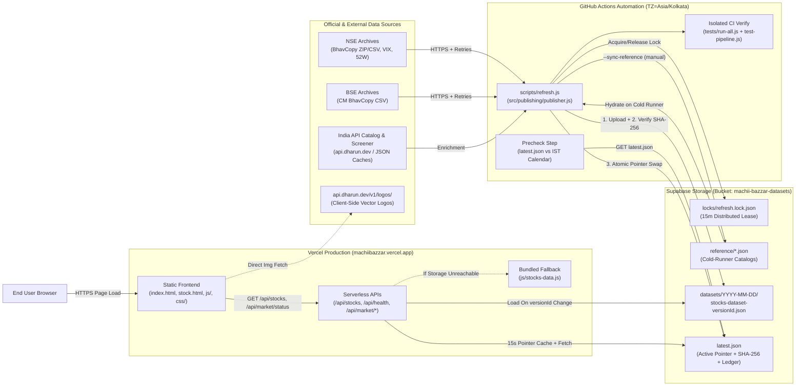
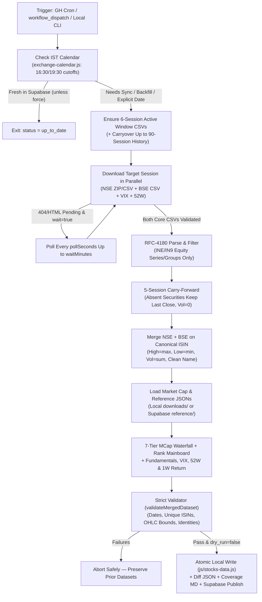
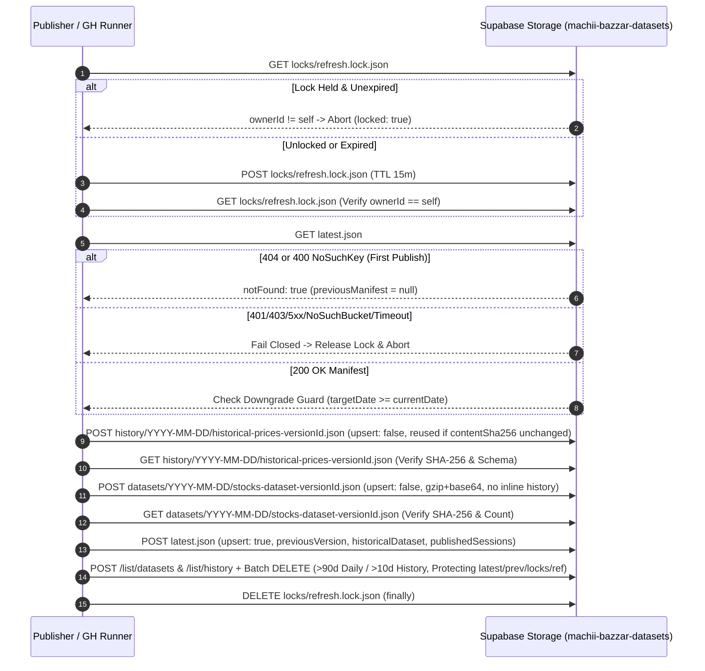
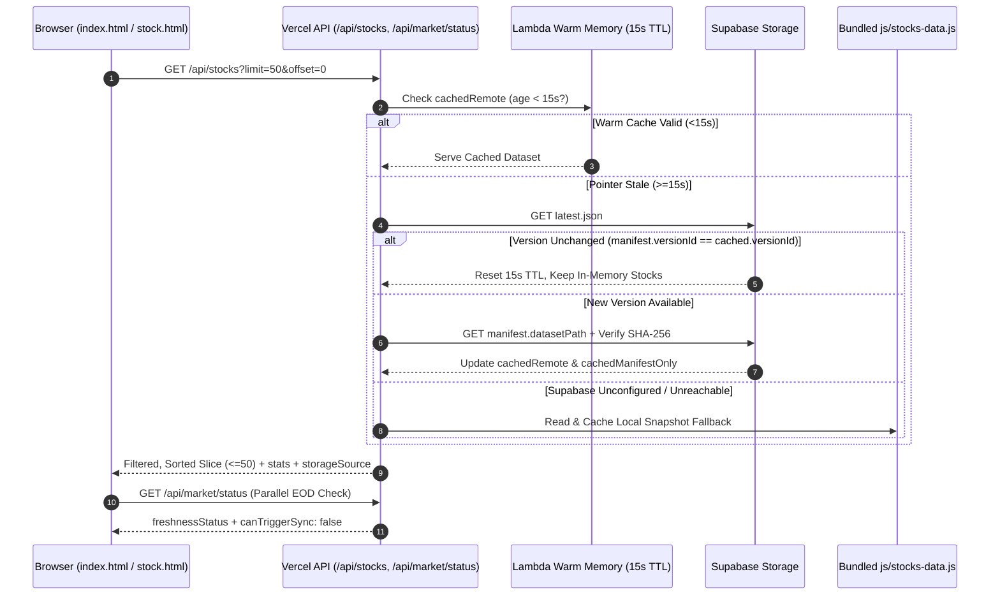
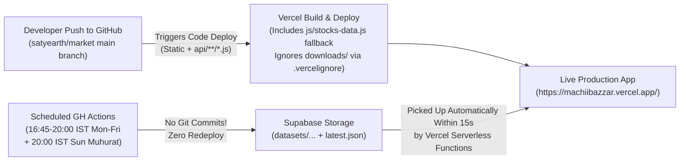

# Machii Bazzar — Complete Technical Blueprint

> **Document Scope:** Standalone, end-to-end engineering reference for the **Machii Bazzar** repository (`satyearth/market`).  
> **Codebase Snapshot Verified Against:** Commit `01d8c9d` (`Fix first-time Supabase Storage publishing`), `pipelineVersion: "2.0.0"`, audited `2026-11-26`.

---

## Table of Contents

1. [Project Overview](#1-project-overview)
2. [Complete Architecture](#2-complete-architecture)
3. [Frontend Documentation](#3-frontend-documentation)
4. [Backend Documentation](#4-backend-documentation)
5. [NSE + BSE Data Pipeline](#5-nse--bse-data-pipeline)
6. [Supabase Storage Architecture](#6-supabase-storage-architecture)
7. [API Documentation](#7-api-documentation)
8. [GitHub Actions Automation](#8-github-actions-automation)
9. [Vercel Deployment](#9-vercel-deployment)
10. [Data Structure](#10-data-structure)
11. [Testing and Quality Assurance](#11-testing-and-quality-assurance)
12. [Complete Project File Map](#12-complete-project-file-map)
13. [Environment Variables and Secrets](#13-environment-variables-and-secrets)
14. [Current Production Status](#14-current-production-status)
15. [Troubleshooting Guide](#15-troubleshooting-guide)
16. [Important Development Rules](#16-important-development-rules)
17. [Mermaid Diagrams](#17-mermaid-diagrams)

---

## 1. Project Overview

### What Machii Bazzar Does
**Machii Bazzar** is an End-of-Day (EOD) Indian equity market screener and stock intelligence platform covering the complete listed equity universe across **NSE** (National Stock Exchange) and **BSE** (Bombay Stock Exchange), including both **Mainboard** and **SME** (NSE Emerge / BSE SME) segments.

### Main Features and Purpose
- **Canonical ISIN-Unified Screener ([index.html](index.html)):** Displays all active Indian equities (`INE*` and `IN9*` ISINs) without duplicate company entries across NSE and BSE, ranked internally by verified market capitalization (`Cr`).
- **Market Pulse Summary Dashboard:** Displays aggregate verified market capitalization, Market Cap coverage percentage, India VIX reading and daily change, bottom-up Advance/Decline/Unchanged breadth bar, Near 52-Week High count, and distribution across verified ranking tiers (`Top 100`, `101–250`, `Remaining`, `Unranked`, `SME`).
- **Server-Side Filtering, Search & Sorting:** Multi-field search (ticker symbol, company name, NSE symbol, BSE scrip code, ISIN, sector, industry, plus consumer brand aliases like `zomato` -> `ETERNAL`), category pills (`ALL`, `TOP GAINERS`, `TOP LOSERS`, `NEAR 52W HIGH`, `★ WATCHLIST`, `HIGH VOLUME`), 12 sector pills, and infinite scroll pagination (`50` stocks per batch).
- **Side-by-Side Comparison & Personal Watchlist:** Client-side `localStorage` watchlist (`machii_watchlist`) and modal comparison of up to `4` selected stocks across key metrics.
- **CSV Export & Density Control:** Exports all currently loaded rows as UTF-8 BOM CSV (`machii-bazzar-stocks-<tradingDate>.csv`) and toggles standard vs compact table row density.
- **Per-Stock Profile Page ([stock.html](stock.html)):** ISIN-addressed detail view showing price, EOD change, 52-week range position bar, OHLC day-range visualizer, volume + volume ratio, valuation ratios (`P/E`, `P/B`, `ROCE %`, `Debt/Equity` when verified), chronological historical closing price table (up to 90 trading sessions), company metadata, and per-exchange listing details.
- **Zero-Commit Automated Daily Refresh:** Official NSE/BSE BhavCopy downloads, validation, enrichment, and atomic immutable publication run on GitHub Actions schedules and write directly to Supabase Storage, which Vercel serverless functions read dynamically without daily Git commits or redeploys.

### Technologies and Programming Languages
- **Backend & Pipeline Runtime:** Node.js (CommonJS, CI runs Node `20`; `"type": "commonjs"` in [package.json](package.json)) with **zero production npm dependencies** (`"dependencies"` is absent — relies strictly on built-in `http`, `https`, `fs`, `path`, `zlib`, `crypto`, `child_process`).
- **Frontend:** Vanilla HTML5, CSS3 (precompiled Tailwind v4 utility CSS + custom editorial "Dark Ink" design tokens in [css/style.css](css/style.css), [css/page-layout.css](css/page-layout.css), [css/stock-details.css](css/stock-details.css)), Google Fonts (`Fraunces`, `Instrument Sans`), and vanilla ES2020+ IIFE JavaScript ([js/app.js](js/app.js), [js/stock-details.js](js/stock-details.js), [js/company-logo.js](js/company-logo.js)).
- **External Object Storage:** Supabase Storage HTTP/REST API (`machii-bazzar-datasets` bucket).
- **CI/CD & Hosting:** GitHub Actions (IST-aware cron + `workflow_dispatch`) and Vercel Serverless Functions + Static Edge hosting (`https://machiibazzar.vercel.app/`).
- **Tooling & QA (`devDependencies` only):** ESLint (`eslint@^10.14.0`, `@eslint/js@^10.0.1`, `globals@^17.14.0`) and Playwright (`playwright@^1.64.1`).

### Overall System Architecture & Communication Flow
The system deliberately separates **heavy daily ingestion/compilation** from **low-latency public read serving**:
1. **GitHub Actions (Producer)** runs post-market in `Asia/Kolkata`, checks if Supabase Storage is already up to date, downloads official NSE & BSE archives directly over HTTPS, hydrates cached JSON reference catalogs from Supabase Storage (`reference/*.json`) when running on a clean runner, merges/enriches/validates all equities, and performs a 3-phase atomic upload + SHA-256 read-back verification + pointer swap (`latest.json`) to Supabase Storage.
2. **Supabase Storage (Persistent State)** stores immutable versioned dataset JSON snapshots under `datasets/<YYYY-MM-DD>/`, the single active manifest pointer `latest.json`, concurrency lease `locks/refresh.lock.json`, and enrichment catalogs under `reference/`.
3. **Vercel (Public Web & API Tier)** serves static HTML/CSS/JS assets and stateless Node.js serverless endpoints under [api/](api/). Each warm serverless function caches the latest Supabase `manifest` and dataset in memory using a 15-second manifest pointer TTL and `versionId` check, automatically falling back to the bundled snapshot ([js/stocks-data.js](js/stocks-data.js)) if Supabase is unconfigured or temporarily unreachable.
4. **Browser Client** opens [index.html](index.html) or [stock.html](stock.html), calls `/api/stocks` and `/api/market/status`, renders incrementally, and never touches exchange servers or Supabase credentials directly.

---

## 2. Complete Architecture

### Component Roles

| Component | Location | Responsibility |
| :--- | :--- | :--- |
| **Frontend UI** | [index.html](index.html), [stock.html](stock.html), [js/](js/), [css/](css/) | Static screener & detail UI; fetches paginated stock slices, status metadata, and external company vector logos; maintains watchlist (`localStorage`) and compare tray. |
| **Backend Services** | [src/](src/), [lib/](lib/), [server.js](server.js) | Modular CommonJS business logic: IST calendar, HTTP retry client, CSV parser, ISIN merger, market-cap/fundamental enrichment, validator, Supabase Storage client, orchestrator, query engine, and hardened local HTTP server. |
| **Serverless API Routes** | [api/](api/) | Six Vercel Node.js functions (`/api/health`, `/api/stocks`, `/api/market/status`, `/api/market/dataset`, `/api/market/history`, `/api/market/refresh`) sharing `src/` query, calendar, and storage modules. Read-only in production. |
| **Data Ingestion** | [src/ingestion/](src/ingestion/) | Downloads and validates official NSE ZIP/CSV BhavCopy, BSE CSV BhavCopy, optional NSE India VIX index close CSV, and optional NSE 52-Week High/Low CSV with pure-Node PKZIP inflation (`zlib`) and HTML error-page rejection. |
| **Data Processing** | [src/processing/](src/processing/), [src/enrichment/](src/enrichment/) | RFC-4180 CSV parsing, company-name normalization, ISIN deduplication across NSE & BSE, 5-session trailing carry-forward, up to 90-session historical closing matrix (preserving verified carryover history and computing `1W`/`1M`/`3M` returns when sufficient sessions exist), 7-tier market cap resolution, Mainboard ranking, sector overrides, VIX, and 52W High/Low enrichment. |
| **Data Validation** | [src/validation/](src/validation/) | Enforces date alignment, minimum universe size, >10% shrinkage protection, 12-character `INE`/`IN9` uniqueness, positive OHLC bounds (`high >= low`), strict chronological histories (`<= 90` sessions), finite non-null returns, and mathematical breadth/coverage identities. |
| **Publishing System** | [src/publishing/](src/publishing/) | Orchestrates download, backfill, merge, validation, changelog diffing, coverage markdown report generation, atomic local `js/stocks-data.js` write, and atomic Supabase Storage upload/pointer swap. |
| **Supabase Storage** | [src/storage/](src/storage/) | Distributed refresh lease (`locks/refresh.lock.json`), separated immutable daily stock snapshots (`datasets/`) & compact columnar 90-session history snapshots (`history/`, `gzip+base64` JSON), SHA-256 integrity checks, downgrade guards, `latest.json` pointer swaps, `reference/` hydration, and fail-closed `90`-day daily / `10`-day history pruning. |
| **GitHub Actions** | [.github/workflows/refresh-stock-data.yml](.github/workflows/refresh-stock-data.yml) | Automated Mon–Fri post-close + Sunday Muhurat scheduler and manual runner. Executes precheck -> refresh -> isolated unit/pipeline tests -> step summary with zero git writes. |
| **Vercel Hosting** | [vercel.json](vercel.json), [.vercelignore](.vercelignore) | Serves static assets cleanly and deploys `api/**/*.js` serverless functions bundled with `js/stocks-data.js` fallback (`maxDuration: 60` seconds). |

### Overall System Architecture Diagram



---

## 3. Frontend Documentation

### Main Pages and Purpose
1. **[index.html](index.html) (`/`):** Main equity screener displaying:
   - Sticky top navigation (`machii · bazzar` wordmark + `STOCKS` chip).
   - EOD Market Status line (`#market-status-badge`) and live sync status pill (`#eod-sync-indicator`).
   - 5-card **Market Pulse Grid** (`#pulse-metrics`): Verified Market Cap, India VIX, Market Breadth bar, Near 52W High counter, and Verified Cap Ranks histogram (`T100`, `Mid`, `Rem`, `Unr`, `SME`).
   - Category & Sector Filter Pill Bar (`#market-filters`): 6 screener pills (`ALL`, `TOP GAINERS`, `TOP LOSERS`, `NEAR 52W HIGH`, `★ WATCHLIST`, `HIGH VOLUME`) + 12 sector pills (`FINANCIALS` through `OIL & GAS`).
   - Screener Table Toolbar: Debounced search input (`data-stocks-search="true"`, `/` keyboard shortcut, `Escape` clear), scope toggle buttons (`This page` / `All results`), CSV export (`#export-csv-btn`), row density toggle (`#density-toggle-btn`), and settings icon (`Customize columns`).
   - Virtualized/infinite-scroll 12-column table (`#stocks-tbody`) + sentinel (`#infinite-sentinel`), comparison tray (`#compare-tray`), and `<dialog id="compare-dialog">`.
2. **[stock.html](stock.html) (`/stock.html?isin=<12-char-ISIN>`):** Canonical ISIN-keyed profile page displaying:
   - Loading indicator (`#stock-loading`), error alert panel (`#stock-error`), and main profile view (`#stock-detail`).
   - Header card: Large (`48×48`) logo, ticker/NSE symbol, company name, exchange/SME badges, Watchlist toggle (`#stock-watchlist-btn`), latest EOD price, daily ₹ and `%` change, 52-week range position track (`#stock-52w-pin`), and market status footer (`#market-data-status`).
   - Trading session card: Open/High/Low/Close boxes, visual Close-within-day-range bar (`#stock-ohlc-range-fill`), traded volume & `volume_ratio`, and conditionally visible valuation ratios (`P/E`, `P/B`, `ROCE %`, `Debt/Equity` — `#stock-fundamentals-section` stays hidden if all 4 are `null`).
   - Recent price history card (`#stock-history-section`): Chronologically reversed (most recent first) closing price & daily `%` change table when at least 2 sessions exist in `historical_prices`.
   - Company information `<dl>` (`Market capitalization`, `Sector`, `Industry`, `52-week high`, `52-week low`, `Segment`, `Series / group`, `Company description`).
   - Exchange listings grid: Dedicated NSE, BSE (with scrip code), and ISIN/listing-status cards.

> **Important Distinction Between UI Elements and Active Code:**
> - **Customize Columns Button (`index.html:204`):** Exists in toolbar markup (`title="Customize columns"`), but `js/app.js` attaches no click listener or column-hiding logic to it.
> - **Scope Toggle Buttons (`This page` / `All results`, `index.html:187-188`):** Present in static HTML markup; `js/app.js` binds sorting exclusively via `th[data-sortable="true"]` server-side queries (`/api/stocks`).
> - **`1M` and `3M` Columns (`index.html:223-224`, `js/app.js:421-422`):** The backend computes `return_1m` (`~22` verified trading sessions) and `return_3m` (`~66` verified trading sessions) when sufficient verified history exists in the up to 90-session window; otherwise they remain `null`. When `null`, `js/app.js` displays `—` with `title="Data not available yet"`; when numeric, `js/app.js` applies return color styling cleanly.
> - **`Company description` Field (`js/stock-details.js:115`):** Passed explicitly as `null` (`N/A`) because exchange BhavCopy and verified reference files do not supply prose descriptions.
> - **`aria-rowcount="5389"` (`index.html:213`):** Static HTML placeholder attribute from an earlier audit snapshot; `js/app.js:150` dynamically overwrites it at runtime with `marketStats.stockCount` (`5,405` locally / `5,445` in live production).

### Homepage Runtime Lifecycle ([js/app.js](js/app.js))
On `DOMContentLoaded` (or immediately if DOM is already interactive), `init()` executes:
1. `setupEvents()` — attaches debounced search (`120ms`), `/` & `Escape` hotkeys, CSV export click, filter/sector pill handlers, density toggle, column sort handlers, delegated `tbody` row clicks (`comparisonStocks`, `watchlist`, row navigation to `./stock.html?isin=...`, `Enter`/`Space` keyboard row activation), and compare dialog handlers.
2. `setupInfiniteScroll()` — creates an `IntersectionObserver` (`rootMargin: '700px 0px'`, fallback to scroll listener) watching `#infinite-sentinel` to trigger `fetchNextBatch()`.
3. `fetchNextBatch()` — requests `GET /api/stocks?...&limit=50&offset=0`. Upon receiving the first batch, updates `marketStats`, `resultTotal`, `hasMore`, renders rows + sparklines, and calls `renderMarketPulse()` to populate all 5 top dashboard cards.
4. `checkEodAutoRefresh()` — checks `sessionStorage['mb_last_sync_check']` (5-minute cache TTL) or queries `GET /api/market/status`:
   - On `file://` URLs: displays `Showing bundled EOD dataset`.
   - When `data.canTriggerSync === false` (production Vercel serverless): updates the EOD pill cleanly (`latest`, `delayed`, or `stale`) and **never** calls `POST /api/market/refresh`.
   - When `data.canTriggerSync === true` (local `server.js`) and `data.needsSync` is true: triggers `POST /api/market/refresh`, polls `/api/market/status` every 3s if `in_progress`, and calls `reloadDatasetHot()` (`applyFilters()`) on completion.
   - If the status endpoint reports a newer `tradingDate` or `storageVersionId` than `marketStats`, triggers `reloadDatasetHot()` automatically.

### Search, Filtering, Sorting & Infinite Scrolling
- **Filter & Sector State:** Selecting any standard pill (`ALL`, `TOP GAINERS`, `TOP LOSERS`, `NEAR 52W HIGH`, `WATCHLIST`, `HIGH VOLUME`) clears `activeSector`. Selecting any `.sector-pill` reads `data-sector` and resets `activeFilter = 'ALL'`.
- **Server-Side Querying:** Every search, filter, or sort change increments `queryVersion`, aborts any in-flight `fetch` via `AbortController`, resets `nextOffset = 0` and `loadedStocks = []`, displays 7 pulsing skeleton rows (`renderSkeletons(7)`), and fetches `GET /api/stocks` with query params `limit=50`, `offset`, `search`, `filter`, `sort`, `direction`, `sortOverride`, plus `isins` (when `WATCHLIST`) or `sector`.
- **Watchlist Empty Short-Circuit:** If `activeFilter === 'WATCHLIST'` and `localStorage` `machii_watchlist` is empty, `fetchNextBatch()` skips the network call and renders an empty-state table prompt.
- **Duplicate Row Prevention:** Client tracks `loadedIsins` (`Set`) across batches to guarantee zero duplicate rows during pagination.
- **Company Comparison Tray:** Users can select up to `MAX_COMPARISON_STOCKS = 4` stocks via `⇄`. Opening the modal renders a `<dialog>` comparing Price, Daily change, Market cap, 1W return, Volume, Sector, and Exchange.

### Stock Details Page ([js/stock-details.js](js/stock-details.js))
1. Reads `?isin=` from `window.location.search` and validates `/^[A-Z0-9]{12}$/i`.
2. Calls `fetchLiveStockByIsin(normalizedIsin)` -> `GET /api/stocks?isin=<ISIN>&limit=1` with `cache: 'no-store'` and a `5000ms` timeout.
3. **Fallback Behaviour:** If the `/api/stocks` lookup fails, times out, or runs over `file://`, calls `loadStaticFallbackScript()`, which dynamically injects `<script src="./js/stocks-data.js">` (`~9.26 MB`) only as a fallback and searches `window.STOCKS_DATA` by ISIN. ([stock.html](stock.html) deliberately does **not** include a static `<script src="./js/stocks-data.js">` tag so normal API page loads stay fast.)
4. Calls `updateMarketStatus()` -> `GET /api/market/status` (`2500ms` timeout) to display whether the EOD snapshot is `Current`, `Current (exchange closed today)`, `Delayed`, or `Stale`.

### Company Logos ([js/company-logo.js](js/company-logo.js) & [js/company-logo-manifest.js](js/company-logo-manifest.js))
- [js/company-logo-manifest.js](js/company-logo-manifest.js) exports `window.COMPANY_LOGO_MANIFEST`, an ISIN-keyed lookup map of `5,389` audited records generated by [scripts/build-company-logo-manifest.js](scripts/build-company-logo-manifest.js) from [docs/reports/logo-verification-audit-2026-11-05.json](docs/reports/logo-verification-audit-2026-11-05.json):
  - `[1, url]` — verified official company logo (`5,096` stocks)
  - `[2, url]` — verified API monogram (`239` stocks)
  - `[0, ""]` — confirmed 404 / no logo (`54` stocks -> skips network request immediately and renders CSS initials)
- Note: Although individual stock records sometimes carry `stock.logo_url` (e.g., `/stock-logos/RELIANCE.png` from benchmark cache), **both [js/app.js](js/app.js) and [js/stock-details.js](js/stock-details.js) ignore `stock.logo_url` and call `window.CompanyLogo.render()` using `window.COMPANY_LOGO_MANIFEST[isin]`**. Any newly listed stock whose ISIN is absent from the 5,389-entry manifest renders an initials circle immediately with zero HTTP 404s.
- Runtime `` load errors are captured by a document-level capturing listener + inline `onerror`, stored in `sessionStorage['machii-logo-failures-v1']` (up to 512 ISINs), and swapped in-place to initials (`CompanyLogo.initials()` strips legal suffixes like `Ltd`, `Limited`, `Private`, `Pvt`, `LLP`, `Inc`, `Co`).
- [js/logo-aliases.js](js/logo-aliases.js) stores `LOGO_ALIASES` (hyphenated tickers, renamed symbols, `-RE1` / `PP` partly-paid shares) used by [scripts/audit-logo-coverage.js](scripts/audit-logo-coverage.js) during offline logo audits; it is not loaded at runtime in HTML.

### Important Frontend CSS & JS Files
- **[css/style.css](css/style.css):** Tailwind v4 compiled utility stylesheet plus font variables (`--font-fraunces`, `--font-instrument`, `--ease-pulse`), row rise animation (`pulse-stocks-rise`), custom scrollbars, `32×32` / `48×48` circular logo rules (`.stock-logo-wrap`), dense-mode padding overrides, and sticky table header positioning (`top: 57px`).
- **[css/page-layout.css](css/page-layout.css):** Dark Ink color tokens (`--ink-bg`, `--ink-card`, `--ink-well`, `--ink-sienna`, `--ink-bullish`, `--ink-bearish`, etc.), responsive shell `.site-wide-shell` (`min(calc(100% - clamp(1rem, 4vw, 3rem)), 112rem)`), mobile/tablet/desktop breakpoints (`<=767px`, `768–1023px`, `1024–1279px`), and compare tray + `<dialog>` styling.
- **[css/stock-details.css](css/stock-details.css):** Responsive 2/3/4-column detail grids (`.stock-detail-grid`), mobile 1-column stack (`<=520px`), `44px` touch target minimums (`--touch-target-min`), and `overflow-wrap: anywhere` word breaking.

---

## 4. Backend Documentation

### Folder Structure
```text
api/                               # Vercel Node.js serverless handlers (production APIs)
  health.js
  stocks.js
  market/
    dataset.js
    refresh.js
    status.js
lib/                               # Backwards-compatibility re-export shims
  dataset-storage.js               -> ../src/storage/supabase-storage
  market-cap-pipeline.js           -> ../src/enrichment/market-cap
  stocks-query.js                  -> ../src/query/stock-query-service
src/                               # Modular backend core
  calendar/exchange-calendar.js
  config/constants.js
  enrichment/fundamentals.js
  enrichment/market-cap.js
  ingestion/bhavcopy-downloader.js
  ingestion/http-client.js
  processing/csv-parser.js
  processing/universe-merger.js
  publishing/publisher.js
  query/stock-query-service.js
  server/local-server.js
  storage/supabase-storage.js
  validation/dataset-validator.js
scripts/                           # CLI entrypoints & audit/verification runners
server.js                          # Local dev entrypoint -> src/server/local-server.js
```

### Module Responsibilities & Dependencies

| Module | Primary Responsibility | Key Dependencies |
| :--- | :--- | :--- |
| [src/config/constants.js](src/config/constants.js) | Shared file paths, `DEFAULT_BUCKET` (`machii-bazzar-datasets`), `LATEST_POINTER_PATH`, `LOCK_OBJECT_PATH`, `REFERENCE_PREFIX`, `HISTORY_PREFIX`, `DEFAULT_RETAIN_TRADING_SESSIONS` (`90`), `DEFAULT_RETAIN_HISTORY_SESSIONS` (`10`), `MAX_HISTORICAL_SESSIONS` (`90`), `DOWNLOAD_WINDOW_SESSIONS` (`6`), `CARRY_FORWARD_SESSIONS` (`5`), `SPARKLINE_SESSIONS` (`6`), return window constants (`6`/`22`/`66`), `POINTER_CACHE_TTL_MS` (`15000`), eligible NSE series & BSE groups, `REFERENCE_FILES`, and `SECTOR_OVERRIDES`. | Built-in `path` |
| [src/calendar/exchange-calendar.js](src/calendar/exchange-calendar.js) | Converts UTC `Date` to IST calendar fields (`Asia/Kolkata`), maintains `EXCHANGE_HOLIDAYS_2026` (16 weekday holidays) & `SPECIAL_TRADING_SESSIONS_2026` (`2026-11-08`), determines `latestExpectedDate` (`16:30 IST` regular / `19:30 IST` special session cutoffs), and evaluates `current` / `delayed` / `stale` / `unknown` freshness. | None |
| [src/ingestion/http-client.js](src/ingestion/http-client.js) | Zero-dependency HTTP/HTTPS GET client with bounded timeouts (`25000ms` default), redirect cap (`5`), browser User-Agent headers, host-scoped `insecureHTTPParser` strictly for `bseindia.com` / `*.bseindia.com`, and exponential backoff honoring `Retry-After` on `403`, `408`, `429`, `5xx`. | `http`, `https` |
| [src/ingestion/bhavcopy-downloader.js](src/ingestion/bhavcopy-downloader.js) | Downloads NSE ZIP/CSV (`BhavCopy_NSE_CM_0_0_0_YYYYMMDD_F_0000.csv.zip`/`.csv`), BSE CSV (`BhavCopy_BSE_CM_0_0_0_YYYYMMDD_F_0000.CSV`), NSE indices (`ind_close_all_DDMMYYYY.csv`), and NSE 52W High/Low (`CM_52_wk_High_low_DDMMYYYY.csv`); inflates PKZIP via `zlib.inflateRawSync`; rejects HTML responses & bad dates; atomic `.tmp` write; session inspection & backfill. | `constants`, `exchange-calendar`, `http-client`, `fs`, `zlib` |
| [src/processing/csv-parser.js](src/processing/csv-parser.js) | RFC-4180 CSV quote-aware line/file parser (`parseCSVContent`, `parseCSVFile`), company name normalizer (`cleanCompanyName`), numeric cleaner (`parseNum`), and `YYYY-MM-DD` / `DD-MM-YYYY` / `DD-MMM-YYYY` date normalizer (`parseDateStr`). | `fs` |
| [src/enrichment/market-cap.js](src/enrichment/market-cap.js) | Hydrates reference JSONs from `downloads/` or Supabase `reference/` (`loadJsonWithReferenceFallback`), paginates live `api.dharun.dev/v1/companies` catalog, runs 7-tier `resolveStockMarketCap()`, ranks mainboard vs SME (`rankStocksAndCategorize`), and writes `docs/reports/MARKET_CAP_COVERAGE_REPORT.md`. | `constants`, `http-client`, `fs` |
| [src/enrichment/fundamentals.js](src/enrichment/fundamentals.js) | Loads India VIX from `ind_close_all_*.csv`, NSE 52W high/low from `CM_52_wk_High_low_*.csv`, BSE 52W fallback from `bse_near_52week_verified.json`, applies `SECTOR_OVERRIDES`, normalizes `'GENERAL'` -> `'Unclassified'`, and carries over verified ratios without fabrication. | `constants`, `csv-parser`, `bhavcopy-downloader` |
| [src/processing/universe-merger.js](src/processing/universe-merger.js) | Compiles up to 90-session historical closing prices (`compileHistoricalMatrix`) via verified prior carryover + local CSV overlay, computes `1W`/`1M`/`3M` returns & 6-session `sparkline_7d`, enforces ISIN & series/group filters, executes bounded 5-session carry-forward for absent securities, merges NSE & BSE fields per ISIN, enriches fundamentals/market caps, ranks universe, and generates changelog diffs (`buildUniverseDiff`). | `constants`, `csv-parser`, `bhavcopy-downloader`, `market-cap`, `fundamentals` |
| [src/validation/dataset-validator.js](src/validation/dataset-validator.js) | Validates target date alignment across `MARKET_STATS` & rows, minimum count (`1000`), >10% shrinkage protection, unique Indian equity ISIN regex `/^IN[E9][A-Z0-9]{9}$/`, positive finite prices, `high >= low`, integer volume, ordered histories (`<= 90` sessions, no future dates), finite non-null returns, and exact breadth & coverage sums. | `constants` |
| [src/storage/historical-store.js](src/storage/historical-store.js) | Compact columnar 90-session history matrix builder (`buildCompactHistoryPayload` `[startOffset, slice]`), `gzip+base64` JSON envelope encoder/decoder, inline `historical_prices` stripper, per-ISIN expander, and structural validator. | `constants`, `crypto`, `zlib` |
| [src/storage/supabase-storage.js](src/storage/supabase-storage.js) | Supabase Storage REST client implementing separated compressed `history/` & daily `datasets/` upload, SHA-256 read-back verification, `contentSha256` history deduplication, `isObjectNotFoundResponse()` first-publish handling, distributed `locks/refresh.lock.json`, downgrade guards, `reference/` transfer, and 90-day daily / 10-day history pruning. | `constants`, `historical-store`, `exchange-calendar`, `crypto`, `http`, `https` |
| [src/publishing/publisher.js](src/publishing/publisher.js) | Orchestrates CLI parsing, PID lockfile `.refresh.lock`, `runRefresh` (precheck, trailing history downloads, wait polling, backfill, `syncUniverse`), changelog export, coverage report generation, atomic local `js/stocks-data.js` + `.backup.js` write, and Supabase Storage publication. | All pipeline modules above |
| [src/query/stock-query-service.js](src/query/stock-query-service.js) | Serves API reads: reads `latest.json` / versioned dataset from Supabase Storage with `15s` TTL manifest cache + `versionId` deduplication, falls back to local `js/stocks-data.js` (`mtimeMs` + `size` cached), applies `SECTOR_OVERRIDES`, filters, searches (including aliases), sorts (`rank`, `symbol`, prices, caps, returns, volume), and paginates (`limit <= 50`). | `constants`, `supabase-storage`, `fs` |
| [src/server/local-server.js](src/server/local-server.js) | Local HTTP server (`PORT` env or `8080`) with allowlisted static assets (`ALLOWED_STATIC_PATHS`), strict path-traversal & method guards, localhost-only CORS, all 5 `/api/*` endpoints, concurrency-locked `POST /api/market/refresh` spawning `scripts/refresh.js`, and a `10`-minute background auto-sync `setInterval`. | `constants`, `exchange-calendar`, `bhavcopy-downloader`, `stock-query-service`, `supabase-storage`, `child_process` |

### Error Handling, Logging, Caching, and Fallback Behavior
- **Error Handling & Resilience:**
  - HTTP retries use exponential backoff (`Math.min(baseDelayMs * 2^(attempt-1), 30000)` in downloader) and respect `Retry-After` headers. HTTP `404`/`410` short-circuit immediately on exchanges without pointless retries; HTML responses on HTTP `200` (common on NSE/BSE CDN blocks) are detected by `looksLikeHtml()` and treated as unpublished/invalid.
  - Lockfiles exist at two levels: local OS PID lock (`downloads/.refresh.lock`, 30-min stale eviction if PID dead or expired) and Supabase distributed object lock (`locks/refresh.lock.json`, 15-min TTL with read-back ownership check). Both clean up in `try ... finally`.
  - Storage manifest errors (`403`, `401`, `400 Bucket not found`, `5xx`, network timeout) fail closed **even when `--force` is passed**, refusing to overwrite `latest.json` or upload orphaned data. Only verified missing-key responses (`404` or `400 NoSuchKey` / `object not found`) initialize a first-time publish.
- **Caching & In-Memory Deduplication (`stock-query-service.js`):**
  - `cachedManifestOnly` (`{ checkedAt, stats, manifest, versionId }`) and `cachedRemote` (`{ versionId, checkedAt, data, manifest }`) share `POINTER_CACHE_TTL_MS = 15000` (15s).
  - After 15s, `loadDatasetAsync()` re-fetches only the small `latest.json` pointer (`~3–4 KB`), checks `manifest.versionId === cachedRemote.versionId`, and reuses the in-memory `stocks` array without re-downloading the multi-megabyte full dataset snapshot unless `versionId` changed.
  - `loadDataset()` caches local `js/stocks-data.js` keyed by `(stat.mtimeMs, stat.size)`.
- **Fallback Chain:**
  1. Fresh Supabase Storage (`storageSource: 'supabase_storage'`)
  2. Stale in-memory Supabase cache if Supabase transiently fails (`storageSource: 'supabase_storage_cached'`)
  3. Local `js/stocks-data.js` (`storageSource: 'local_fallback'` when Supabase was configured, or `'local_file'` when Supabase URL is not set)
  4. Client-side static fallback in [js/stock-details.js](js/stock-details.js) dynamically loading `./js/stocks-data.js` when running offline or `/api/stocks` is unreachable.

---

## 5. NSE + BSE Data Pipeline

Step-by-step execution flow inside [src/publishing/publisher.js](src/publishing/publisher.js), [src/ingestion/bhavcopy-downloader.js](src/ingestion/bhavcopy-downloader.js), [src/processing/universe-merger.js](src/processing/universe-merger.js), [src/enrichment/](src/enrichment/), and [src/validation/](src/validation/):

1. **Session & Date Resolution (`resolveTargetTradingDate` / `runRefresh`):**
   - Evaluates IST wall-clock via `getLatestExpectedTradingDate()`. Weekdays before `16:30 IST`, weekends (except `2026-11-08`), and exchange holidays roll back to the previous valid trading session.
   - Unless `--sync-only` without `--date` (which resolves to `stored.latestCompleteDate`), targets explicit `--date=YYYY-MM-DD` or `latestExpectedDate`.
   - Refuses non-trading days, future trading dates (`> latestExpectedDate`), and downgrades (`< authoritativePublishedDate` unless `--allow-downgrade`). If already fresh against Supabase `latest.json` (or local `js/stocks-data.js` when `--skip-storage`), exits cleanly with `status: 'up_to_date'`.
2. **Download Official Exchange Sources (`bhavcopy-downloader.js`):**
   - Ensures the daily `6` active sessions in `getRecentTradingSessions(targetDate, DOWNLOAD_WINDOW_SESSIONS)` have primary BhavCopy CSVs cached in `downloads/` (downloading any missing active-window sessions with `includeSupplementary: false`), while `syncUniverse()` requests up to `90` historical sessions (`MAX_HISTORICAL_SESSIONS`) for per-stock close compilation via verified carryover + any cached CSVs.
   - Downloads NSE CM Unified BhavCopy for `targetDate` (tries `.csv.zip` first, `.csv` fallback) from `nsearchives.nseindia.com` (`Referer: https://www.nseindia.com/`) in parallel with BSE CM Unified BhavCopy (`.CSV`) from `www.bseindia.com` (`Referer: https://www.bseindia.com/markets/MarketInfo/BhavCopy.aspx`, using `insecureHTTPParser: true` strictly for `bseindia.com` hosts).
   - If `--wait` is active (e.g., CI `--wait-minutes=4`) and either exchange returns `404` or HTML indicating pending EOD upload, polls every `pollSeconds` (`30s` default) up to `waitMinutes`.
   - Once both core BhavCopies validate, fetches supplementary optional archives for `targetDate`: `ind_close_all_DDMMYYYY.csv` (India VIX) and `CM_52_wk_High_low_DDMMYYYY.csv` (52-Week High/Low). Missing optional archives do **not** abort the pipeline.
3. **ZIP Extraction, Integrity Validation & Atomic Disk Caching:**
   - Pure-Node `extractCsvFromZipBuffer()` locates PKZIP EOCD / central directory / local file header and inflates Method `8` (Deflate via `zlib.inflateRawSync`) or Method `0` (Stored) into UTF-8 CSV text.
   - `validateBhavcopyCsvContent()` verifies size `>= 50,000` bytes (configurable in tests), rejects HTML payloads (`looksLikeHtml()`), verifies all `7` required columns (`TradDt`, `ISIN`, `TckrSymb`, `SctySrs`, `ClsPric`, `PrvsClsgPric`, `TtlTradgVol`), row count `>= 1000`, valid `YYYY-MM-DD` `TradDt`, and exact `TradDt === expectedDate`.
   - Commits files atomically via `.tmp.<pid>.<ts>` + `fs.renameSync`.
4. **CSV Parsing & Symbol/ISIN Normalization (`csv-parser.js` & `universe-merger.js`):**
   - `parseCSVContent()` parses RFC-4180 quoted CSV fields cleanly (e.g., commas inside `"TCS, Limited"`).
   - Filters strictly to Indian equity ISINs matching `isEligibleIsin()` (`INE*` ordinary shares and `IN9*` partly-paid shares), excluding debt, mutual funds, sovereign bonds, and non-eligible instruments.
   - Eligible NSE series (`NSE_EQUITY_SERIES`): Mainboard `EQ`, `BE`, `BZ`; SME `SM`, `ST`, `SZ`.
   - Eligible BSE groups (`BSE_EQUITY_GROUPS`): Mainboard `A`, `B`, `T`, `X`, `XT`, `Z`, `ZP`, `P`, `R`, `SS`, `TS`, `IF`, `IT`, `E`; SME `M`, `MT`, `MS`. (Debt/odd groups `F`, `G`, `D`, `GC`, `C`, `W`, `H`, `Q` in `constants.js` are excluded.)
   - `cleanCompanyName()` normalizes all-caps exchange names into title case and expands abbreviations (`Ltd.` -> `Limited`, `Inds.` -> `Industries`, `Fin.` -> `Finance`, `Pharma.`/`Pharm.`, `Engg.`, etc.).
   - Same-exchange duplicates sharing an ISIN (rare series overlap) keep `EQ` over other series on NSE, and `A` over other groups on BSE.
5. **5-Session Carry-Forward for Illiquid / Non-Traded Equities:**
   - Securities listed on NSE/BSE that did not trade on `targetDate` (absent from target BhavCopy) are carried forward from the trailing 5 sessions in `historicalDates` (`idx = length - 2` down to `0`) with their latest verified closing price as `current_price` / `prev_close`, `change_percent: 0.00`, `volume: 0`, OHLC `null`, and `traded_on_target: false`.
6. **NSE + BSE Merge & Field Rules:**
   - Iterates unique ISINs (`new Set([...nseByIsin.keys(), ...bseByIsin.keys()])`):
     - **Dual-listed (`nse && bse`):** `exchanges = ['NSE', 'BSE']`, primary `symbol = nse.nse_symbol || bse.bse_ticker || bse.bse_scrip_code`, picks the longer normalized `company_name`, `segment = 'SME'` if either exchange classifies it SME else `'Mainboard'`, `series = nse.series || bse.group`. When both traded on `targetDate`: takes NSE `open_price`, `current_price`, `prev_close`, `change_percent` (falling back to BSE if null), computes `high_price = Math.max(nse, bse)`, `low_price = Math.min(nse, bse)`, and sums `volume = nse.volume + bse.volume`. When only one exchange traded on `targetDate`, uses the exchange that actively traded (`traded_on_target === true`). If `high_price < low_price` ever occurs in dirty source rows, values are swapped safely.
     - **NSE-only / BSE-only:** Uses single-exchange quote fields and leaves the absent exchange ID strictly `null` (`bse_scrip_code: null` or `nse_symbol: null`).
7. **New Listing Discovery, Deltas & Delisted/Suspended Handling (`buildUniverseDiff`):**
   - Compares merged universe by ISIN against `previousUniverseByIsin` (sourced from Supabase remote dataset if newer/equal date than local `js/stocks-data.js`, else local `js/stocks-data.js`).
   - Records `newlyListed` (Mainboard vs SME breakdown), `newExchangeListings` (single -> dual listing expansion), `symbolChanges`, `seriesChanges` (e.g., T2T / SME -> Mainboard), and `delistedOrSuspended` (present in prior universe but absent across the entire 6-session trailing window).
   - Writes full structured diff JSON locally to `downloads/universe-changes-<tradingDate>.json` and embeds `changeLogSummary` in `MARKET_STATS`.
8. **Enrichment (`market-cap.js` & `fundamentals.js`):**
   - **Cold-Runner Hydration:** If local `downloads/*.json` caches are missing (such as on fresh GitHub Actions runners), `loadJsonWithReferenceFallback()` fetches `reference/benchmark_stocks_verified.json`, `reference/bse_list_securities_verified.json`, `reference/api-companies-catalog.json`, and `reference/screener_market_caps.json` from Supabase Storage. Only `api-companies-catalog.json` falls back to paginated live HTTP calls (`https://api.dharun.dev/v1/companies`) if missing or `<= 5,000` items.
   - **7-Tier Market Cap Waterfall:** `BENCHMARK_VERIFIED` -> `BSE_SECURITY_MASTER` -> `INDIA_API_ISIN` -> `SCREENER_DATASET` -> `INDIA_API_TICKER` -> `CALCULATED_OUTSTANDING_SHARES` -> `PREVIOUS_SESSION_VERIFIED` carryover; otherwise `null`.
   - **Internal Ranking (`rankStocksAndCategorize`):** Sorts descending by `market_cap_cr` (`null`s last, tie-break alphabetically by `symbol`), assigns integer `rank` `1..N` strictly to **Mainboard** stocks with non-null verified market caps, marks SME stocks `rank: null` / `'SME Platform'`, and marks unverified Mainboard `rank: null` / `'Unranked (Unverified Market Cap)'`.
   - **Historical Matrix & Multi-Horizon Returns (`1W` / `1M` / `3M`):** `compileHistoricalMatrix()` hydrates verified prior `historical_prices` (`< targetDate`) from `previousUniverseByIsin` within the `90`-session window and overlays authoritative closes from `downloads/` BhavCopy CSVs. Attaches chronological `historical_prices` (`[{date, close}]`, up to `90` sessions), `sparkline_7d` (trailing `6` closes from `SPARKLINE_SESSIONS`), and computes `return_1w` (`6`-session window, `>= 2` closes), `return_1m` (`~22`-session window when dataset spans `>= 22` verified trading dates and stock closes exist within `maxStartLag: 2`, else `null`), and `return_3m` (`~66`-session window when dataset spans `>= 66` verified trading dates and stock closes exist within `maxStartLag: 4`, else `null`). Without prior carryover beyond local CSVs, `historical_prices` begins with available verified dates and grows organically up to `90` sessions across daily runs.
   - **Fundamentals & Supplementary:** Attaches `vix`, `vixChangePct`, `vixDate` from NSE index archive (or `null`); `week52_high`, `week52_low`, `pct_from_high`, `is_near_high` (`pct_from_high >= -8.0`) from NSE 52W archive with BSE fallback; applies `SECTOR_OVERRIDES` (100 ISIN mappings) and preserves verified `pe_ratio`, `pb_ratio`, `roce`, `debt_to_equity`, `volume_ratio`.
9. **Validation (`validateMergedDataset`):** Enforces all invariants before writing anything.
10. **Publication & Reporting:**
    - Writes [js/stocks-data.js](js/stocks-data.js) atomically via temp file + regex/JSON read-back verification + `.backup.js` copy.
    - Publishes to Supabase Storage (when `SUPABASE_URL` & `SUPABASE_SERVICE_ROLE_KEY` exist and `--skip-storage` / `--dry-run` are off).
    - Generates [docs/reports/MARKET_CAP_COVERAGE_REPORT.md](docs/reports/MARKET_CAP_COVERAGE_REPORT.md).

### Source vs Intermediate vs Final Published Data
- **Source Data (`downloads/`):** Raw official archives (`BhavCopy_NSE_CM_*.csv`, `BhavCopy_BSE_CM_*.CSV`, `ind_close_all_*.csv`, `CM_52_wk_High_low_*.csv`) and enrichment JSONs (`benchmark_stocks_verified.json`, `bse_list_securities_verified.json`, `api-companies-catalog.json`, `screener_market_caps.json`, `bse_near_52week_verified.json`). Cached/gitignored; not deployed to Vercel.
- **Intermediate Data (In-Memory & Changelogs):** Parsed exchange maps (`nseByIsin`, `bseByIsin`), up to 90-session closing price matrix (`priceHistoryByIsin`), validation report (`errors`, `warnings`), coverage report markdown, and `downloads/universe-changes-<date>.json`.
- **Final Published Data:**
  - **Remote Production:** Supabase JSON object `datasets/<tradingDate>/stocks-dataset-<versionId>.json` + manifest `latest.json`.
  - **Local Fallback / Dev File:** [js/stocks-data.js](js/stocks-data.js) (`const MARKET_STATS = ...; const STOCKS_DATA = ...;`), bundled into Vercel functions via [vercel.json](vercel.json).

---

## 6. Supabase Storage Architecture

Implemented in [src/storage/supabase-storage.js](src/storage/supabase-storage.js):

- **Bucket Name:** `machii-bazzar-datasets` (`DEFAULT_BUCKET` in `constants.js`, overridable via `SUPABASE_STORAGE_BUCKET`).
- **Storage Authentication & Key Isolation:**
  - **Reads (`downloadObject`, `listObjects`):** Uses `authKey = serviceKey || anonKey`. If an auth key is configured, sends `Authorization: Bearer <key>` and `apikey: <key>` to `/storage/v1/object/authenticated/<bucket>/<path>`. If no key is provided (Vercel reading a public bucket using only `SUPABASE_URL`), sends unauthenticated requests to `/storage/v1/object/public/<bucket>/<path>`.
  - **Writes / Deletes (`isWriteConfigured`):** Strictly requires `SUPABASE_URL` + `SUPABASE_SERVICE_ROLE_KEY` + bucket.
  - **Why `SUPABASE_SERVICE_ROLE_KEY` Must Never Reach Frontend or Public Vercel Config:** The Supabase `service_role` JWT bypasses Row-Level Security (RLS) and grants unrestricted read, write, overwrite, and batch-delete privileges over the entire bucket and Supabase project. Exposing it in frontend JS or Vercel `NEXT_PUBLIC_*` / client-accessible bundles would allow anyone to corrupt or wipe production datasets, forge `latest.json`, or abuse Supabase APIs. In Machii Bazzar, **only GitHub Actions** receives `SUPABASE_SERVICE_ROLE_KEY`, while Vercel uses read-only access (and browser clients talk only to Vercel `/api/*` endpoints).
- **Distributed Locking (`locks/refresh.lock.json`):**
  - Before publishing, `acquireStorageLock(ownerId)` reads `locks/refresh.lock.json`. If another owner holds a non-expired lock (`expiresAtUtc > now`, default TTL `15` minutes), publishing aborts safely with `locked: true`.
  - Writes lock payload (`ownerId`, `acquiredAtUtc`, `expiresAtUtc`), reads it back immediately to confirm `verifiedObj.ownerId === ownerId` (guarding against concurrent write races), and releases in a `finally` block (`releaseStorageLock(ownerId)`).
- **First-Time Publishing When `latest.json` Does Not Exist (`01d8c9d`):**
  - During the initial upload to a fresh bucket, Supabase Storage commonly returns **HTTP `400 Bad Request` with `NoSuchKey`** (or HTTP `404`).
  - `isObjectNotFoundResponse(res)` inspects HTTP `404` or HTTP `400` bodies and returns `true` **strictly** for `NoSuchKey`, `not_found`, `statusCode: "404"`, or `Object not found`.
  - It explicitly returns `false` for `NoSuchBucket`, `Bucket not found`, `jwt`, `unauthorized`, `forbidden`, `401`, `403`, `5xx`, or network failures (`statusCode === 0`), causing `publishDatasetToStorage()` to **fail closed** (even with `force: true`) without touching Storage.
  - On verified `notFound: true`, `previousManifest` remains `null`, `previousVersion` is set to `null`, `publishedSessions` starts at `[stats.tradingDate]`, and the first immutable dataset is uploaded, verified, and pointed to by a newly created `latest.json`.
- **Immutable Versioning, History Separation & 3-Phase Atomic Publishing:**
  1. **Downgrade Guard:** If `latest.json` already exists and `stats.tradingDate < previousManifest.tradingDate` (without `allowDowngrade`), publication aborts before uploading.
  2. **Phase 1A/2A — Compact Historical Dataset:** Compiles `history/<tradingDate>/historical-prices-<versionId>.json` storing `{ sessions, closesByIsin }` (`[startOffset, slice]` per ISIN, up to `90` sessions) in a `gzip+base64` JSON envelope (`encoding: 'gzip+base64'`). If `contentSha256` matches the verified existing historical object, that immutable object is reused without duplicate upload; otherwise it uploads with `upsert: false` and passes read-back SHA-256 + schema verification before touching `latest.json`.
  3. **Phase 1B/2B — Lean Daily Stock Dataset:** Strips inline `historical_prices` from daily rows (keeping `sparkline_7d`, `return_1w`/`1m`/`3m`, quotes, and fundamentals), encodes as `gzip+base64` JSON (`~0.76 MiB`), uploads to `datasets/<tradingDate>/stocks-dataset-<versionId>.json` (`upsert: false`, `cacheControl: '31536000'`), and verifies exact SHA-256 + stock count + absence of inline history bloat on read-back.
  4. **Phase 3 — Atomic Pointer Swap:** Uploads `latest.json` (`upsert: true`, `cacheControl: '30'`) containing metadata, `datasetPath`, `encoding`, `sha256`, `bytes`, `rawBytes`, `historicalDataset` (`versionId`, `datasetPath`, `sha256`, `contentSha256`, `startDate`, `endDate`, `sessionCount`), `publishedSessions` (up to `180` tracked trading dates), `previousVersion` (protecting both daily and historical paths), and `stats`.
- **90-Session Retention & Free-Plan Safety Guards (`pruneOldDatasets`):**
  - Runs as **Phase 4 (non-fatal cleanup)** after `latest.json` is already updated.
  - Evaluates valid exchange trading days (`checkTradingDay(dateStr)`) independently across `datasets/` (`DEFAULT_RETAIN_TRADING_SESSIONS = 90` distinct valid sessions) and `history/` (`DEFAULT_RETAIN_HISTORY_SESSIONS = 10` rolling recovery versions of the 90-session matrix).
  - `isSafeDatasetPrunePath()` & `isSafeHistoryPrunePath()` restrict deletions strictly to `datasets/YYYY-MM-DD/*` and `history/YYYY-MM-DD/*` without traversal, refusing to delete `latest.json`, `locks/`, or `reference/`. `protectedPaths` additionally shields active + `previousVersion` daily and historical blobs.
  - Deletes expired paths via Supabase batch `DELETE` in chunks of up to `100` (`DEFAULT_DELETE_BATCH_SIZE`). Supports `dryRun: true`.
- **Measured Supabase Free Plan (1 GB) Footprint:** On the real `5,405`–`5,580`-ISIN universe, each compressed daily snapshot measures `~0.76 MiB` (`792 KB` vs `5.04 MiB` raw / `22.63 MiB` with inline 90d history), compact 90-session columnar history measures `~1.55 MiB` (`1,625 KB` vs `3.10 MiB` raw JSON; real 20-session history measures `~0.35 MiB`), and `reference/` totals `~5.29 MiB`. At full 90-session steady state (`90` daily snapshots + `10` rolling 90d history snapshots + `reference/`), total storage is **`~88.8 MiB`** — leaving **`~935.2 MiB` (`~91%`) free headroom** under Supabase Free Plan's `1,024 MiB` cap (`~212.8 MiB` even if retaining all `90` history versions).
- **Reference Storage (`reference/*.json`):** Stores `benchmark_stocks_verified.json`, `bse_list_securities_verified.json`, `screener_market_caps.json`, and `api-companies-catalog.json` (`cacheControl: '3600'`) for deterministic cold CI runs.

---

## 7. API Documentation

All API handlers live under [api/](api/) for Vercel Serverless and are mirrored in [src/server/local-server.js](src/server/local-server.js) for local development.

### Endpoint Summary
| Endpoint | Allowed Method(s) | Cache-Control (Vercel) | Data Source |
| :--- | :--- | :--- | :--- |
| `/api/health` | `GET` | `no-store` | Supabase `latest.json` manifest (15s cache) -> local `js/stocks-data.js` |
| `/api/stocks` | `GET` | `no-store` | Supabase daily snapshot (hydrates separated `history/` automatically for `isin` / `includeHistory` queries) -> local `js/stocks-data.js` |
| `/api/market/status` | `GET` | `public, s-maxage=15, stale-while-revalidate=60` | Supabase `latest.json` manifest + IST calendar -> local `js/stocks-data.js` |
| `/api/market/dataset` | `GET` | `public, s-maxage=15, stale-while-revalidate=60` | Supabase `latest.json` manifest + IST calendar -> local `js/stocks-data.js` |
| `/api/market/history` | `GET` | `public, s-maxage=15, stale-while-revalidate=60` | Supabase compact `history/` dataset (metadata or per-ISIN closing series) -> local fallback |
| `/api/market/refresh` | `POST` | `no-store` | Vercel: Force reads Supabase `latest.json` (read-only); Local `server.js`: spawns `scripts/refresh.js` |

*(Non-allowed methods return HTTP `405` JSON `{ "ok": false, "error": "Method not allowed." }` with an `Allow` header; unknown `/api/*` routes on local server return `404`.)*

---

### 1. `GET /api/health` ([api/health.js](api/health.js))
- **Purpose:** Readiness, dataset date, freshness state, and storage configuration probe.
- **Query Parameters:** None.
- **Response (`200 OK` if stats found, `503` if missing, `500` on error):**
  Actual live production response observed `2026-11-26T11:25:58.939Z`:
  ```json
  {
    "ok": true,
    "status": "delayed",
    "tradingDate": "2026-11-25",
    "stockCount": 5445,
    "isUpToDate": false,
    "freshnessStatus": "delayed",
    "storageSource": "supabase_storage",
    "storageVersionId": "2026-11-25-2026-11-26T07-32-19-340Z",
    "storageConfigured": {
      "read": true,
      "write": false
    },
    "timestampUtc": "2026-11-26T11:25:58.939Z"
  }
  ```
  - `status` is `"healthy"` when `freshness.isFresh`, otherwise `freshness.freshnessStatus` (`"delayed"`, `"stale"`, `"unknown"`), or `"degraded"` on `503`.

### 2. `GET /api/stocks` ([api/stocks.js](api/stocks.js))
- **Purpose:** Paginated, searchable, filterable, and sortable stock listing, plus single-ISIN profile lookups.
- **Query Parameters** (handled by `executeStockQuery()` in [src/query/stock-query-service.js](src/query/stock-query-service.js)):
  - `limit`: Integer clamped to `1..50` (default `50`).
  - `offset`: Non-negative integer pagination offset (default `0`).
  - `isin`: Exact 12-char ISIN filter (used by `stock.html` with `limit=1`).
  - `search`: Case-insensitive substring/alphanumeric match (max `120` chars) across `symbol`, `company_name`, `nse_symbol`, `bse_scrip_code`, `isin`, `sector`, `industry`, plus aliases (`zomato`/`blinkit` -> `ETERNAL`, `policybazaar`/`paisabazaar` -> `POLICYBZR`, `maggi` -> `NESTLEIND`, `jlr`/`jaguar` -> `TATAMOTORS`).
  - `filter`: `'ALL'` (default), `'WATCHLIST'` (requires comma-separated `isins`), `'TOP GAINERS'`, `'TOP LOSERS'`, `'NEAR 52W HIGH'` (`is_near_high` or `pct_from_high >= -8`), `'HIGH VOLUME'` (`volume_ratio >= 1.8`).
  - `isins`: Comma-separated ISIN list when `filter=WATCHLIST`.
  - `exchange`: `'NSE'` or `'BSE'`.
  - `sector`: Exact case-insensitive sector name filter (e.g., `'Financial Services'`).
  - `sort`: Whitelisted in `SORTABLE`: `rank`, `symbol`, `current_price`, `change_percent`, `market_cap_cr` (default), `return_1w`, `return_1m`, `return_3m`, `volume_ratio`, `volume`.
  - `direction`: `'asc'` or `'desc'` (default `'desc'`).
  - `sortOverride`: `'true'` overrides default `change_percent` sort when `filter` is `TOP GAINERS` / `TOP LOSERS`.
- **Response (`200 OK`, `500` on error):**
  ```json
  {
    "ok": true,
    "stocks": [ "...up to 50 stock objects..." ],
    "offset": 0,
    "nextOffset": 50,
    "limit": 50,
    "total": 5445,
    "hasMore": true,
    "stats": { "...MARKET_STATS object..." },
    "storageSource": "supabase_storage",
    "storageVersionId": "2026-11-25-2026-11-26T07-32-19-340Z"
  }
  ```

### 3. `GET /api/market/status` ([api/market/status.js](api/market/status.js))
- **Purpose:** Evaluates active dataset freshness against IST calendar expectations and tells the UI whether sync can be triggered (`canTriggerSync: false` on Vercel, `true` on local `server.js`).
- **Response (`200 OK`, `500` on error):** Actual live response observed `2026-11-26`:
  ```json
  {
    "ok": true,
    "canTriggerSync": false,
    "isSyncing": false,
    "tradingDate": "2026-11-25",
    "istDisplayTime": "26 Nov 2026, 13:02:19 IST",
    "refreshedAtUtc": "2026-11-26T07:32:19.340Z",
    "nseSourceDate": "2026-11-25",
    "bseSourceDate": "2026-11-25",
    "stockCount": 5445,
    "pipelineVersion": "2.0.0",
    "storageSource": "supabase_storage",
    "storageVersionId": "2026-11-25-2026-11-26T07-32-19-340Z",
    "isUpToDate": false,
    "needsSync": true,
    "freshnessStatus": "delayed",
    "isDelayed": true,
    "isStale": false,
    "missingSessionsCount": 1,
    "latestExpectedDate": "2026-11-26",
    "latestDownloadedDate": "2026-11-25",
    "latestProcessedDate": "2026-11-25",
    "latestPublishedDate": "2026-11-25",
    "reason": "Today's session (2026-11-26) BhavCopy is pending or delayed; showing previous valid session (2026-11-25).",
    "marketCalendar": {
      "latestExpectedDate": "2026-11-26",
      "currentIstDate": "2026-11-26",
      "isMarketOpenNow": false,
      "isEodPublishedToday": true,
      "isWeekend": false,
      "isHoliday": false,
      "isSpecialSession": false,
      "reason": "Trading session closed and EOD Bhavcopy expected for 2026-11-26"
    },
    "changeLogSummary": {
      "newlyListedCount": 40,
      "newSmeCount": 1,
      "newMainboardCount": 39,
      "newExchangeListingsCount": 0,
      "symbolChangesCount": 0,
      "seriesChangesCount": 0,
      "delistedOrSuspendedCount": 0
    }
  }
  ```
  *(Note: On local `server.js`, also includes `syncStartedAt` and checks `inspectStoredSessions()` locally for `latestDownloadedDate`.)*

### 4. `GET /api/market/dataset` ([api/market/dataset.js](api/market/dataset.js))
- **Purpose:** Returns the complete `MARKET_STATS` block alongside `freshness`, `storageSource`, `storageVersionId`, and `isSyncing` (without transferring the full `STOCKS_DATA` array).
- **Responses:** `200 OK` `{ ok: true, stats, freshness, storageSource, storageVersionId, isSyncing: false }`, `404` `{ ok: false, error: 'Dataset not found' }`, or `500` on error.

### 5. `POST /api/market/refresh` ([api/market/refresh.js](api/market/refresh.js))
- **Purpose:** Guards against website-triggered scraping on Vercel while supporting local CLI spawns on `server.js`.
- **Vercel Serverless Behaviour (`api/market/refresh.js`):** Calls `loadMarketStatsAsync({ force: true })` to re-check Supabase Storage directly:
  - If `freshness.isFresh` -> **`200 OK`**: `{ ok: true, status: 'up_to_date', message, tradingDate, istDisplayTime, storageSource, storageVersionId }`.
  - If stale/delayed -> **`503 Service Unavailable`**:
    ```json
    {
      "ok": false,
      "status": "sync_unavailable",
      "message": "Read-only serverless runtime relies on GitHub Actions + external storage for daily EOD updates.",
      "tradingDate": "...",
      "latestExpectedDate": "...",
      "isDelayed": true,
      "storageSource": "supabase_storage"
    }
    ```
- **Local Server Behaviour (`src/server/local-server.js`):** Accepts optional `?date=YYYY-MM-DD`, respects in-memory `isSyncing` lock (`200` `status: 'in_progress'`), or spawns `node scripts/refresh.js --latest` / `--date=...` (`200` `status: 'updated'` or `500` `status: 'failed'`).

---

## 8. GitHub Actions Automation

Configured in [.github/workflows/refresh-stock-data.yml](.github/workflows/refresh-stock-data.yml):

### Schedules & Triggers
- **Weekday Post-Close Schedule (UTC -> IST = UTC+05:30):**
  - `'15 11 * * 1-5'` -> **16:45 IST** Mon–Fri (primary EOD check after 16:30 NSE/BSE cutoff)
  - `'0 12 * * 1-5'` -> **17:30 IST** Mon–Fri (retry window if exchanges published late)
  - `'0 13 * * 1-5'` -> **18:30 IST** Mon–Fri (secondary delayed BhavCopy window)
  - `'30 14 * * 1-5'` -> **20:00 IST** Mon–Fri (late catch-up / reconciliation window)
- **Special Sunday Muhurat Check:** `'30 14 * * 0'` -> **20:00 IST** Sundays (no-op on regular Sundays via calendar check; runs after `19:30 IST` cutoff on special trading Sundays such as `2026-11-08`).
- **Concurrency & Environment:**
  - `concurrency: { group: stock-data-refresh, cancel-in-progress: false }` (queues rather than canceling mid-upload).
  - `permissions: { contents: read }` (strictly read-only repo token; **zero Git pushes**).
  - `env: { TZ: Asia/Kolkata, FORCE_COLOR: '1' }`, `timeout-minutes: 25`.

### Manual Execution & Workflow Inputs (`workflow_dispatch`)
| Input | Type | Default | CLI Flag Passed to `scripts/refresh.js` | Purpose |
| :--- | :--- | :--- | :--- | :--- |
| `date` | `string` | `''` | `--date=<YYYY-MM-DD>` (else `--latest`) | Target a specific historical trading session. |
| `backfill` | `boolean` | `false` | `--backfill` | Download & fill missing sessions across the trailing range before compiling. |
| `force` | `boolean` | `false` | `--force` | Force re-download, bypass freshness skip, and re-compile/publish. |
| `dry_run` | `boolean` | `false` | `--dry-run` | Validate downloads, merge, and invariants without writing `js/stocks-data.js` or uploading to Supabase. |
| `wait_minutes` | `string` | `'4'` | `--wait --wait-minutes=<n> --poll-seconds=30` | Poll NSE/BSE every `30s` up to `N` minutes if BhavCopy returns pending `404`/HTML (clamped/defaulted to `'4'` if invalid). |

### Required GitHub Configuration (Names Only)
- **Secrets:** `SUPABASE_URL`, `SUPABASE_SERVICE_ROLE_KEY`
- **Variables:** `SUPABASE_STORAGE_BUCKET` (optional; workflow and code default to `'machii-bazzar-datasets'`).

### Job Execution Sequence
1. **Checkout & Node Setup:** `actions/checkout@v4` (`fetch-depth: 1`), `actions/setup-node@v4` (`node-version: '20'`, `cache: 'npm'`), `npm ci --omit=dev`.
2. **Cache Downloads (`actions/cache@v4`):** Keyed by `downloads-v2-${{ github.run_id }}` with `restore-keys: downloads-v2-` to preserve trailing active-window BhavCopy CSVs (at least `6` active sessions, accumulating older cached sessions over time).
3. **`precheck` Step (`id: precheck`):** Sets `GITHUB_OUTPUT` variables (`expected`, `is_fresh`, `remote_date`, `remote_version`) using `SUPABASE_URL`, `SUPABASE_SERVICE_ROLE_KEY`, and `SUPABASE_STORAGE_BUCKET`. Calls `getLatestExpectedTradingDate()` and `storage.fetchLatestManifest()`.
4. **`refresh` Step:** Executes **only** if `github.event_name == 'workflow_dispatch' || steps.precheck.outputs.is_fresh == 'false'`. Runs `node scripts/refresh.js` with assembled flags (e.g. `--latest --wait --wait-minutes=4 --poll-seconds=30`). Outputs structured fields (`refresh_status`, `refresh_ok`, `published_date`, `stock_count`, `storage_version`, `retention_deleted`).
5. **Isolated Verification Step:** Runs **without** `SUPABASE_*` secrets (`node tests/run-all.js && node scripts/test-pipeline.js`, plus `node scripts/verify-dataset.js` whenever `dry_run != true` and the target session CSV exists in `downloads/`).
6. **Workflow Summary (`if: always()`):** Queries `latest.json` (read-only) and prints a Markdown summary table to `$GITHUB_STEP_SUMMARY` including Latest Expected Session, Published Date, Stock Count, Storage Version ID, Deleted Expired Sessions, and `Git Commits Created: 0 (Disabled)`.

### Safe Manual Run Procedure
To test safely without affecting production Supabase data, trigger **Actions -> Automated Daily Stock Data Refresh -> Run workflow** with `dry_run: true` (optionally setting `date` to an existing trading session). For a real manual recovery, leave `dry_run: false` and toggle `backfill: true` or specify `date`.

---

## 9. Vercel Deployment

- **Production Domain:** `https://machiibazzar.vercel.app/`
- **Deployment Trigger:** Automatic deployment from GitHub `satyearth/market` pushes (`main` branch). Daily data updates do **not** trigger Vercel builds because daily updates publish strictly to Supabase Storage.
- **Configuration File ([vercel.json](vercel.json)):**
  ```json
  {
    "$schema": "https://openapi.vercel.sh/vercel.json",
    "functions": {
      "api/**/*.js": {
        "includeFiles": "js/stocks-data.js",
        "maxDuration": 60
      }
    }
  }
  ```
  `includeFiles: "js/stocks-data.js"` guarantees every serverless API route can always fall back to the committed EOD snapshot (`5,405` stocks) even if Supabase Storage is temporarily unreachable or unconfigured on a preview deployment. No build command or external npm dependencies are required.
- **Exclusion Rules ([.vercelignore](.vercelignore)):** Excludes `.git`, `.github`, `.backup`, `.agents`, `.vscode`, `downloads`, `docs`, `tests`, `scripts`, `test-results`, `server.js`, `eslint.config.js`, `js/stocks-data.backup.js`, `*.log`, `*.zip`, `.env`, and `.env.*` so serverless bundles stay lightweight and never leak archives, backups, or local env files.
- **Environment Variables Needed in Vercel (Names Only):**
  - `SUPABASE_URL` *(Required for reading live Supabase Storage snapshots)*
  - `SUPABASE_STORAGE_BUCKET` *(Optional; defaults to `machii-bazzar-datasets`)*
  - `SUPABASE_ANON_KEY` *(Required only if bucket is Private; optional when bucket allows public reads)*
- **Why Vercel Needs Read Access Only:** Production `/api/*` endpoints strictly read `latest.json` and versioned `datasets/...json` snapshots. Verified live `/api/health` confirms `storageConfigured: { read: true, write: false }`.

---

## 10. Data Structure

### 1. Supabase `latest.json` Manifest & `versionId` Format
- **`versionId` format:** `<YYYY-MM-DD>-<UTC_ISO_TIMESTAMP_WITH_COLONS_AND_DOTS_REPLACED_BY_HYPHENS>`  
  Verified live example: `"2026-11-25-2026-11-26T07-32-19-340Z"`
- **Dataset object path format:** `datasets/<tradingDate>/stocks-dataset-<versionId>.json`
- **`latest.json` schema** (from `publishDatasetToStorage()` in [src/storage/supabase-storage.js](src/storage/supabase-storage.js)):
  ```json
  {
    "schemaVersion": 1,
    "versionId": "2026-11-25-2026-11-26T07-32-19-340Z",
    "tradingDate": "2026-11-25",
    "nseSourceDate": "2026-11-25",
    "bseSourceDate": "2026-11-25",
    "refreshedAtUtc": "2026-11-26T07:32:19.340Z",
    "istDisplayTime": "26 Nov 2026, 13:02:19 IST",
    "totalStocks": 5445,
    "pipelineVersion": "2.0.0",
    "datasetPath": "datasets/2026-11-25/stocks-dataset-2026-11-25-2026-11-26T07-32-19-340Z.json",
    "sha256": "<64-char hex digest of dataset JSON payload>",
    "bytes": 8000000,
    "publishedSessions": ["2026-11-25"],
    "publishedSessionsComplete": true,
    "previousVersion": {
      "versionId": "...",
      "tradingDate": "...",
      "datasetPath": "...",
      "sha256": "..."
    },
    "stats": { "...complete MARKET_STATS object..." }
  }
  ```

### 2. Versioned Dataset Payload & `js/stocks-data.js`
- **Supabase JSON file:** `{ schemaVersion: 1, versionId, tradingDate, refreshedAtUtc, stats: MARKET_STATS, stocks: STOCKS_DATA }`.
- **Local fallback script ([js/stocks-data.js](js/stocks-data.js)):** Declares `const MARKET_STATS = { ... };` and `const STOCKS_DATA = [ ... ];` parsed cleanly by both browser scripts and backend regex matchers.

### 3. Verified Real `STOCKS_DATA` Examples (Local Snapshot `2026-11-25`)
#### Mainboard Dual-Listed Equity (`RELIANCE`)
```json
{
  "symbol": "RELIANCE",
  "company_name": "Reliance Industries Ltd",
  "isin": "INE002A01018",
  "nse_symbol": "RELIANCE",
  "bse_scrip_code": "500325",
  "exchanges": ["NSE", "BSE"],
  "segment": "Mainboard",
  "series": "EQ",
  "listing_status": "Active",
  "sector": "Oil Gas & Consumable Fuels",
  "industry": "Refineries & Marketing",
  "open_price": 1359.8,
  "high_price": 1394.4,
  "low_price": 1357,
  "close_price": 1373.9,
  "current_price": 1373.9,
  "prev_close": 1351,
  "change_percent": 1.7,
  "volume": 19939717,
  "volume_ratio": 1.96,
  "historical_prices": [
    { "date": "2026-11-17", "close": 1367 },
    { "date": "2026-11-18", "close": 1363 },
    { "date": "2026-11-19", "close": 1375.6 },
    { "date": "2026-11-20", "close": 1377.5 },
    { "date": "2026-11-23", "close": 1351 },
    { "date": "2026-11-25", "close": 1373.9 }
  ],
  "sparkline_7d": [1367, 1363, 1375.6, 1377.5, 1351, 1373.9],
  "return_1w": 0.5,
  "return_1w_session_start": "2026-11-17",
  "return_1w_session_end": "2026-11-25",
  "return_1m": null,
  "return_3m": null,
  "week52_high": 1611.8,
  "week52_low": 1152.2,
  "pct_from_high": -14.76,
  "is_near_high": false,
  "pe_ratio": 21.63,
  "pb_ratio": 1.86,
  "roce": 10.26,
  "debt_to_equity": 0.41,
  "logo_url": "/stock-logos/RELIANCE.png",
  "trading_date": "2026-11-25",
  "fetched_at": "2026-11-25T14:53:37.229Z",
  "market_cap_cr": 1776424.32,
  "market_cap_source": "BENCHMARK_VERIFIED",
  "rank": 1,
  "verified_rank_tier": "Top 100 Verified",
  "refreshed_at": "2026-11-25T14:53:38.557Z"
}
```
- **SME Example (`VMARCIND`, `INE0GXK01018`):** `segment: "SME"`, `series: "SM"`, `market_cap_cr: 4609.65`, `rank: null`, `verified_rank_tier: "SME Platform"`, `bse_scrip_code: null`.
- **Unverified Market Cap Example (`AARCON`, `INE056J01015`):** `exchanges: ["BSE"]`, `nse_symbol: null`, `bse_scrip_code: "532024"`, `market_cap_cr: null`, `market_cap_source: null`, `rank: null`, `verified_rank_tier: "Unranked (Unverified Market Cap)"`.

### 4. Field Dictionary & Units
| Field(s) | Type / Format | Meaning & Units |
| :--- | :--- | :--- |
| `isin` | `string` (12 chars) | Canonical primary key (`INE*` ordinary, `IN9*` partly-paid equity). |
| `symbol` | `string` | Preferred display ticker (`nse_symbol` if NSE/dual-listed, else `bse_ticker` / `bse_scrip_code`). |
| `nse_symbol`, `bse_scrip_code` | `string \| null` | Exchange-specific identifiers; strictly `null` when absent from that exchange. |
| `exchanges` | `Array<'NSE' \| 'BSE'>` | Listing footprint derived during ISIN merge. |
| `segment`, `series`, `listing_status` | `string` | `'Mainboard'` or `'SME'`; NSE `SctySrs` (or BSE Group fallback); `'Active'`. |
| `open_price`, `high_price`, `low_price`, `close_price`, `current_price`, `prev_close` | `number \| null` | Prices in **INR (₹)**. `current_price` equals `close_price`. |
| `change_percent` | `number \| null` | Daily percentage change: `((close - prev_close) / prev_close) * 100`, rounded to 2 decimals. |
| `volume`, `volume_ratio` | `integer`, `number` | Shares traded (aggregated across NSE + BSE for dual-listed); volume multiplier vs average (`1.0` default carryover). |
| `historical_prices`, `sparkline_7d` | `Array \| null` | Up to 90 trading sessions of chronological `{date, close}` objects (`historical_prices`) and plain closing-price array for the trailing 6 sessions (`sparkline_7d`). |
| `return_1w`, `return_1w_session_start/end` | `number \| null`, `string \| null` | Percentage change from oldest session close to latest close across the trailing 6-session window. |
| `return_1m`, `return_3m` | `number \| null` | Multi-horizon returns over `~22` (`1M`) and `~66` (`3M`) verified trading sessions when dataset & stock history meet minimum verified depth; otherwise `null`. |
| `week52_high`, `week52_low`, `pct_from_high`, `is_near_high` | `number \| null`, `boolean` | EOD 52W INR extremes and percentage distance; `is_near_high` is `true` within `-8.0%`. |
| `pe_ratio`, `pb_ratio`, `roce`, `debt_to_equity` | `number \| null` | Verified valuation multiples (`roce` in `%`); `null` when unverified. |
| `market_cap_cr`, `market_cap_source` | `number \| null`, `string \| null` | Market capitalization in **₹ Crores (`10^7` INR)** + waterfall provenance tag. |
| `rank`, `verified_rank_tier` | `integer \| null`, `string` | Mainboard verified rank (`1..N`) and tier label (`Top 100 Verified`, `Rank 101–250 Verified`, `Remaining Verified`, `SME Platform`, `Unranked (Unverified Market Cap)`). |
| `trading_date`, `fetched_at`, `refreshed_at` | `YYYY-MM-DD`, ISO UTC `...Z` | Active session date and pipeline fetch/compile UTC timestamps. |

---

## 11. Testing and Quality Assurance

All checks below (except the live-network logo audit script and screenshot-writing responsive audit script) were executed directly against the `2026-11-26` working tree (base commit `01d8c9d`) with zero failures.

| Command | Script / Suite | What It Verifies | Verified Run Result (`2026-11-26`) |
| :--- | :--- | :--- | :--- |
| `npm run lint` | `eslint .` ([eslint.config.js](eslint.config.js)) | Syntax & static rules across `.js` files (ignores `node_modules`, `test-results`, `.backup`, `company-logo-manifest.js`). | **PASS** (`exit 0`, 0 errors) |
| `npm run test:unit` | [tests/run-all.js](tests/run-all.js) | Isolated suite (scrubs `SUPABASE_*` env):<br>1. `ingestion.test.js` (calendar, ZIP, retries)<br>2. `normalization.test.js` (CSV, ISIN merge, 90-session carryover & `1W`/`1M`/`3M` returns)<br>3. `enrichment.test.js` (cap tiers, overrides)<br>4. `validation.test.js` (bounds, history limits, `syncOnly`)<br>5. `storage-retention.test.js` (3-phase publish, `NoSuchKey` first publish, fail-closed errors, 90-session prune)<br>6. `api-and-query.test.js` (limit cap 50, cache, 405s)<br>7. `security-and-ci.test.js` (server allowlist, no `git push`) | **7 suite(s) passed, 0 suite(s) failed** |
| `npm run test:verify` | [scripts/verify-dataset.js](scripts/verify-dataset.js) | 13 test groups reconciling [js/stocks-data.js](js/stocks-data.js) vs raw BhavCopies (`downloads/`): date consistency, ISINs, dual/single counts, breadth sums, VIX optional strictness, `6..90`-session history bounds & `1M`/`3M` availability guards, SME & cap segments. | **67 PASSED, 0 FAILED** |
| `npm run test:qa` | [scripts/qa-frontend-audit.js](scripts/qa-frontend-audit.js) | Simulated frontend QA: search, filter pills, null-preserving sort, pagination bounds, Market Pulse binding, exchange badges, ISIN details, logos, performance. | **104 PASSED, 0 FAILED** |
| `npm run test:audit` | [scripts/missing-stock-audit.js](scripts/missing-stock-audit.js) | Reconciles 100% of eligible NSE+BSE BhavCopy equities across active 6-session window against compiled dataset and checks entity resolution safeguards. | **39 PASSED, 0 FAILED** |
| `npm run test:discovery` | [scripts/test-new-listing-discovery.js](scripts/test-new-listing-discovery.js) | New Mainboard/SME listing detection, exchange expansion, ISIN matching, unpriced listings, idempotency, history preservation (`<= 90`), rollback. | **32 PASSED, 0 FAILED** |
| `npm run test:refresh` | [scripts/test-auto-refresh.js](scripts/test-auto-refresh.js) | Exchange calendar, holidays, `16:30 IST` cutoff, `/api/market/status` & `/api/market/refresh`, lock mutex, frontend sync UI states. | **22 PASSED, 0 FAILED** |
| `npm run test:pipeline` | [scripts/test-pipeline.js](scripts/test-pipeline.js) | 33 mocked E2E assertions across scenarios 1–34: 404/200-HTML rejection, holidays/Muhurat, backoff/timeouts, corrupted ZIP/CSV, shrinkage, backfill, locks, checksum rollback, 90d/10d retention, cold-runner separated history carryover & `1W`/`1M`/`3M` returns, duplicate reuse, and illiquid gaps. | **33 PASSED, 0 FAILED** |
| `npm run test:mcap` | [scripts/test-market-cap-coverage.js](scripts/test-market-cap-coverage.js) | >99% cap coverage (>5,000 stocks), pagination, null safeguards, backup dataset & coverage report validation. | **19 PASSED, 0 FAILED** |
| `npm run test:infinite-scroll` / `test:browser` | [scripts/test-infinite-scroll.js](scripts/test-infinite-scroll.js) | Real Playwright Chromium test against `server.js`: loads all `5,405` unique ISINs over `109` batches (`<=50`), tests API retry fallback, logos & failure cache, sort/filter/search, infinite scroll, and mobile layout. | **PASS** (`5,405` ISINs verified in `109` batches; expected synthetic `503` & `ERR_FAILED` retry/fallback logs during negative tests) |
| `npm test` | Chained `run-all` + 6 scripts | Runs unit + verify + QA + missing-stock + discovery + auto-refresh + pipeline sequentially. | **PASS** (all 7 chained scripts passed, 0 failed) |
| `npm run test:responsive` | [scripts/audit-responsive-comprehensive.js](scripts/audit-responsive-comprehensive.js) | Playwright horizontal-scroll & touch-target audit across 8 viewports (`320px`–`1920px`); captures PNGs and `audit-results.json`. | *Not re-run during this read-only blueprint audit (writes screenshots/JSON artifact).* |
| `npm run test:logos` | [scripts/audit-logo-coverage.js](scripts/audit-logo-coverage.js) | Hits live `api.dharun.dev/v1` to audit logo URLs and writes `LOGO_COVERAGE_AUDIT.md`. | *Not re-run during this read-only blueprint audit (makes live external HTTP requests and writes output).* |
| `npm run build:logos` | [scripts/build-company-logo-manifest.js](scripts/build-company-logo-manifest.js) | Deterministically rebuilds [js/company-logo-manifest.js](js/company-logo-manifest.js) from [docs/reports/logo-verification-audit-2026-11-05.json](docs/reports/logo-verification-audit-2026-11-05.json) (`5,389` records). | *Build tool (verified code; did not rewrite manifest during read-only task).* |

---

## 12. Complete Project File Map

Tracked Git repository contains **69 files**. Ignored runtime folders include `downloads/` (`74` local files, `~38.75 MB`), `node_modules/`, `.backup/` (`pre-rebuild-2026-11-26`), and `js/stocks-data.backup.js`.

### Root Configuration & Entrypoints
| Path | What It Does | Why It Exists | Used By |
| :--- | :--- | :--- | :--- |
| [index.html](index.html) | Main equity screener page HTML. | Serves the primary user interface. | Vercel static, `local-server.js` |
| [stock.html](stock.html) | Per-stock detail page HTML (`?isin=...`). | Displays stock fundamentals, OHLC, history, listings. | Vercel static, `local-server.js`, links from `app.js` |
| [package.json](package.json) | Project metadata, zero runtime deps, `devDependencies`, 26 npm scripts. | Defines Node scripts, Playwright/ESLint tooling. | npm CLI, GitHub Actions (`npm ci`) |
| [package-lock.json](package-lock.json) | Deterministic lockfile for `devDependencies`. | Guarantees reproducible CI/local installs. | `npm ci` |
| [vercel.json](vercel.json) | Bundles `js/stocks-data.js` into `api/**/*.js` (`maxDuration: 60`). | Ensures fallback data is present in Vercel functions. | Vercel build/runtime |
| [.vercelignore](.vercelignore) | Excludes `.git`, `downloads/`, `tests/`, `scripts/`, `docs/`, `server.js`, `.backup/`, `.env*`. | Keeps serverless deployments small and secret-free. | Vercel CLI / Git integration |
| [.gitignore](.gitignore) | Ignores `node_modules/`, `.backup/`, `downloads/*.{json,csv,zip}`, `.env*`, `stocks-data.backup.js`. | Prevents large temporary archives and secrets in Git. | Git |
| [eslint.config.js](eslint.config.js) | ESLint flat config (CommonJS + browser/Node + app globals). | Enforces consistent JS linting across client & server. | `npm run lint` |
| [server.js](server.js) | Local HTTP entrypoint booting `src/server/local-server.js` + 10-min auto-scheduler. | Provides `npm start` & browser E2E test server. | Developers, `test-infinite-scroll.js`, `test-auto-refresh.js` |
| [README.md](README.md) | Concise repository landing overview and quick commands. | Top-level GitHub documentation. | Developers |

### Vercel Serverless APIs (`api/`)
| Path | What It Does | Used By |
| :--- | :--- | :--- |
| [api/health.js](api/health.js) | `GET /api/health` readiness/freshness/storage check. | Monitoring, `api-and-query.test.js` |
| [api/stocks.js](api/stocks.js) | `GET /api/stocks` query, search, filter, sort, pagination, ISIN lookup. | `js/app.js`, `js/stock-details.js`, `test-infinite-scroll.js` |
| [api/market/status.js](api/market/status.js) | `GET /api/market/status` IST calendar & active version telemetry (`canTriggerSync: false`). | `js/app.js`, `js/stock-details.js` |
| [api/market/dataset.js](api/market/dataset.js) | `GET /api/market/dataset` full `MARKET_STATS` + `historicalDataset` summary + freshness payload. | API consumers, `api-and-query.test.js` |
| [api/market/history.js](api/market/history.js) | `GET /api/market/history` versioned history metadata & `?isin=` 90-session close series. | API consumers, `api-and-query.test.js` |
| [api/market/refresh.js](api/market/refresh.js) | `POST /api/market/refresh` read-only Supabase re-check (`200` if fresh / `503 sync_unavailable` if stale). | Legacy callers (`app.js` skips on `canTriggerSync: false`) |

### Modular Backend (`src/` and `lib/` Shims)
*(See Section 4 for full responsibility and dependency matrix.)*
- `src/config/constants.js` — Paths, bucket/pointer constants, series/group rules, `SECTOR_OVERRIDES`.
- `src/calendar/exchange-calendar.js` — IST wall-clock, 2026 holidays, Muhurat overrides, `16:30`/`19:30` EOD cutoffs.
- `src/ingestion/http-client.js` & `src/ingestion/bhavcopy-downloader.js` — Retrying HTTP client (`bseindia.com` non-strict parser), ZIP extraction, exchange downloaders & session validator.
- `src/processing/csv-parser.js` & `src/processing/universe-merger.js` — CSV parser, name cleaner, ISIN deduplication, 5-session carry-forward, up to 90-session price history + `1W`/`1M`/`3M` returns, NSE+BSE merge, changelog diffing.
- `src/enrichment/market-cap.js` & `src/enrichment/fundamentals.js` — 7-tier cap resolution, `reference/` hydration, Mainboard ranking, VIX, 52W High/Low, coverage report generator.
- `src/validation/dataset-validator.js` — Integrity, ISIN uniqueness, bounds, history depth (`<= 90` sessions), finite returns, shrinkage, and breadth/coverage identities.
- `src/storage/historical-store.js` & `src/storage/supabase-storage.js` — Compact columnar `[startOffset, slice]` 90-session store + `gzip+base64` envelopes, auth URL builders, distributed lock, `isObjectNotFoundResponse` first-publish support, separated `history/` + daily `datasets/` upload/SHA-256 verification/swap, and `90`-day daily / `10`-day history pruning.
- `src/publishing/publisher.js` — End-to-end orchestration (`syncUniverse`, `runRefresh`, CLI arg parser, atomic local write).
- `src/query/stock-query-service.js` — `15s` pointer cache + `versionId` deduplication + local fallback + filtering/sorting/pagination.
- `src/server/local-server.js` — Local dev/test server, allowlisted static paths, local background sync spawner.
- `lib/dataset-storage.js`, `lib/market-cap-pipeline.js`, `lib/stocks-query.js` — 3-line compatibility shims forwarding legacy require paths to `src/`.

### Frontend Assets (`js/`, `css/`)
- [js/app.js](js/app.js) — Screener table, search, filter pills, sorting, infinite scroll, comparison modal, watchlist, CSV export, Market Pulse binding, EOD indicator.
- [js/stock-details.js](js/stock-details.js) — `?isin=` query routing, `/api/stocks` fetch, dynamic lazy fallback to `js/stocks-data.js`, OHLC/52W/history/ratios rendering.
- [js/company-logo.js](js/company-logo.js) — Safe `CompanyLogo.render()`, initials generator, sessionStorage 404 failure cache.
- [js/company-logo-manifest.js](js/company-logo-manifest.js) — Auto-generated ISIN -> `[statusCode, logoUrl]` map (`5,389` records).
- [js/logo-aliases.js](js/logo-aliases.js) — Ticker/symbol/partly-paid alias map used by logo audit tooling.
- [js/stocks-data.js](js/stocks-data.js) — Git-tracked fallback EOD dataset (`MARKET_STATS` + `5,405` `STOCKS_DATA` items as of `2026-11-25`).
- [css/style.css](css/style.css), [css/page-layout.css](css/page-layout.css), [css/stock-details.css](css/stock-details.css) — Utility CSS, Dark Ink palette tokens, responsive breakpoints, compare dialog, details layout.

### CLI Scripts (`scripts/`), Tests (`tests/`), Automation (`.github/`), & Reports (`docs/`)
- **CLI Wrappers:** `scripts/refresh.js`, `scripts/download-bhavcopy.js`, `scripts/sync-stock-universe.js`, `scripts/exchange-calendar.js`, `scripts/build-company-logo-manifest.js`.
- **Verification / Audit Scripts:** `scripts/verify-dataset.js`, `scripts/qa-frontend-audit.js`, `scripts/missing-stock-audit.js`, `scripts/test-new-listing-discovery.js`, `scripts/test-auto-refresh.js`, `scripts/test-pipeline.js`, `scripts/test-market-cap-coverage.js`, `scripts/test-infinite-scroll.js`, `scripts/audit-logo-coverage.js`, `scripts/audit-responsive-comprehensive.js`.
- **Unit Test Suites (`tests/`):** `run-all.js` + `ingestion.test.js`, `normalization.test.js`, `enrichment.test.js`, `validation.test.js`, `storage-retention.test.js`, `api-and-query.test.js`, `security-and-ci.test.js`.
- **Workflow:** [.github/workflows/refresh-stock-data.yml](.github/workflows/refresh-stock-data.yml).
- **Documentation & Reports (`docs/`):** [docs/ARCHITECTURE.md](docs/ARCHITECTURE.md), [docs/EXTERNAL_STORAGE_SETUP.md](docs/EXTERNAL_STORAGE_SETUP.md), [docs/reports/MARKET_CAP_COVERAGE_REPORT.md](docs/reports/MARKET_CAP_COVERAGE_REPORT.md), [docs/reports/logo-verification-audit-2026-11-05.json](docs/reports/logo-verification-audit-2026-11-05.json) (`5.38 MB` — required by `build:logos` and `test:infinite-scroll`).

---

## 13. Environment Variables and Secrets

**Security Notice:** Variable names below are verified from source code (`src/storage/supabase-storage.js`, `src/server/local-server.js`, `.github/workflows/refresh-stock-data.yml`). Zero actual values, keys, URLs, or tokens are printed.

| Variable Name | Purpose | Configured In | Required / Optional | Sensitive? |
| :--- | :--- | :--- | :--- | :--- |
| `SUPABASE_URL` | Base project URL (`https://<ref>.supabase.co`) used to build Storage read/write URLs. | GitHub Actions Secrets, Vercel Env Vars, Optional Local `.env` | Required for Supabase read/write (optional for pure local dev fallback) | Low/Moderate (kept in GitHub Secrets & Vercel Env in this repo; not hardcoded in Git) |
| `SUPABASE_SERVICE_ROLE_KEY` | Full administrative JWT authorizing object uploads, overwrites, locks, `list`, and `delete` batch pruning. | **GitHub Actions Secrets ONLY** (never Vercel client or frontend; optional local CLI for `storage:publish`) | **Required** for automated publishing & retention pruning | **HIGH — Strictly Confidential** |
| `SUPABASE_ANON_KEY` | Read-scoped Supabase key for `/storage/v1/object/authenticated/` when bucket is Private. | Vercel Env Vars (if bucket is Private) | Optional (not required when `machii-bazzar-datasets` allows public read) | Low (public anon key if read-only RLS, still kept out of static HTML) |
| `SUPABASE_STORAGE_BUCKET` | Overrides bucket name (`DEFAULT_BUCKET = 'machii-bazzar-datasets'`). | GitHub Actions Variables (`vars`), Vercel Env Vars, Local shell | Optional (defaults to `machii-bazzar-datasets`) | No |
| `PORT` | HTTP listen port for local dev server (`src/server/local-server.js`). | Local shell / `.env` | Optional (defaults to `8080`) | No |
| `GITHUB_ACTIONS` | Standard CI boolean injected by GitHub runners; sets `marketStats.automationStatus.pipelineMode`. | GitHub Actions Runtime (automatic) | Automatic in CI | No |
| `TZ` | Runtime timezone (`Asia/Kolkata`) set in workflow and scripts. | `.github/workflows/refresh-stock-data.yml` | Automatic in CI (`exchange-calendar.js` forces `Asia/Kolkata` via `Intl.DateTimeFormat`) | No |
| `GITHUB_RUN_ID` | Built-in runner ID used as `ownerId` (`gha-${GITHUB_RUN_ID}-${GITHUB_RUN_ATTEMPT}`) and cache key. | GitHub Actions Runtime (automatic) | Automatic in CI | No |

---

## 14. Current Production Status

### Directly Verified Current Facts (Inspected `2026-11-26` at `~16:56–16:57 IST` / `11:25–11:26 UTC`)
| Property | Verified State | Source Verified |
| :--- | :--- | :--- |
| **Production Website** | `https://machiibazzar.vercel.app/` (Live `HTTP 200` on APIs) | Read-only `GET /api/health`, `/api/market/status`, `/api/market/dataset`, `/api/stocks?limit=1` |
| **GitHub Repository** | `satyearth/market` on branch `main` at commit `01d8c9d` | `git remote -v`, `git log -n 5 --oneline` |
| **Supabase Bucket Name** | `machii-bazzar-datasets` | Live `/api/market/dataset` (`stats.storageBucket`) & `constants.js` |
| **Live Production Stock Count** | **`5,445`** equities (`nseCount: 3196`, `bseCount: 4761`, `dualListedCount: 2512`, `nseOnlyCount: 684`, `bseOnlyCount: 2249`) | Live `/api/health`, `/api/market/dataset`, `/api/stocks?limit=1` |
| **Live Production Market Cap Coverage** | `5,391` verified (`99.01%`), `₹4,88,02,149 Cr`; Breadth `1997` adv / `2823` dec / `624` unch / `1` unpriced (`A/D: 0.71`); VIX `17.67` (`-0.16%`) | Live `/api/market/dataset` |
| **Live Production Trading Date** | `2026-11-25` (`refreshedAtUtc`: `2026-11-26T07:32:19.340Z` / `26 Nov 2026, 13:02:19 IST`) | Live `/api/market/status` & `/api/health` |
| **Live Storage Source & Version ID** | `storageSource: "supabase_storage"`, `versionId: "2026-11-25-2026-11-26T07-32-19-340Z"` | Live `/api/health` & `/api/stocks?limit=1` |
| **Live Storage Permissions** | `storageConfigured: { read: true, write: false }`, `canTriggerSync: false` | Live `/api/health` & `/api/market/status` |
| **Live Freshness State at Audit Time** | `status: "delayed"` / `needsSync: true` (`latestExpectedDate: "2026-11-26"`) because audit ran at `16:56 IST` right after the `16:30 IST` cutoff, matching `2026-11-25` until today's post-close run finishes | Live `/api/market/status` |
| **Pipeline Version** | `2.0.0` | Live `/api/market/status` & `src/publishing/publisher.js` |
| **Local Git-Tracked Snapshot (`js/stocks-data.js`)** | `5,405` equities dated `2026-11-25` (`refreshedAtUtc: 2026-11-25T14:53:38.557Z`); live Supabase snapshot has +40 newly included carry-forward/listed equities (`changeLogSummary.newlyListedCount: 40` = 39 Mainboard + 1 SME) | Local `js/stocks-data.js` vs live `/api/market/status` |

### Items That Cannot Be Directly Verified From Repository / Public Endpoints
- **Dashboard Settings & Secret Values:** Exact Vercel project dashboard env var list (whether `SUPABASE_ANON_KEY` is also set alongside `SUPABASE_URL`), GitHub Repository Secrets contents, and Supabase Storage dashboard RLS policies / bucket public-access toggle (though public or anon read succeeds in Vercel production as proven by live `storageSource: "supabase_storage"`).
- **Direct Storage Listing:** Total historical session folders currently residing in live Supabase `datasets/` and exact contents of live `reference/` objects cannot be enumerated without private Supabase URL/credentials.

---

## 15. Troubleshooting Guide

| Symptom / Error | Likely Root Cause | Where Checked & Exact Resolution |
| :--- | :--- | :--- |
| **NSE/BSE download fails or returns HTML error on `200 OK`** | Exchange servers published late (`404`), blocked request headers (`403`/`429`), or served HTML error/maintenance page; or BSE returned malformed HTTP headers. | [bhavcopy-downloader.js](src/ingestion/bhavcopy-downloader.js) & [http-client.js](src/ingestion/http-client.js) handle retries, `Retry-After`, HTML rejection, and `insecureHTTPParser` for `bseindia.com`. Re-run with `--wait --wait-minutes=5`, check exchange holiday dates, or trigger manual `workflow_dispatch`. |
| **`Missing BhavCopy source files for YYYY-MM-DD`** | Target session (or one of the 6 trailing sessions) is not in `downloads/` during `--sync-only` or local run. | Run `npm run download` or `node scripts/refresh.js --date=YYYY-MM-DD` (not `--sync-only`), or `--backfill`. |
| **`Dataset integrity validation FAILED` / shrinkage >10% / date mismatch** | Truncated BhavCopy, corrupt CSV row, stale previous universe causing >10% drop, or NSE/BSE archive date mismatch (`nseSourceDate !== bseSourceDate`). | Inspect error list from [dataset-validator.js](src/validation/dataset-validator.js). Re-download suspect CSV (`--force`). Only pass `--force` on valid structural universe changes. |
| **Supabase `HTTP 401` / `403` / `Invalid JWT` / `Bucket not found`** | Wrong or missing `SUPABASE_URL` or `SUPABASE_SERVICE_ROLE_KEY`, or wrong `SUPABASE_STORAGE_BUCKET` name. | Verify secrets/vars match `machii-bazzar-datasets`. Check [supabase-storage.js](src/storage/supabase-storage.js) `isObjectNotFoundResponse()` intentionally fails closed on auth/bucket errors instead of initializing an empty publish. |
| **`Storage GET latest.json failed with HTTP 400: NoSuchKey`** | First publish on an empty bucket **with pre-commit code** prior to commit `01d8c9d` (or malformed path). | Already fixed in `01d8c9d` via `isObjectNotFoundResponse()`. First publish on missing `latest.json` now creates `datasets/...json` and `latest.json` cleanly; initial seed command is `npm run storage:publish-with-ref` when seeding locally. |
| **`Uploaded dataset checksum mismatch; latest.json NOT updated`** | Transient network corruption between upload and read-back verification. | Safe rollback worked as intended: `latest.json` still points to prior valid version. Re-run the refresh job (`force` not even needed if `latest.json` did not advance). |
| **GitHub Actions workflow fails in `refresh` or `verify`** | Either upstream exchanges stayed down past `wait_minutes`, `Concurrent storage refresh in progress` lock held (<15m), or integrity check failed. | Inspect `$GITHUB_STEP_SUMMARY` and step logs in GitHub Actions. Wait for active lock expiry (15m max) if locked; re-run safely with `dry_run: true` first to diagnose. |
| **Vercel API returns `500` or `storageSource: "local_fallback"`** | `SUPABASE_URL` unset in Vercel, Supabase Storage outage, or private bucket missing `SUPABASE_ANON_KEY`. | Check `GET /api/health` (`storageConfigured` and `storageSource`). Verify Vercel env vars and Supabase bucket read permissions; users continue seeing bundled `js/stocks-data.js` (`5,405` stocks) cleanly via fallback. |
| **Website shows `"Delayed"` or `"Stale EOD data"`** | Past `16:30 IST` cutoff before NSE/BSE release BhavCopy / before `16:45–20:00 IST` GH Actions cron completes; or browser cached old check for 5 min (`sessionStorage['mb_last_sync_check']`). | Wait for scheduled GH Actions run or run manual `workflow_dispatch`; refresh page after 5 min / clear `sessionStorage` to re-poll `/api/market/status`. |
| **Missing future holiday (`2027+`) breaks calendar freshness** | `EXCHANGE_HOLIDAYS_2026` and `SPECIAL_TRADING_SESSIONS_2026` are hardcoded for 2026 in [exchange-calendar.js](src/calendar/exchange-calendar.js). | Add upcoming NSE/BSE annual holiday & Muhurat dates to `src/calendar/exchange-calendar.js` before January 2027. |

---

## 16. Important Development Rules

Future developers and AI assistants working on **Machii Bazzar** must strictly follow these codebase and operational invariants:

1. **Preserve Existing Frontend UI/UX:** Do not alter [index.html](index.html), [stock.html](stock.html), layout classes, Dark Ink tokens, or client workflows unless explicitly requested. Note that some controls (`Customize columns`, `1M`/`3M`, `This page`/`All results`) are intentionally kept untouched to preserve visual parity.
2. **Never Expose `SUPABASE_SERVICE_ROLE_KEY`:** Keep write keys strictly in GitHub Actions Secrets (or developer local `.env` ignored by `.gitignore`/`.vercelignore`). Never commit `.env` files, never expose write keys to browser JS, `vercel.json`, or test suites (`tests/run-all.js` explicitly deletes `SUPABASE_*` vars).
3. **Never Let Website Visitors Trigger Scraping:** Public production APIs ([api/](api/)) must stay read-only (`canTriggerSync: false` in `/api/market/status`; `503 sync_unavailable` on stale `POST /api/market/refresh`). Exchange downloads run strictly offline or via GitHub Actions.
4. **Keep Production Publishing Controlled by GitHub Actions:** Daily refreshes publish atomically to Supabase Storage with **zero Git commits** (`permissions: { contents: read }`). Do not add automated `git commit` or `git push` steps to `.github/workflows/refresh-stock-data.yml`.
5. **Preserve Immutable Datasets & Publishing Safety:** Never switch `datasets/<date>/...json` uploads to overwrite in place (`upsert: false`), never bypass SHA-256 read-back verification before swapping `latest.json`, never relax `isObjectNotFoundResponse()` to swallow `401`/`403`/`NoSuchBucket` errors, and preserve `previousVersion` + 90-session `protectedPaths` guards.
6. **Maintain Zero Fabricated Data & Canonical ISIN Keying:** Always deduplicate on canonical 12-character `INE`/`IN9` ISINs (never ticker symbols alone). Leave missing prices, caps, ratios, unpopulated `1M`/`3M` returns (when verified sessions are below `22`/`66`), or missing logos strictly `null` / `—` / initials (never `0`).
7. **Avoid Unnecessary Architecture Rewrites:** Keep the zero-runtime-dependency Node.js CommonJS design unless a clear external requirement justifies adding dependencies.
8. **Run Relevant Tests Before Changes:** Before pushing or proposing production changes, run `npm run lint`, `npm test`, `npm run test:mcap`, and when UI/API changes touch frontend behavior, `npm run test:infinite-scroll`. Keep tests strictly isolated from production Supabase.

---

## 17. Mermaid Diagrams

*(See Section 2 for the Overall System Architecture diagram; below are the four operational flow diagrams covering Daily Data Pipeline, Supabase Publishing Sequence, Website API Data Retrieval, and Deployment Flow.)*

### A. Daily Data Pipeline (Ingestion -> Enrichment -> Validation -> Output)



### B. Supabase Storage Atomic Publishing Sequence



### C. Website API Data Retrieval Flow



### D. Deployment & Continuous Sync Flow


